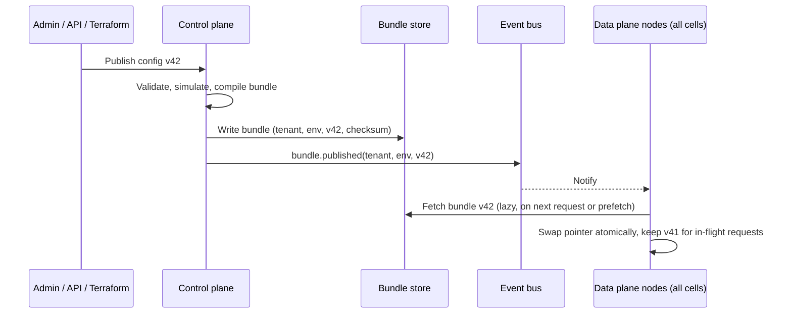
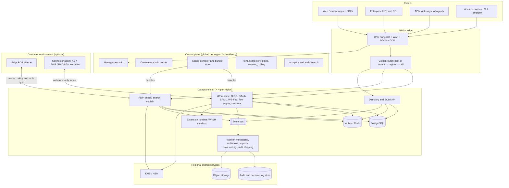
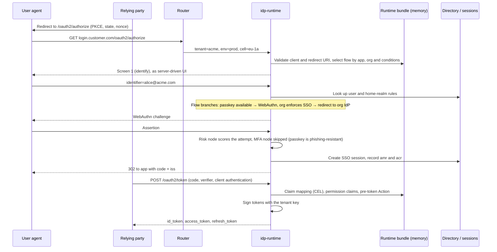
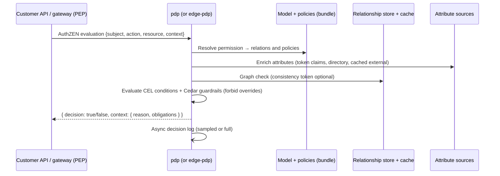
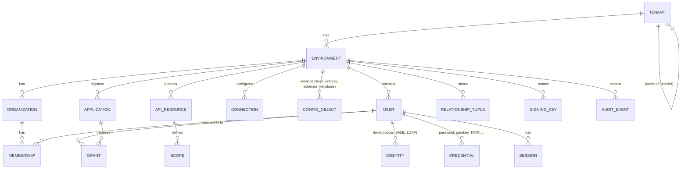
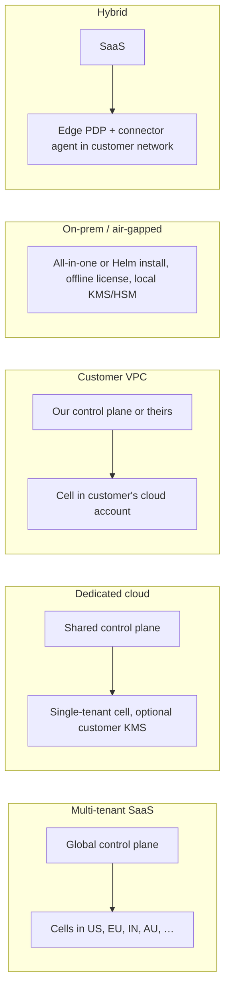

# 04 — Architecture

## 1. Architectural principles

1. **Engines, not features.** Behavior lives in tenant configuration that
   generic engines interpret: flow, policy, expression, schema, template,
   connector and extension engines. A new customer requirement should be a new
   configuration (or at most a new node type or connector), never a branch in
   core code.
2. **Control plane / data plane split.** Authoring, administration and billing
   live in the control plane. Login, token issuance and authorization decisions
   live in the data plane, which is optimized for latency and availability.
3. **Static stability.** If the control plane, a connector or the event bus is
   down, the data plane keeps serving with its last known good configuration
   and keys.
4. **Cells for blast radius.** The data plane is deployed as independent cells,
   each serving a set of tenants with its own databases. One bad cell never
   takes down another; enterprise tenants can get a dedicated cell.
5. **Tenant context is mandatory.** Every request, query, cache key, log line,
   metric and event carries a tenant ID. The data layer refuses queries without
   one, and the database enforces it a second time with row-level security.
6. **Secure by default, configurable by policy.** Defaults follow
   RFC 9700 and NIST SP 800-63B. Weakening a default needs an explicit, audited
   configuration change.
7. **Standards at the edges, our model inside.** Every protocol (OIDC, SAML,
   SCIM, AuthZEN, LDAP, RADIUS) is an adapter over one internal identity and
   authorization model.
8. **One codebase, every deployment.** The same build runs as multi-tenant
   SaaS, a dedicated cell, in a customer VPC, or as a single all-in-one binary
   for air-gapped and local use.
9. **Modular monolith first.** Strict module boundaries inside one repository
   and language, compiled into a few deployables. Split further only when
   scaling data proves it is needed.

## 2. How "100% dynamic" works

### 2.1 Configuration model

Every configurable object (application, connection, flow, policy, authorization
model, schema, template, branding, hook, risk rule, …) is stored as a
**versioned document**:

```
ConfigObject {
  tenant_id, environment_id, kind, id,
  version,                 // monotonically increasing
  status,                  // draft | published | archived
  spec,                    // JSON validated by the kind's JSON Schema
  parent_ref,              // inheritance (platform → tenant → env → org → app)
  created_by, created_at, change_note, checksum
}
```

**Lifecycle:** `draft → validate → test/simulate → publish → (rollback)`.

- **Validate:** JSON Schema checks, CEL type-checking, reference integrity
  (no flow pointing at a deleted connection), and policy analysis (Cedar
  validation, unreachable flow nodes, permission cycles).
- **Simulate:** run the draft against recorded or synthetic requests and show
  the differences ("these 312 users would now need MFA", "these 14
  authorization decisions change from allow to deny").
- **Publish:** atomic per environment. Optional gradual rollout (a percentage
  of traffic) with automatic rollback when error or denial rates spike.
- **Promote:** copy a version from dev → stage → prod, with a diff and optional
  four-eyes approval.
- **GitOps:** the same objects export to and import from YAML; a Terraform
  provider and CLI are first-class clients of the same API.

### 2.2 Inheritance and overrides

Effective configuration is resolved by merging layers, most specific first:

```
Application override → Organization override → Environment → Tenant → Platform default
```

Each field's schema declares whether lower layers may override it, which lets
the platform enforce floors (for example "a regulated tenant cannot disable
PKCE") and lets tenants enforce floors on their organizations ("org admins
cannot disable MFA").

### 2.3 Runtime bundles: dynamic without being slow

Interpreting raw configuration on every request would be slow. On publish,
the control plane **compiles** a tenant environment into an immutable
**runtime bundle**:

- flows compiled into state machines,
- CEL expressions parsed, type-checked and compiled into programs,
- authorization model and Cedar policies compiled and indexed,
- templates pre-parsed, inheritance pre-merged, connector configurations resolved.



- Data plane nodes keep bundles in an in-memory LRU per tenant, backed by a
  regional cache and the bundle store, so a cold tenant costs one fetch.
- Each request and each in-flight login transaction is **pinned** to the bundle
  version it started with. Publishing mid-login never breaks a user.
- Target propagation time: publish → effective everywhere in under 5 seconds (p99).
- If the bus is down, nodes poll bundle version heads (static stability).

### 2.4 The engines

| Engine | Interprets | Technology |
|--------|------------|------------|
| Flow engine | Login, registration, recovery, step-up and consent journeys | Versioned node graphs → state machines |
| Policy engine | Authorization models, relationships, guardrail policies | Zanzibar-style graph + CEL conditions + Cedar |
| Expression engine | Conditions, claim mappings, attribute rules, validations | CEL (safe, non-Turing-complete, fast) |
| Schema engine | Custom attributes for users, organizations, devices, resources | JSON Schema 2020-12 |
| Template engine | Emails, SMS, UI text, localization | Sandboxed templates + ICU MessageFormat |
| Connector framework | IdPs, messaging, CAPTCHA, KYC, risk, SIEM, CRM | Manifests + typed adapters |
| Extension runtime | Customer code at hook points | WebAssembly sandbox (wazero) |
| Risk engine | Risk rules and scoring models | Rules in CEL + pluggable ML scorers |

## 3. System overview



### 3.1 Deployables

| Deployable | Plane | Responsibility | Scaling |
|------------|-------|----------------|---------|
| `router` | Edge | Resolve tenant from host, path or client ID; route to region and cell; first-tier rate limits | Stateless, global |
| `idp-runtime` | Data | Protocol endpoints, flow engine, hosted-UI backend, sessions, token issuance, MFA | Stateless, horizontal |
| `pdp` | Data | Authorization check, search, explain; relationship writes and watch | Stateless + caches, horizontal |
| `directory-api` | Data | Users, groups, organizations CRUD; SCIM 2.0 server | Stateless, horizontal |
| `worker` | Data | Email, SMS and push dispatch; webhooks; imports and exports; SCIM outbound; audit shipping | Queue-driven |
| `ext-runtime` | Data | WASM execution with CPU, memory and time limits; egress allowlist | Isolated node pool |
| `mgmt-api` | Control | Management API, config versioning, compilation, promotion | Stateless |
| `console` / `hosted-ui` | Control / Edge | Static SPAs and assets served by CDN | CDN |
| `edge-pdp` | Customer | Local authorization decisions from synced data | Sidecar or library |
| `connector-agent` | Customer | Outbound-only tunnel to on-prem AD/LDAP/RADIUS/Kerberos | Per customer site |
| `authnnz` (all-in-one) | All | Every module in one process, for local development, small installs and air-gapped deployments | Single node or small cluster |

All deployables are built from one repository; they are compositions of the
same internal modules (see section 13).

## 4. Key request flows

### 4.1 OIDC login through a dynamic flow



### 4.2 Flow definition (example)

Flows are versioned documents edited in the visual designer or as YAML.
Conditions are CEL.

```yaml
kind: Flow
id: login-default
spec:
  start: identify
  nodes:
    identify:
      type: identify
      config: { identifiers: [email, phone], passkey_autofill: true }
      next:
        - when: org.policy.sso_enforced
          goto: enterprise_sso
        - when: user.exists && size(user.passkeys) > 0
          goto: passkey
        - goto: password
    passkey:   { type: authenticate.webauthn, next: [{ goto: risk }] }
    password:  { type: authenticate.password, next: [{ goto: risk }] }
    enterprise_sso: { type: federate, config: { connection: "${org.sso_connection}" }, next: [{ goto: risk }] }
    risk:
      type: risk.evaluate
      next:
        - when: risk.score >= 80
          goto: deny
        - when: risk.score >= 40 || ((app.requires_mfa || org.policy.mfa_required) && !session.mfa_satisfied)
          goto: mfa
        - goto: consent
    mfa:
      type: authenticate.mfa
      config: { allowed: [webauthn, totp, push], phishing_resistant_only: "${org.policy.phishing_resistant}" }
      next: [{ goto: consent }]
    consent:  { type: consent, next: [{ goto: complete }] }
    deny:     { type: terminate, config: { error: access_denied } }
    complete: { type: complete }
```

**Node catalog (initial):** `identify`, `authenticate.*` (password, otp,
webauthn, totp, push, magic-link, certificate), `federate`, `mfa.enroll`,
`verify.identifier`, `collect.attributes`, `risk.evaluate`, `captcha`,
`consent`, `terms.accept`, `org.select`, `account.link`, `action` (WASM),
`http.call` (connector), `branch`, `set` (variables), `notify`, `terminate`,
`complete`. New node types are the main extension point for the engineering team.

### 4.3 Server-driven UI contract

The flow engine never renders HTML directly. Each step returns a screen
descriptor that the hosted UI, embeddable components and native mobile SDKs all
render. The same flow therefore works on web, iOS and Android without app
releases.

```json
{
  "transaction": "txn_01JD4…",
  "screen": {
    "id": "identify",
    "title": { "key": "login.title" },
    "components": [
      { "type": "input", "name": "identifier", "kind": "email",
        "autocomplete": "username webauthn", "required": true },
      { "type": "button", "action": "submit", "label": { "key": "common.continue" } },
      { "type": "divider", "label": { "key": "common.or" } },
      { "type": "idp_buttons", "providers": ["google", "apple", "microsoft"] }
    ]
  },
  "messages": [],
  "bundle_version": 42
}
```

### 4.4 Authorization check



## 5. Authorization engine design

### 5.1 One model, three layers

1. **Relationships (ReBAC).** A Zanzibar-style graph of tuples
   `object#relation@subject`. RBAC is a special case: roles are relations, and
   role assignments are tuples. Organization and resource hierarchies are
   relation traversals.
2. **Conditions (ABAC).** Relations and permissions can carry CEL conditions
   over subject, resource and request context (time, IP, `acr`, risk score,
   device posture).
3. **Guardrail policies (PBAC).** Cedar `permit` and `forbid` policies for
   cross-cutting rules: separation of duties, "never allow delete without AAL2",
   "deny access from sanctioned countries". Default combining rule:
   **deny overrides**.

Decision = (relationship permits OR a Cedar policy permits) AND no Cedar
`forbid` applies, plus the explanation trace.

Beginners only see a simple RBAC screen (roles × permissions × assignments).
The console generates the underlying model, so the progression from RBAC to
ReBAC to ABAC needs no migration.

### 5.2 Model language (illustrative)

```
model 1.0

type user
type team
  relations
    define member: [user]

type organization
  relations
    define admin:  [user]
    define member: [user, team#member] or admin

type folder
  relations
    define org:    [organization]
    define parent: [folder]
    define owner:  [user]
    define editor: [user, team#member] or owner or editor from parent
    define viewer: [user, user:*] or editor or viewer from parent or member from org

type document
  relations
    define parent: [folder]
    define owner:  [user]
    define editor: [user] or owner or editor from parent
    define viewer: [user with not_expired] or editor or viewer from parent
  permissions
    define can_view:   viewer
    define can_edit:   editor
    define can_delete: owner

condition not_expired(current_time: timestamp, expires_at: timestamp) {
  current_time < expires_at
}
```

Guardrail policy (Cedar):

```cedar
forbid (principal, action == Action::"document:delete", resource)
when { context.authn.aal < 2 };

forbid (principal, action, resource)
when { context.risk.score >= 80 };
```

### 5.3 Engine choice

- **Relationship engine:** build on an embeddable, Apache-2.0 Zanzibar
  implementation (OpenFGA or SpiceDB) behind our own interface, or write our
  own. A Phase 0 spike decides (decision D-05). Our DSL stays ours either way,
  so the engine can be swapped later.
- **Policy engine:** Cedar (`cedar-go`) for guardrails. It is analyzable
  (we can prove "this change only narrows access"), fast and sandboxed. OPA/Rego
  import is a later option for customers who already use it.
- **Expressions:** CEL (`cel-go`), shared with the flow engine.

### 5.4 Performance and consistency

- Check cache keyed by (tenant, model version, subject, permission, object,
  snapshot). Invalidated by the relationship change stream.
- Snapshot tokens (Zanzibar "zookies") let clients ask for "at least as fresh
  as my last write" without paying for full consistency on every call.
- Edge PDP subscribes to model, policy and tuple changes (a tenant-filtered
  watch stream) and answers locally. On a miss it falls back to the central PDP.
- Batch evaluation and search use the same engine; very large "list objects"
  queries move to precomputed materialized permission indexes (Phase 4).

## 6. Multi-tenancy and isolation

| Tier | How | Who gets it |
|------|-----|-------------|
| Pooled | Shared cell; `tenant_id` on every row; PostgreSQL row-level security; per-tenant cache key prefixes; per-tenant rate limits and quotas | Developer, Pro, Business |
| Database-isolated | Dedicated database inside a shared cell | Enterprise option |
| Dedicated cell | Whole data plane stack for one tenant | Enterprise and Regulated |
| Customer VPC / on-prem | Same software in the customer's account or data center | Regulated, Self-hosted |

- **Tenant resolution:** a custom domain or `{tenant}.{region}.authnnz.io`
  becomes (tenant, environment, region, cell) through the global tenant
  directory, cached at the edge.
- **Noisy neighbors:** per-tenant concurrency limits, weighted fair queuing in
  workers, quotas on extensions and outbound messaging.
- **Isolation tests:** an automated suite tries cross-tenant access on every
  API and runs in CI; external penetration tests focus on it.

## 7. Data architecture

### 7.1 Stores

| Store | Use | Notes |
|-------|-----|-------|
| PostgreSQL | System of record: identities, credentials, organizations, applications, relationships, sessions (durable), configuration | Per cell; synchronous replica in-region; tenant-scoped RLS; distributed SQL (CockroachDB or YugabyteDB) evaluated in Phase 5 for global active-active |
| Valkey / Redis | Hot sessions, OTPs, rate-limit counters, flow transactions, caches | Ephemeral data only; loss tolerable |
| Event bus | Outbox events, cache invalidation, bundle notifications, webhooks, audit pipeline | NATS JetStream (light, runs on-prem and at the edge); Kafka sinks for customer streaming |
| Object storage | Bundles, imports/exports, branding assets, audit archives | S3-compatible |
| Columnar store | Audit and decision logs, analytics | ClickHouse; OpenSearch optional for full-text search |
| KMS / HSM | Root keys, tenant key-encryption keys, signing keys for high-assurance tenants | AWS KMS, Azure Key Vault, GCP KMS, Vault Transit, PKCS#11 |

### 7.2 Core data model



Other entities: `Group`, `Device`, `ServiceAccount`, `AgentIdentity`,
`ApiKey`, `RefreshTokenFamily`, `Hook`, `WebhookSubscription`, `Domain`,
`BrandingTheme`, `Template`, `RiskRule`, `AccessRequest`, `ReviewCampaign`,
`ConsentRecord`, `UsageRecord`.

All IDs are prefixed, sortable identifiers (for example `usr_01JD…`,
`app_01JD…`) so they are recognizable in logs and secret scanners.

### 7.3 Events and audit

- **Transactional outbox:** each state change writes its event in the same
  database transaction; a relay publishes to the bus. Delivery is at least once,
  and consumers deduplicate.
- **Event schema:** CloudEvents envelope; audit payloads mapped to OCSF.
- **Tamper evidence (Phase 4):** per-tenant hash chain over audit events, with
  periodic anchors signed by a KMS key; a verification API proves the log was
  not altered.
- **Fan-out:** webhooks, SIEM streams, analytics, Shared Signals transmitter,
  usage metering.

## 8. Security architecture

### 8.1 Key hierarchy

```
Cloud KMS / HSM root key (never leaves the KMS)
 └── Tenant key-encryption key (KEK), one per tenant per region
      ├── Data encryption keys: PII fields, secrets, connector credentials
      └── Signing keys (JWT/SAML), wrapped by the KEK
            ├── Standard tiers: decrypted in memory in idp-runtime, rotated on a schedule
            └── High-assurance tiers: never exported; signing happens inside the HSM or KMS
```

- Deleting a tenant KEK crypto-shreds that tenant's data, backups included.
- Signing keys rotate automatically with overlap in JWKS. Emergency rotation
  and revocation take one API call.
- Bring your own key and hold your own key: tenant-controlled KEK in their
  own KMS (Enterprise and Regulated).

### 8.2 Top threats and mitigations

| Threat | Mitigations |
|--------|-------------|
| Token theft and replay | Short lifetimes, refresh rotation with reuse detection, DPoP/mTLS binding, CAEP revocation |
| Authorization code interception, mix-up, open redirect | Mandatory PKCE, exact redirect URI matching, `iss` parameter, PAR |
| SAML XML signature wrapping and XXE | Hardened parser (no DTDs), strict schema validation, verify-then-use of the signed element only, fuzzing, dedicated test corpus |
| Credential stuffing, brute force, SMS pumping | Rate limits, breached-password checks, bot detection, risk engine, spend caps |
| Cross-tenant data access | Tenant context in the data layer, RLS, isolation test suite, penetration tests |
| Malicious or buggy extension code | WASM sandbox with no ambient authority, CPU, memory and time limits, egress allowlist, secrets injected per call |
| Admin account takeover | Phishing-resistant MFA required for admins, step-up for sensitive changes, four-eyes approval, admin anomaly alerts |
| Signing key compromise | KMS/HSM, rotation, separation of duties for key operations, emergency revocation runbook |
| Supply-chain attack | Pinned dependencies, SCA scanning, SBOM, signed builds (SLSA level 3 target), reproducible images |
| Insider access to production | No standing access; JIT access with approval; every session recorded and audited |
| Bad configuration published | Validation, simulation, gradual rollout, automatic rollback, platform floors that tenants cannot override |

### 8.3 Secure development lifecycle

Threat model per epic; security champion in every team; SAST, DAST, SCA and
secret scanning in CI; fuzzing of every parser (JWT, SAML/XML, SCIM filters,
CEL inputs, DSL); OpenID, FIDO and SAML conformance suites in CI; external
penetration test before beta, before GA and then twice a year; public bug
bounty from GA. Coding rules are in [08 §3.8](08-engineering-standards.md#38-security-rules)
and the test approach in [09](09-testing-strategy.md).

## 9. API design

| Surface | Style | Examples |
|---------|-------|----------|
| Protocol endpoints | Per standard | `/.well-known/openid-configuration`, `/oauth2/authorize`, `/oauth2/token`, `/oauth2/par`, `/oauth2/introspect`, `/oauth2/revoke`, `/oauth2/device_authorization`, `/oauth2/bc-authorize`, `/userinfo`, `/jwks`, `/logout`, `/saml2/{conn}/sso`, `/scim/v2/Users` |
| Authentication API (headless) | REST + server-driven UI | `POST /v1/flows/{flow}/transactions`, `POST /v1/transactions/{id}/steps` |
| Authorization API | AuthZEN + gRPC | `POST /access/v1/evaluation`, `/access/v1/evaluations`, `/access/v1/search/{subject,resource,action}`; `POST /v1/relationships:write`, `GET /v1/relationships:watch` |
| Management API | REST, resource-oriented, OpenAPI 3.2 | `/v1/environments/{env}/users`, `/applications`, `/connections`, `/flows`, `/authz/models`, `/policies`, `/config/versions` |
| Events | Webhooks, streams, Shared Signals | `user.created`, `session.revoked`, `config.published`, CAEP and RISC events |

Full conventions, error format, versioning and toolchain:
[10 — API standards](10-api-standards.md).

**Summary:** URL versioning (`/v1`) with at least 12 months of deprecation
notice; cursor pagination; `Idempotency-Key` on writes; `ETag`/`If-Match`
optimistic concurrency on configuration; RFC 9457 problem details for errors;
standard `RateLimit` headers; field masks for partial updates; every API also
available through gRPC for SDKs and internal callers.

## 10. Technology stack

| Layer | Choice | Why | Alternatives |
|-------|--------|-----|--------------|
| Backend language | **Go, latest stable release** (D-03, accepted) | Fast, small static binaries (ideal for edge PDP and on-prem), strong identity ecosystem (OpenFGA, SpiceDB, Ory, Dex, Vault), native FIPS 140-3 crypto module, easy hiring | Java/Kotlin (Spring Authorization Server, OpenSAML maturity), Rust (performance, slower delivery) |
| Protocol layer | Our own, on vetted primitives (JOSE, WebAuthn, SAML/XML-DSig libraries) | The authorization server is core IP and must be fully dynamic | Adopt a framework (fosite, zitadel/oidc) — see D-04 |
| Expressions | CEL (`cel-go`) | Safe, fast, typed; also used by Kubernetes and Zanzibar implementations | Expr, JSONLogic |
| Policies | Cedar (`cedar-go`) | Analyzable, fast, Apache 2.0 | OPA/Rego |
| Relationship engine | OpenFGA or SpiceDB embedded, or own (spike) | Zanzibar semantics, Apache 2.0 | Own implementation |
| Extensions | WebAssembly via `wazero` | Pure Go, strong sandbox, multi-language | V8 isolates, Firecracker microVMs |
| Database | PostgreSQL, latest major version | Reliability, RLS, JSONB, wide managed support | CockroachDB / YugabyteDB for global |
| Cache | Valkey (Redis-compatible) | Open license, fast | Redis, KeyDB |
| Event bus | NATS JetStream | Lightweight, edge- and on-prem-friendly | Kafka / Redpanda |
| Analytics and audit | ClickHouse | High-volume logs at low cost | OpenSearch, BigQuery |
| Console and hosted UI | TypeScript, React, Vite, TanStack, Radix UI, Tailwind CSS; Lit web components for the login renderer ([11](11-admin-ui.md#8-front-end-technology)) | Ecosystem, embeddability | Vue, Svelte |
| Mobile SDKs | Swift, Kotlin; Flutter and React Native wrappers | Native passkeys and server-driven UI | — |
| Containers and infrastructure | Distroless images, Kubernetes, Helm, Gateway API, Argo CD and Argo Rollouts, cert-manager, External Secrets, KEDA, Kyverno, OpenTofu ([12](12-containers-and-deployment.md)) | Portable across AWS, Azure, GCP, on-prem and air-gapped | Nomad |
| Observability | OpenTelemetry, Prometheus, Grafana, Tempo, Loki | Open standards | Datadog |

Exact versions and the "latest stable everywhere" upgrade policy are in
[08 §1](08-engineering-standards.md#1-version-policy-latest-stable-everywhere).
Every third-party library goes through a license review (permissive licenses
only in shipped code) and a security review.

## 11. Deployment topologies



## 12. Non-functional requirements and SLOs

| Area | Target |
|------|--------|
| Data plane availability | 99.99% monthly (99.995% for dedicated cells) |
| Control plane availability | 99.9%; data plane unaffected by control plane outages |
| `/oauth2/token` latency | p99 < 50 ms in-region, excluding customer Actions and external calls |
| Login page step | p99 < 150 ms server time |
| Authorization check | p99 < 10 ms central with warm cache; < 1 ms edge PDP |
| JWKS and discovery | CDN-served, p99 < 20 ms globally |
| Throughput per cell (initial target, confirmed by load tests) | 5,000 logins/s; 50,000 token operations/s; 200,000 checks/s |
| Scale per cell | 100 million identities; 1 billion relationship tuples |
| Configuration propagation | p99 < 5 s from publish to every node |
| Recovery | RPO ≤ 1 minute; RTO ≤ 15 minutes for regional failover |
| Audit durability | No loss (outbox, at-least-once delivery, deduplication) |
| Deployments | Zero downtime; database migrations backward-compatible (expand, migrate, contract) |
| Accessibility | WCAG 2.2 AA for hosted UI and portals |

## 13. Repository layout

The monorepo layout, the internal structure of each module (domain, use cases,
adapters) and the dependency rules are defined in
[08 §2 — Repository and code structure](08-engineering-standards.md#2-repository-and-code-structure).
