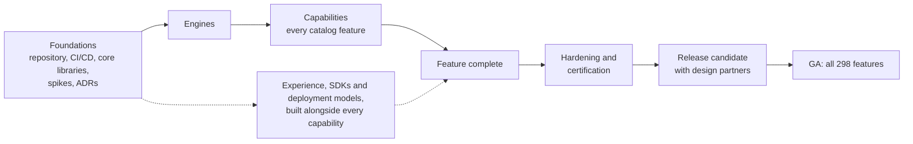

# 05 — Delivery Plan: One Release

## 1. Principle

**Everything ships in the first release.** All 298 features in the
[feature catalog](02-feature-catalog.md) are part of general availability (GA).
Nothing is split into later phases or deferred (decision D-23).

What this means in practice:

- **One customer-facing release.** There is no MVP, beta feature set or
  "coming later" list. The catalog is the GA scope.
- **Claude implements it** (decision D-28), workstream by workstream (§4).
- **The build order follows technical dependencies, not priorities.** Shared
  foundations and engines are built first because everything else is built on
  them (§5). That order changes *when* work starts, never *whether* a feature
  ships.
- **Integration checkpoints** regularly run everything built so far end to end
  in staging (§6). They are internal quality gates, not releases.
- **Design partners** use pre-release builds from early on, so the product is
  validated by real customers before GA without splitting the release.

**Trade-offs of a single release:**
- There is no customer revenue or market feedback before GA, except through
  design partners.
- The whole scope is integrated and hardened at once.

## 2. Stages

| Stage | What happens |
|-------|--------------|
| **Foundations** | Repository and CI/CD, core libraries, spikes for the decisions in [06 §1.2](06-decisions.md#12-accepted-with-a-foundations-spike), ADRs |
| **Build** | Engines first, then every capability with its UI, API, SDK and Terraform support; integration checkpoints throughout |
| **Feature complete** | Every catalog feature meets the definition of done |
| **Hardening and certification** | Full-scale load, chaos and disaster-recovery drills; external penetration tests; conformance certifications; accessibility audit; SOC 2 Type II observation window |
| **Release candidate** | Design partners run the release candidate; fixes only; certification reports issued; GA readiness review |
| **GA** | All 298 features, all deployment models, all industry packs |

**Timeline:** no calendar date is set yet. The first estimate is made at the end
of foundations from measured progress, and every checkpoint reports progress as
features done out of 298. The main pacing factors are build and review
throughput, external dependencies (accounts, certification labs, auditors,
penetration testers) and design-partner feedback.

### Foundations

| Area | Deliverables |
|------|--------------|
| Working rules | A `CLAUDE.md` with the working rules for every implementation session, pointing to this plan, the standards and the ADRs |
| Architecture | ADRs 0001–0024 ([06 §2](06-decisions.md#2-adr-backlog)); threat model v1; data model v1 |
| Spikes | Relationship engine (OpenFGA vs SpiceDB vs own); distributed SQL for global tenants (D-11); OpenAPI generator (D-16); service-to-service mTLS (D-19); SAML and JOSE library hardening (D-04); WASM runtime; runtime-bundle compilation and hot swap; hierarchical resolution with merge rules |
| Engineering standards | Standards in [08](08-engineering-standards.md): lint configs, pin checks, Renovate in propose-only mode, dev container, Makefile, PR template, review automation; version baseline verified |
| Platform | Monorepo and module skeleton ([08 §2](08-engineering-standards.md#2-repository-and-code-structure)); CI pipeline ([09 §10](09-testing-strategy.md#10-when-each-suite-runs)); container build with SBOM, signing and scanning; Compose dev environment; Helm chart on kind; observability ([12](12-containers-and-deployment.md)) |
| Core libraries | Tenant context and RLS; configuration versioning and bundles; **audit core** (`audit.Tx`, outbox, hash chain, reconciliation; [13](13-audit-and-change-tracking.md)); crypto and KMS abstraction for AWS, Azure and Google Cloud; event bus; error and ID conventions |
| Test foundations | `testkit`, contract-suite pattern, fuzz and benchmark harnesses, OpenAPI validation in API tests ([09](09-testing-strategy.md)) |
| API and UI foundations | OpenAPI 3.2 pipeline ([10](10-api-standards.md)); design system and console shell ([11](11-admin-ui.md)) |
| Issue tracker | Every catalog feature as an epic, grouped by workstream, broken into small issues |
| Owner tasks | Name protection, accounts and design partners, as listed in [25](25-business-setup-guide.md) |

**Exit:** a "hello tenant" request flows router → idp-runtime → database with
tenant isolation, audit and tracing end to end; ADRs accepted; spikes decided;
first timeline estimate made.

## 3. Implementation model

### 3.1 Who does what

| Who | Responsibilities |
|-----|------------------|
| **Claude** | Architecture and ADRs; code for every workstream; tests at every level; infrastructure as code and CI/CD; SDKs; documentation; first-draft translations; runbooks; compliance evidence and trust-center content; independent review passes on every pull request (D-29) |
| **Product owner (you)** | Decisions, including the deferred ones ([06 §1.3](06-decisions.md#13-deferred)); accounts and credentials (cloud, domains, package registries, signing keys); company setup, contracts and vendors ([25](25-business-setup-guide.md)); design partners; checkpoint reviews |
| **Third parties** | Penetration testers, SOC 2 and ISO auditors, certification labs (OpenID, FIDO), in-country translation reviewers, bug bounty platform |
| **Later** | Production operations (D-30) and go-to-market people (D-26), decided before hardening |

### 3.2 How the work is done

- **Small pull requests.** Each implements part of a feature with its tests,
  docs and audit events, following [08](08-engineering-standards.md).
- **Independent review on every pull request.** A review pass separate from
  the session that wrote the code; security-critical code gets an additional
  security-focused review. All CI gates must pass before merge.
- **The repository is the single source of truth.** Each implementation session
  starts from `CLAUDE.md`, this plan, the ADRs and the issue tracker, so work
  stays consistent across many sessions.
- **Progress is visible:** features done out of 298, per workstream, at every
  checkpoint.

### 3.3 What is needed from the owner, and when

| When | Needed |
|------|--------|
| Now | Name protection started (trademark search, domains, package names) |
| During foundations | Design partners recruited; compliance tool chosen (D-13) |
| Before deploying to cloud staging | AWS, Azure and Google Cloud accounts with billing; budget (D-14) |
| Before the first public preview | Domain, package-registry accounts, signing keys held securely |
| Before hardening | Penetration-test firm, auditors, certification fees, translation reviewers; decisions D-26 and D-30 |
| Before the release candidate | Pricing (D-25), contracts, marketplace seller accounts |

## 4. Workstreams

Each workstream owns sections of the [feature catalog](02-feature-catalog.md#workstream-ownership)
end to end: engine, API, console screens, SDK support, Terraform resources, docs
and tests.

| # | Workstream | Catalog sections |
|---|-----------|------------------|
| WS-01 | Platform core and hierarchy | A (TEN) |
| WS-02 | Identity and organizations | B (IDM), H (ORG), P (MIG) |
| WS-03 | Authentication | C (AUTH) |
| WS-04 | Protocols and federation | D (FED), E (OAUTH), F (SESS) |
| WS-05 | Authorization | G (AUTHZ) |
| WS-06 | Machine, agent and AI identity | I (M2M) |
| WS-07 | Flows and extensibility | J (DYN) |
| WS-08 | Security and risk | K (SEC) |
| WS-09 | Audit and governance, including the audit log service | L (GOV) |
| WS-10 | Experience: console, portals, hosted UI, theme studio, screen builder and tours | M (UX) |
| WS-11 | Developer experience: APIs, SDKs, CLI, Terraform, docs, AI assistant and MCP server | N (DX) |
| WS-12 | Infrastructure, SRE, self-hosted and operations features | O (OPS) |
| WS-13 | Industry packs and compliance | Q (IND) |

Workstreams integrate only through module facades and published events
([08 §2](08-engineering-standards.md#2-repository-and-code-structure)), and one
definition of done applies to all of them
([08 §5](08-engineering-standards.md#5-git-workflow-reviews-and-releases)).

## 5. Build order by dependency

All of this is one release; the layers only show what must exist before other
work can build on it.

| Layer | Contents |
|-------|----------|
| **1. Foundations** | Repository, CI/CD, tenancy and isolation, configuration versioning, audit core, crypto and KMS, events, API and UI pipelines |
| **2. Engines** | Runtime-bundle compiler, hierarchical resolution, flow engine, CEL, schema and template engines, connector framework, authorization engine (model, relationships, Cedar), extension runtime, risk engine core |
| **3. Capabilities** | Every authentication method, protocol, federation, authorization, governance, security, machine/agent/AI/MCP, migration and multi-level feature, built on the engines; industry packs as configuration on top |
| **4. Experience and developer tools** | Console screens, portals, hosted UI, SDKs, CLI, Terraform, docs. Built alongside each capability, because a feature is not done until its UI, API, SDK and Terraform support exist |
| **5. Scale and deployment models** | Cells, multi-region active-active, AWS, Azure and Google Cloud, dedicated cells, customer cloud, self-hosted, air-gapped, Kubernetes operator. Built continuously |

## 6. Integration checkpoints

Every six weeks, everything on `main` is deployed to staging and verified:

- every completed feature runs end to end through the hosted login, APIs,
  console, SDKs and audit trail;
- all quality gates in [09](09-testing-strategy.md) pass (isolation, audit
  coverage, conformance suites run so far, benchmarks);
- design partners receive the build and report back;
- the owner reviews a demo and the progress report (features done out of 298,
  per workstream, with risks and re-planning).

A checkpoint never removes scope. If work falls behind, the response is to
re-sequence dependencies or adjust the GA estimate openly.

## 7. GA exit criteria

**Scope**
- All 298 catalog features meet the definition of done: API, console, Terraform
  and SDK support where relevant, documentation, audit events and tests.
- All deployment models are installed and running at a design partner or as an
  internal reference installation: multi-region SaaS on AWS, Azure and Google
  Cloud, dedicated cell, customer cloud, self-hosted Helm, air-gapped bundle.
- SDKs are available in every listed language, and migration importers have been
  tested with real exports.

**Conformance and interoperability**
- OpenID Certified for the OIDC OP profiles, logout, FAPI 2.0 and FAPI-CIBA.
- FIDO server certification.
- SAML interoperability with Okta, Entra ID, AD FS, Ping and Google Workspace.
- SCIM validated with Okta and Entra ID.
- AuthZEN interoperability tests passed.
- SMART on FHIR tested with reference EHR sandboxes.

**Quality and operations**
- Every SLO in [04 §12](04-architecture.md#12-non-functional-requirements-and-slos)
  met at 150% of the cell targets.
- Multi-region failover drill meets RPO ≤ 1 minute and RTO ≤ 15 minutes.
- Chaos suite passing.

**Security and audit**
- Two external penetration tests with no open critical or high findings.
- Bug bounty running.
- Zero unaudited changes; audit coverage matrix complete.

**Compliance**
- SOC 2 Type II, ISO 27001 and HIPAA attestation issued; the rest per
  [03 §4](03-standards-and-compliance.md#4-company-certifications-and-attestations).

**Operations readiness** (who provides it is decided by D-30)
- Accountable 24/7 on-call in place and rehearsed; runbooks for every alert;
  support tiers live with their response targets ([18](18-operating-the-service.md)).
- Incident and breach playbooks rehearsed in tabletop exercises; regulatory
  notification templates approved.
- Trust center, status page, vulnerability disclosure policy and the self-hosted
  release and LTS policy published.

**Commercial readiness** (shaped by D-25 and D-26)
- Pricing, self-service billing, contracts, marketplace listings, partner
  program, sales enablement and reference customers ready, as listed in
  [22 §9](22-commercialization.md#9-commercial-readiness-at-ga).

**Customers**
- 5+ design partners across segments running the release candidate in
  production-like use.

**External processes that end after GA.** FedRAMP authorization is granted by
the US government after an assessment that typically takes a year or more. The
product capabilities it needs (FIPS mode, PIV/CAC, controls) are in the release,
and the readiness assessment is done by GA.

## 8. Engineering process and quality

- **Process:** coding standards, repository structure, version policy, reviews
  and the definition of done are in [08](08-engineering-standards.md). API
  conventions are in [10](10-api-standards.md); container and release practices
  in [12](12-containers-and-deployment.md).
- **Quality:** the full test strategy is in [09](09-testing-strategy.md). Key gates:
  - `-race` on every test run;
  - ≥ 90% coverage on security-critical modules;
  - tenant-isolation, admin-permission and audit-coverage matrices over every endpoint;
  - conformance suites in CI;
  - a 10% benchmark regression limit on hot paths.

## 9. Risk register

| # | Risk | Likelihood | Impact | Mitigation |
|---|------|-----------|--------|------------|
| R1 | Single large release: integration problems surface late | High | High | Dependency-ordered build, integration checkpoints every 6 weeks, contract tests between modules, design partners on pre-release builds |
| R2 | Security defect in a core protocol | Medium | Critical | Vetted primitives, conformance suites, fuzzing, external penetration tests, bug bounty |
| R3 | Bad tenant configuration causes outages | Medium | High | Validation, simulation, gradual rollout, automatic rollback, platform floors, static stability |
| R4 | Dynamic engines too slow | Medium | High | Compiled runtime bundles, caching, benchmarks with regression gates in CI |
| R5 | Cross-tenant data leak | Low | Critical | Data-layer tenant enforcement, RLS, isolation suite, penetration tests |
| R6 | Certifications take longer than planned | Medium | High | Owner starts the compliance program during foundations; compliance automation; early auditor engagement; observation window planned inside hardening ([25 §5](25-business-setup-guide.md#5-compliance-program)) |
| R7 | Crowded market | High | Medium | Differentiators in [01](01-product-vision.md#6-differentiators), complete platform at launch, migration tooling |
| R8 | Dependency on third-party engines (OpenFGA, SpiceDB, Cedar) | Low | Medium | Our own DSL and interfaces; Apache-2.0 licenses allow forking |
| R9 | Security defects missed without human code review (D-29) | Medium | Critical | Independent review pass on every pull request and a security-focused pass on security-critical code; mandatory automated gates (fuzzing, property tests, conformance suites, isolation and audit matrices, SAST, SCA, secret scanning); two external penetration tests and a bug bounty before GA; human review can be added at any time |
| R10 | SMS cost and fraud | Medium | Medium | Pumping protection, spend caps, pass-through pricing, push and passkeys preferred |
| R11 | Key-management failure | Low | Critical | KMS/HSM, automated rotation, key ceremonies, tested emergency runbooks |
| R12 | Extension code abused or unstable | Medium | Medium | WASM sandbox, quotas, timeouts with fail-open/fail-closed policy per hook |
| R13 | Audit gaps or audit pipeline outage | Low | Critical | Same-transaction capture (fail closed), durable spools with strict mode always on, reconciliation, gapless sequences, hourly verification ([13](13-audit-and-change-tracking.md)) |
| R14 | Audit storage cost (full decision logging, no opt-out) | High | Medium | Columnar compression, short hot retention for allow-decisions with Parquet archive, long hot retention priced as an add-on |
| R15 | Pinned versions fall behind on security fixes | Medium | High | Daily vulnerability scans of every pinned version, 48-hour target for critical fixes, monthly upgrade review ([08 §1.5](08-engineering-standards.md#15-upgrade-schedule)) |
| R16 | No revenue or market feedback until GA | High | Medium | Paid design-partner agreements, early-access contracts signed before GA, design-partner feedback at every checkpoint |
| R17 | Consistency across many implementation sessions | Medium | High | Repository as single source of truth (`CLAUDE.md`, plan, ADRs, issue tracker), small pull requests, strict linters and standards, contract tests between modules, checkpoints |
| R18 | Malicious tenants use white-label pages, domains or email for phishing | Medium | High | Tenant screening and verification, graduated limits, content scanning, takedown process ([18 §7](18-operating-the-service.md#7-platform-abuse-prevention)) |
| R19 | Pricing or packaging does not fit the market; long enterprise sales cycles | Medium | High | Pricing research and design-partner validation before the release candidate, paid early access, POC kit, trust center, marketplace and partner channels ([22](22-commercialization.md)) |
| R20 | Legal or export-control blockers delay sales in some markets | Low | High | Export classification, contracts and entity setup started during the build with legal counsel ([25](25-business-setup-guide.md)) |
| R21 | External dependencies (accounts, auditors, certification labs, pen testers) block progress | Medium | Medium | Owner checklist with timing ([§3.3](#33-what-is-needed-from-the-owner-and-when)); local and kind-based environments until cloud accounts exist |

## 10. Immediate next steps

1. **Owner:** start name protection for Portun (trademark search, domains,
   package names) and recruit design partners ([25](25-business-setup-guide.md)).
2. **Claude:** write `CLAUDE.md` and ADR-0001 (modular monolith) and ADR-0002
   (tenancy and isolation).
3. **Claude:** create the repository skeleton, CI pipeline and development
   environment.
4. **Claude:** load the 298 catalog features into the issue tracker as epics, by
   workstream.
5. **Claude:** run the foundation spikes and record the results as ADRs.
