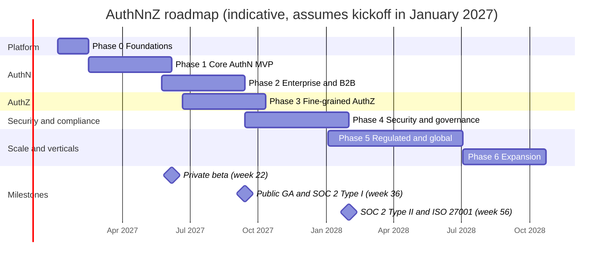

# 05 — Roadmap & Delivery

## 1. Assumptions

- Kickoff once decisions D-01 to D-08 ([06](06-decisions.md)) are confirmed.
- Team starts at about 14 people, grows to about 29 in Phases 2–3 and about 36 in Phases 4–5 (section 3).
- Weeks are counted from kickoff. Phases overlap because separate teams own
  AuthN, AuthZ and platform work.
- Estimates are indicative. Re-plan at the end of each phase from measured velocity.

The chart uses a kickoff date of 4 January 2027 only so it can be drawn; the plan itself is in weeks from kickoff.

## 2. Phases

### Phase 0 — Foundations (weeks 0–6)

**Goal:** decisions made, skeleton running end to end, guardrails in place.

| Workstream | Deliverables |
|-----------|--------------|
| Product | Confirm decisions (06); ICP and pricing research; competitor teardown (PM-02); design partners recruited (3–5 companies) |
| Architecture | ADRs 0001–0020 ([06](06-decisions.md)); threat model v1; data model v1 |
| Spikes | Relationship engine (OpenFGA vs SpiceDB vs own) with benchmarks; WASM extension runtime; runtime-bundle compilation and hot swap; SAML library hardening review |
| Engineering standards | Standards in [08](08-engineering-standards.md) adopted: golangci-lint and ESLint configs, pin checks, Renovate in propose-only mode, dev container, Makefile, CODEOWNERS, PR template; version baseline verified for compatibility |
| Platform | Monorepo and module skeleton ([08 §2](08-engineering-standards.md#2-repository-and-code-structure)); CI pipeline ([09 §10](09-testing-strategy.md#10-when-each-suite-runs)); container build with SBOM, signing and scanning; Docker Compose dev environment; Helm chart skeleton on kind; observability baseline ([12](12-containers-and-deployment.md)) |
| Test foundations | `testkit` (PostgreSQL template databases, embedded NATS, tenant fixtures), contract-suite pattern, fuzz and benchmark harnesses, OpenAPI validation in API tests ([09](09-testing-strategy.md)) |
| API and UI foundations | OpenAPI 3.2 pipeline: lint rules, bundling, breaking-change gate, Go and TypeScript generation (choose generator, D-16) ([10](10-api-standards.md)); design system and console shell ([11](11-admin-ui.md)) |
| Core libraries | Tenant context and RLS enforcement; config versioning skeleton; crypto and KMS abstraction; transactional outbox and event bus; audit event model; error and ID conventions |
| Compliance | Security policies drafted; compliance-automation tool chosen; SOC 2 control mapping started |

**Exit criteria:** a "hello tenant" request flows router → idp-runtime → database
with tenant isolation enforced and traced end to end; ADRs approved; spike
results recorded.

### Phase 1 — Core AuthN MVP (weeks 6–22) → private beta

**Goal:** a developer can sign up, configure an app and log users in with
modern methods; basic RBAC works.

**Scope:** TEN-01, 03 (pooled), 06, 08, 09 (basic) · IDM-01, 02, 03 (static),
05, 07 (basic), 12 · AUTH-01, 03, 05, 06, 08, 09 (top 4 + generic) · FED-01 ·
OAUTH-01 to 07 · SESS-01 to 04 · AUTHZ-01 (basic), 02, 06 (single), 17, 21 (direct
grants), 14 (all decisions logged), 22, 25, 26 (basic), 27 (built-in roles) ·
ORG-01 · M2M-01 · DYN-01, 02 (engine + default flows), 05, 07, 09 (framework),
10 · SEC-01, 02, 08 (basic), 09 · GOV-01, 10, 11, 12, 16, 18 (signed checkpoints),
19 · UX-01, 03, 06 · DX-01,
02 (first wave), 05 · OPS-01 (metering) · MIG-04

**Exit criteria:**
- OpenID conformance suite (Basic and Config OP) passing in CI
- p99 targets met for token and login endpoints in load tests at 25% of cell target
- External penetration test completed; no open critical or high findings
- Audit coverage matrix and write-ahead-log reconciliation passing: zero unaudited changes; hash-chain verification passing
- 3+ design partners live in staging; at least one in production

### Phase 2 — Enterprise & B2B (weeks 20–36) → public GA

**Goal:** a B2B SaaS company can sell to enterprises using our platform.

**Scope:** TEN-04, 07, 10 · IDM-03 (dynamic), 04, 06, 07 (full), 08, 09, 11,
13, 14 · AUTH-02, 04, 09 (full), 12, 17, 19, 20, 26 · FED-02 to 04, 06 to 10 ·
OAUTH-08 to 11, 15, 18 · SESS-03 (Actions), 10 · AUTHZ-23, 27 (custom roles) ·
ORG-02 to 05, 07 · M2M-02, 06 ·
DYN-02 (A/B), 03, 04, 06, 11 (YAML, Terraform), 12, 13 · SEC-03, 05, 06, 10,
13 · GOV-02, 03, 07 (basic), 13 (configuration and identity), 14, 15, 17, 20 ·
UX-02, 04, 05, 07 · DX-02 (second wave), 03, 04,
06, 07 · OPS-01 (billing), 05 (internal Helm) · MIG-01 (first importers), 02 ·
IND-01, 02

**Exit criteria:**
- SAML interoperability tested against Okta, Entra ID, AD FS, Ping and Google Workspace
- SCIM validated with Okta and Entra ID provisioning
- FIDO server certification submitted
- SOC 2 Type I report issued
- Status page and on-call rotation live; 99.99% SLO met for 4 consecutive weeks in beta

### Phase 3 — Fine-grained authorization (weeks 24–40)

**Goal:** the platform's authorization engine competes with standalone
authorization vendors.

**Scope:** AUTHZ-01 (full DSL + visual editor), 03 to 10, 12 (sidecar), 14, 18,
21 (explicit deny), 26 (full, with explain) · GOV-13 (relationships, access-as-of)

**Exit criteria:**
- AuthZEN interoperability tests passing
- Check p99 < 10 ms central and < 1 ms edge at target throughput
- Policy simulation and explain available in the console
- Two design partners running fine-grained authorization in production

### Phase 4 — Security, governance & compliance (weeks 36–56)

**Goal:** win enterprise security reviews and Enterprise-tier deals.

**Scope:** TEN-02, 09 (crypto-shredding) · IDM-10, 16 · AUTH-07, 13, 18, 22,
23, 25, 29 · FED-13 · OAUTH-13, 16 · SESS-05 to 07 · AUTHZ-11, 12 (WASM,
library), 13, 15, 16, 19, 24, 28 · ORG-06 · M2M-03, 07 · DYN-08, 11 (Pulumi, operator) · SEC-04, 07,
08 (per-tenant keys), 11 · GOV-04 to 09, 18 (RFC 3161 anchoring) · UX-08 · OPS-02,
03 · MIG-01 (all importers), 03 · IND-09, 11

**Exit criteria:**
- SOC 2 Type II report (3-month observation window starting at GA) and ISO 27001 certificate issued
- HIPAA attestation; BAA available
- Risk engine reduces account takeover in design-partner data (baseline measured in Phase 2)
- Public bug bounty running

### Phase 5 — Regulated industries & global scale (weeks 52–78)

**Goal:** sell to banks, healthcare, government and telecom; serve global
tenants with residency guarantees; ship the self-hosted edition.

**Scope:** TEN-03 (dedicated cell, customer VPC), 05 · IDM-15, 17 · AUTH-10,
11, 14, 15, 21, 24, 27, 28 · FED-05, 12 · OAUTH-12, 14 · SESS-08 · ORG-08 · M2M-04, 05,
08, 09 · SEC-12 · OPS-04, 05 (self-hosted GA), 06 · IND-03 to 08, 10

**Exit criteria:**
- OpenID Certified for FAPI 2.0 and FAPI-CIBA
- SMART on FHIR app launch tested with reference EHR sandboxes
- Multi-region failover drill meets RPO ≤ 1 min and RTO ≤ 15 min
- Self-hosted edition installed by 2+ customers, including one air-gapped

### Phase 6 — Expansion (week 78+)

AUTH-16 (verifiable credentials and wallets) · FED-11 (OpenID Federation) ·
OAUTH-17 (transaction tokens) · SESS-09 (post-quantum) · AUTHZ-20 (XACML) ·
IND-12 · FedRAMP program · advanced identity governance · AI-driven policy
recommendations ("these 40 users have not used admin rights in 90 days").

## 3. Team plan

| Role | Phases 0–1 | Phases 2–3 | Phases 4–5 |
|------|-----------|-----------|-----------|
| Engineering lead / architect | 2 | 2 | 3 |
| Identity and protocol engineers (OIDC, SAML, WebAuthn) | 4 | 6 | 7 |
| Authorization engineers | 1 | 3 | 4 |
| Platform / SRE | 1 | 2 | 4 |
| Security engineers | 1 | 2 | 3 |
| Frontend (console, hosted UI, portals) | 2 | 3 | 3 |
| SDK and mobile engineers | 1 | 3 | 4 |
| QA / test automation | 1 | 2 | 2 |
| Product manager | 1 | 2 | 2 |
| Designer (UX) | part-time | 1 | 1 |
| Technical writer / developer relations | part-time | 2 | 2 |
| Compliance / GRC lead | part-time | 1 | 1 |
| **Total (approx.)** | **~14** | **~29** | **~36** |

Hire two or three senior engineers with real identity-protocol experience
first; protocol and security mistakes are the most expensive to fix later.
Use specialist consultants for SAML hardening and FAPI certification if needed.
Solutions engineering and support staff join from public GA; they are not
counted above.

### Team topology

- **AuthN team:** flows, factors, federation, OAuth/OIDC, sessions
- **AuthZ team:** model, engine, PDP, edge PDP, policy tooling
- **Platform team:** tenancy, configuration and bundles, data, events, infrastructure, observability
- **Experience team:** console, hosted UI, portals, SDKs, docs
- **Security and compliance:** threat modeling, reviews, certifications, incident response (embedded champions in each team)

## 4. Engineering process

Coding standards, repository structure, the version policy, reviews and the
definition of done are in [08 — Engineering standards](08-engineering-standards.md).
API conventions are in [10](10-api-standards.md); container and release
practices in [12](12-containers-and-deployment.md).

## 5. Quality strategy

The full test strategy — unit, integration, contract, API, security matrices,
conformance, end-to-end, front-end, fuzzing, performance and resilience, with
examples and CI gates — is in [09 — Testing strategy](09-testing-strategy.md).
Key gates: `-race` on every test run, ≥ 90% coverage on security-critical
modules, automatic tenant-isolation and admin-permission matrices over every
endpoint, OpenID/FIDO/SAML conformance suites in CI, and a 10% benchmark
regression limit on hot paths.

## 6. Risk register

| # | Risk | Likelihood | Impact | Mitigation |
|---|------|-----------|--------|------------|
| R1 | Scope explosion ("all features from all industries") | High | High | Phase gates, feature IDs, "engines not features", packs as configuration only |
| R2 | Security defect in a core protocol | Medium | Critical | Vetted primitives, conformance suites, fuzzing, external reviews, bug bounty, security champions |
| R3 | Bad tenant configuration causes outages | Medium | High | Validation, simulation, gradual rollout, automatic rollback, platform floors, static stability |
| R4 | Dynamic engines too slow | Medium | High | Compiled runtime bundles, caching, benchmarks with regression gates in CI |
| R5 | Cross-tenant data leak | Low | Critical | Data-layer tenant enforcement, RLS, isolation suite, penetration tests |
| R6 | Certifications take longer than sales expect | High | Medium | Start controls in Phase 0, compliance automation, early auditor engagement |
| R7 | Crowded market | High | Medium | Differentiators in [01](01-product-vision.md#6-differentiators), focused ICP, migration tooling |
| R8 | Dependency on third-party engines (OpenFGA, SpiceDB, Cedar) | Low | Medium | Our own DSL and interfaces; Apache-2.0 licenses allow forking |
| R9 | Scarce identity-protocol talent | Medium | High | Hire senior specialists first; consultants for SAML/FAPI; internal training |
| R10 | SMS cost and fraud | Medium | Medium | Pumping protection, spend caps, pass-through pricing, push and passkeys preferred |
| R11 | Key-management failure | Low | Critical | KMS/HSM, automated rotation, key ceremonies, tested emergency runbooks |
| R12 | Extension code abused or unstable | Medium | Medium | WASM sandbox, quotas, timeouts with fail-open/fail-closed policy per hook |
| R13 | Audit gaps or audit pipeline outage | Low | Critical | Same-transaction capture (fail closed), durable spools, reconciliation, gapless sequences, hourly verification ([13](13-audit-and-change-tracking.md)) |
| R14 | Audit storage cost (full decision logging) | High | Medium | Columnar compression, short hot retention for allow-decisions, Parquet archive, long hot retention priced as an add-on |
| R15 | Pinned versions fall behind on security fixes | Medium | High | Daily vulnerability scans of every pinned version, 48-hour target for critical fixes, monthly upgrade review ([08 §1.5](08-engineering-standards.md#15-upgrade-schedule)) |

## 7. Immediate next steps (first two weeks)

1. Confirm decisions D-01 to D-08 in [06](06-decisions.md).
2. Recruit 3–5 design partners across at least two segments (B2B SaaS and one regulated).
3. Hire or assign the engineering lead and the first two senior identity engineers.
4. Write ADR-0001 (modular monolith and deployables) and ADR-0002 (tenancy and isolation).
5. Start the relationship-engine and runtime-bundle spikes.
6. Set up the repository skeleton, CI pipeline and development environment.
7. Turn the feature catalog into epics in the issue tracker, tagged by phase.
