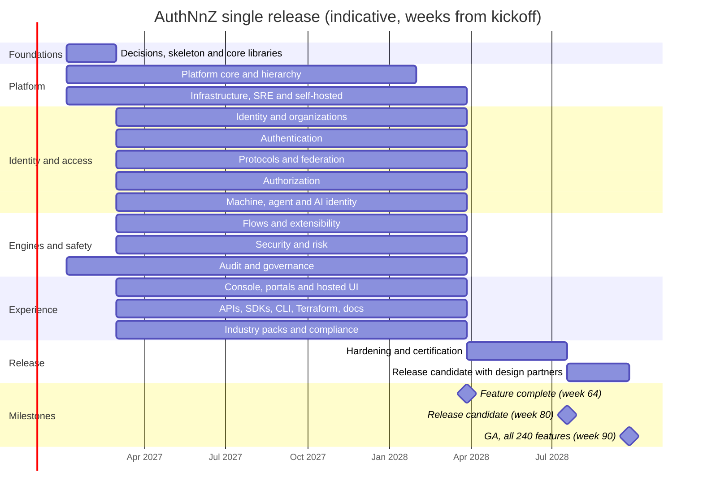

# 05 — Delivery Plan: One Release

## 1. Principle

**Everything ships in the first release.** All 240 features in the
[feature catalog](02-feature-catalog.md) are part of general availability (GA).
Nothing is split into later phases or deferred (decision D-23).

What this means in practice:

- **One customer-facing release.** There is no MVP, beta feature set or
  "coming later" list. The catalog is the GA scope.
- **All workstreams build in parallel.** Thirteen teams each own a part of the
  catalog (§3) and work at the same time.
- **The build order follows technical dependencies, not priorities.** Shared
  foundations and engines are built first because everything else is built on
  them (§4). That order changes *when* work starts, never *whether* a feature
  ships.
- **Integration checkpoints every six weeks** run everything built so far end
  to end in staging (§5). They are internal quality gates, not releases.
- **Design partners** use pre-release builds from early on, so the product is
  validated by real customers before GA without splitting the release.

**Trade-offs of a single release:**
- There is no customer revenue or market feedback before GA, except through design partners.
- A larger team is needed sooner: about 64 engineers instead of growing to about 30.
- The whole scope is integrated and hardened at once.

The plan manages these with the checkpoints, design partners and quality gates
below.

## 2. Timeline

Indicative, assuming a January 2027 kickoff only so the chart can be drawn;
the plan itself is in weeks from kickoff.

| Stage | Weeks | What happens |
|-------|-------|--------------|
| **Foundations** | 0–8 | Decisions confirmed, repository and CI/CD, core libraries, first spikes, hiring ramp |
| **Parallel build** | 8–64 | All 13 workstreams build their catalog sections; integration checkpoint every 6 weeks |
| **Feature complete** | 64 | Every catalog feature meets the definition of done |
| **Hardening and certification** | 64–80 | Full-scale load, chaos and disaster-recovery drills; external penetration tests; conformance certifications; accessibility audit; SOC 2 Type II observation window |
| **Release candidate** | 80–90 | Design partners run the release candidate; fixes only; certification reports issued; GA readiness review |
| **GA** | 90 (about 21 months) | All 240 features, all deployment models, all industry packs |

### Foundations (weeks 0–8)

| Workstream | Deliverables |
|-----------|--------------|
| Product | Confirm decisions ([06](06-decisions.md)); pricing research; competitor teardown (PM-02); recruit 5+ design partners across B2B SaaS, CIAM, finance, healthcare and public sector or telecom |
| Architecture | ADRs 0001–0022 ([06](06-decisions.md)); threat model v1; data model v1 |
| Spikes | Relationship engine (OpenFGA vs SpiceDB vs own); distributed SQL for global tenants (D-11); WASM runtime; runtime-bundle compilation and hot swap; hierarchical resolution with merge rules; SAML library hardening; service-to-service mTLS (D-19) |
| Engineering standards | Standards in [08](08-engineering-standards.md) adopted: lint configs, pin checks, Renovate in propose-only mode, dev container, Makefile, CODEOWNERS, PR template; version baseline verified |
| Platform | Monorepo and module skeleton ([08 §2](08-engineering-standards.md#2-repository-and-code-structure)); CI pipeline ([09 §10](09-testing-strategy.md#10-when-each-suite-runs)); container build with SBOM, signing and scanning; Compose dev environment; Helm chart on kind; observability ([12](12-containers-and-deployment.md)) |
| Core libraries | Tenant context and RLS; configuration versioning and bundles; **audit core** (`audit.Tx`, outbox, hash chain, reconciliation; [13](13-audit-and-change-tracking.md)); crypto and KMS abstraction; event bus; error and ID conventions |
| Test foundations | `testkit`, contract-suite pattern, fuzz and benchmark harnesses, OpenAPI validation in API tests ([09](09-testing-strategy.md)) |
| API and UI foundations | OpenAPI 3.2 pipeline ([10](10-api-standards.md)); design system and console shell ([11](11-admin-ui.md)) |
| Compliance | Security policies; compliance-automation tool; SOC 2 and ISO 27001 control mapping; FedRAMP readiness planning |

**Exit:** a "hello tenant" request flows router → idp-runtime → database with
tenant isolation, audit and tracing end to end; ADRs approved; spikes decided.

## 3. Workstreams and team

Each workstream owns sections of the [feature catalog](02-feature-catalog.md#workstream-ownership)
end to end: engine, API, console screens, SDK support, Terraform resources,
docs and tests.

| # | Workstream | Catalog sections | Engineers |
|---|-----------|------------------|-----------|
| WS-01 | Platform core and hierarchy | A (TEN) | 5 |
| WS-02 | Identity and organizations | B (IDM), H (ORG), P (MIG) | 5 |
| WS-03 | Authentication | C (AUTH) | 5 |
| WS-04 | Protocols and federation | D (FED), E (OAUTH), F (SESS) | 6 |
| WS-05 | Authorization | G (AUTHZ) | 6 |
| WS-06 | Machine, agent and AI identity | I (M2M) | 4 |
| WS-07 | Flows and extensibility | J (DYN) | 5 |
| WS-08 | Security and risk | K (SEC) | 4 |
| WS-09 | Audit and governance | L (GOV) | 4 |
| WS-10 | Experience: console, portals, hosted UI | M (UX) | 7 |
| WS-11 | Developer experience: APIs, SDKs, CLI, Terraform, docs | N (DX) | 5 |
| WS-12 | Infrastructure, SRE and self-hosted | O (OPS) | 5 |
| WS-13 | Industry packs and compliance | Q (IND) | 3 |
| | **Engineers** | | **64** |

Shared roles: architects (3), engineering managers (5), product managers (5),
designers (3), technical writers and developer relations (4), security and GRC
(3), test-infrastructure engineers (2). **Total about 89 people.**

**Ramp:** about 25 people during foundations (platform core, infrastructure,
audit, architects, first leads), full size by month 6. Hire two or three senior
identity-protocol engineers first; use specialist consultants for SAML
hardening and FAPI certification where needed.

**Working agreements across workstreams:**
- Teams integrate through module facades and published events only
  ([08 §2](08-engineering-standards.md#2-repository-and-code-structure)).
- An architecture group of the architects and workstream leads meets weekly.
- A shared definition of done applies to everyone
  ([08 §5](08-engineering-standards.md#5-git-workflow-reviews-and-releases)).

## 4. Build order by dependency

All of this is one release; the layers only show what must exist before other
work can build on it.

| Layer | Contents | Ready by (target) |
|-------|----------|-------------------|
| **1. Foundations** | Repository, CI/CD, tenancy and isolation, configuration versioning, audit core, crypto and KMS, events, API and UI pipelines | Week 8 |
| **2. Engines** | Runtime-bundle compiler, hierarchical resolution, flow engine, CEL, schema and template engines, connector framework, authorization engine (model, relationships, Cedar), extension runtime, risk engine core | Week 26 |
| **3. Capabilities** | Every authentication method, protocol, federation, authorization, governance, security, machine/agent/AI/MCP, migration and multi-level feature, built on the engines; industry packs as configuration on top | Week 56 |
| **4. Experience and developer tools** | Console screens, portals, hosted UI, SDKs, CLI, Terraform, docs. Built alongside each capability, because a feature is not done until its UI, API, SDK and Terraform support exist | Week 64 |
| **5. Scale and deployment models** | Cells, multi-region active-active, dedicated cells, customer VPC, self-hosted, air-gapped, Kubernetes operator. Built continuously | Week 64 |

## 5. Integration checkpoints

Every six weeks (weeks 14, 20, 26 … 62) all workstreams integrate on `main`, and
the whole platform is deployed to staging and verified:

- every completed feature runs end to end through the hosted login, APIs,
  console, SDKs and audit trail;
- all quality gates in [09](09-testing-strategy.md) pass (isolation, audit
  coverage, conformance suites run so far, benchmarks);
- design partners receive the build and report back;
- progress is reported as features done out of 240, per workstream, with
  risks and re-planning where a workstream is behind.

A checkpoint never removes scope. If a workstream falls behind, the response
is to re-plan within the release: move people, re-sequence dependencies or
adjust the GA date openly.

## 6. GA exit criteria

**Scope**
- All 240 catalog features meet the definition of done: API, console, Terraform
  and SDK support where relevant, documentation, audit events and tests.
- All deployment models are installed and running at a design partner or as an
  internal reference installation: multi-region SaaS, dedicated cell, customer
  VPC, self-hosted Helm, air-gapped bundle.
- SDKs are available in every listed language, and migration importers have been
  tested with real exports.

**Conformance and interoperability**
- OpenID Certified for the OIDC OP profiles, logout, FAPI 2.0 and FAPI-CIBA.
- FIDO server certification.
- SAML interoperability with Okta, Entra ID, AD FS, Ping and Google Workspace.
- SCIM validated with Okta and Entra ID.
- AuthZEN interoperability tests passed.
- SMART on FHIR tested with reference EHR sandboxes.

**Quality and operations**
- Every SLO in [04 §12](04-architecture.md#12-non-functional-requirements-and-slos)
  met at 150% of the cell targets.
- Multi-region failover drill meets RPO ≤ 1 minute and RTO ≤ 15 minutes.
- Chaos suite passing.

**Security and audit**
- Two external penetration tests with no open critical or high findings.
- Bug bounty running.
- Zero unaudited changes; audit coverage matrix complete.

**Compliance**
- SOC 2 Type II, ISO 27001 and HIPAA attestation issued; the rest per [03 §4](03-standards-and-compliance.md#4-company-certifications-and-attestations).

**Customers**
- 5+ design partners across segments running the release candidate in
  production-like use.

**External processes that end after GA.** FedRAMP authorization is granted by
the US government after an assessment that typically takes a year or more. The
product capabilities it needs (FIPS mode, PIV/CAC, controls) are in the release,
and the readiness assessment is done by GA.

## 7. Engineering process and quality

- **Process:** coding standards, repository structure, version policy, reviews
  and the definition of done are in [08](08-engineering-standards.md). API
  conventions are in [10](10-api-standards.md); container and release practices
  in [12](12-containers-and-deployment.md).
- **Quality:** the full test strategy is in [09](09-testing-strategy.md). Key gates:
  - `-race` on every test run;
  - ≥ 90% coverage on security-critical modules;
  - tenant-isolation, admin-permission and audit-coverage matrices over every endpoint;
  - conformance suites in CI;
  - a 10% benchmark regression limit on hot paths.

## 8. Risk register

| # | Risk | Likelihood | Impact | Mitigation |
|---|------|-----------|--------|------------|
| R1 | Single large release: integration problems surface late | High | High | Dependency-ordered build, integration checkpoints every 6 weeks, contract tests between modules, design partners on pre-release builds |
| R2 | Security defect in a core protocol | Medium | Critical | Vetted primitives, conformance suites, fuzzing, external reviews, bug bounty, security champions |
| R3 | Bad tenant configuration causes outages | Medium | High | Validation, simulation, gradual rollout, automatic rollback, platform floors, static stability |
| R4 | Dynamic engines too slow | Medium | High | Compiled runtime bundles, caching, benchmarks with regression gates in CI |
| R5 | Cross-tenant data leak | Low | Critical | Data-layer tenant enforcement, RLS, isolation suite, penetration tests |
| R6 | Certifications take longer than planned | Medium | High | Compliance program starts at foundations; compliance automation; early auditor engagement; observation window planned inside hardening |
| R7 | Crowded market | High | Medium | Differentiators in [01](01-product-vision.md#6-differentiators), complete platform at launch, migration tooling |
| R8 | Dependency on third-party engines (OpenFGA, SpiceDB, Cedar) | Low | Medium | Our own DSL and interfaces; Apache-2.0 licenses allow forking |
| R9 | Hiring about 64 engineers, including scarce identity-protocol specialists | High | High | Start hiring before kickoff; senior specialists first; consultants for SAML/FAPI; strong onboarding through standards and dev container |
| R10 | SMS cost and fraud | Medium | Medium | Pumping protection, spend caps, pass-through pricing, push and passkeys preferred |
| R11 | Key-management failure | Low | Critical | KMS/HSM, automated rotation, key ceremonies, tested emergency runbooks |
| R12 | Extension code abused or unstable | Medium | Medium | WASM sandbox, quotas, timeouts with fail-open/fail-closed policy per hook |
| R13 | Audit gaps or audit pipeline outage | Low | Critical | Same-transaction capture (fail closed), durable spools, reconciliation, gapless sequences, hourly verification ([13](13-audit-and-change-tracking.md)) |
| R14 | Audit storage cost (full decision logging) | High | Medium | Columnar compression, short hot retention for allow-decisions, Parquet archive, long hot retention priced as an add-on |
| R15 | Pinned versions fall behind on security fixes | Medium | High | Daily vulnerability scans of every pinned version, 48-hour target for critical fixes, monthly upgrade review ([08 §1.5](08-engineering-standards.md#15-upgrade-schedule)) |
| R16 | No revenue or market feedback until GA | High | Medium | Paid design-partner agreements, early-access contracts signed before GA, design-partner feedback at every checkpoint |
| R17 | Coordination cost of 13 parallel teams | Medium | High | Module facades and contract tests, weekly architecture group, shared definition of done, one integration cadence |

## 9. Immediate next steps

1. Confirm the open decisions in [06](06-decisions.md), including team size and
   budget for about 89 people (D-14).
2. Start hiring: the engineering lead, architects, and senior identity and platform
   engineers first.
3. Recruit 5+ design partners across segments and sign early-access agreements.
4. Write ADR-0001 (modular monolith) and ADR-0002 (tenancy and isolation).
5. Start the foundation spikes listed in §2.
6. Create the repository skeleton, CI pipeline and development environment.
7. Load the 240 catalog features into the issue tracker as epics, one board per workstream.
