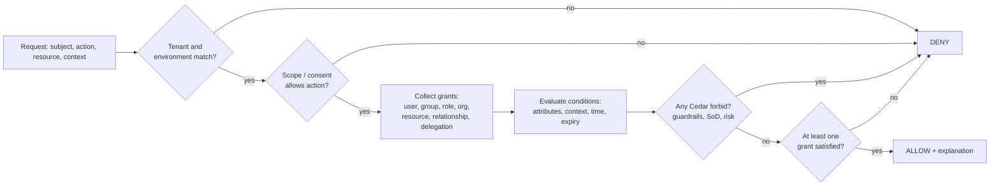

# 07 — Authentication & Authorization Coverage

This document answers two questions: **is every type of authentication
planned?** and **is every level of authorization planned?** Each row points to
the feature IDs in the [feature catalog](02-feature-catalog.md), where the
delivery phase is recorded.

## 1. Authentication coverage

Any method below can be used as a first factor, a second factor, or a step-up
factor. The combination is chosen per application, organization, user segment
or risk level by policy (AUTH-20), not by code.

| Category | Methods | Feature IDs |
|----------|---------|-------------|
| **Something you know** | Password (NIST SP 800-63B rules, breached-password check) | AUTH-01, AUTH-02 |
| | App PIN unlocking a device-bound key (mobile banking style) | AUTH-25 |
| **One-time codes and links** | Email magic link, email OTP | AUTH-03 |
| | SMS, voice and WhatsApp OTP | AUTH-04 |
| **Authenticator apps and tokens** | TOTP/HOTP apps (Google Authenticator, Microsoft Authenticator, 1Password, …) | AUTH-06 |
| | Hardware OATH tokens with seed import (PSKC) | AUTH-27 |
| | Push approval in our authenticator app or SDK, with number matching | AUTH-07 |
| **Cryptographic, phishing-resistant** | Passkeys (synced and device-bound), FIDO2 security keys | AUTH-05 |
| | X.509 client certificates, smart cards (PIV/CAC), mutual TLS | AUTH-10 |
| | Mobile device binding (keys in Secure Enclave or StrongBox) | AUTH-25 |
| **Biometrics** | Face, fingerprint through passkeys and platform authenticators (biometric data never leaves the device) | AUTH-05, AUTH-25 |
| | Liveness and face match for identity proofing and account recovery | AUTH-24, IDM-15 |
| **Social login** | Google, Apple, Microsoft, GitHub + any OAuth2/OIDC provider (generic connector) | AUTH-09 |
| | Facebook, LinkedIn, X, Amazon, Slack, Discord | AUTH-09 |
| | Regional providers: WeChat, LINE, Kakao, Naver, VK, Yahoo! JAPAN | AUTH-29 |
| | Google One Tap, FedCM, native Sign in with Apple/Google token exchange | AUTH-26 |
| **Enterprise federation** | SAML 2.0 (inbound and as IdP), enterprise OIDC | FED-02, FED-03, FED-04 |
| | LDAP / Active Directory bind (on-prem agent), directory sync | FED-06, IDM-11 |
| | Kerberos / SPNEGO (Integrated Windows Authentication) | AUTH-11 |
| | WS-Federation | FED-05 |
| | RADIUS for VPNs and network devices | FED-12 |
| | Home-realm discovery, JIT provisioning, identity brokering | FED-07, FED-08, FED-10 |
| **National and digital identity** | Government eIDs and bank IDs (through OIDC/SAML connectors) | IND-06, FED-03, FED-04 |
| | Verifiable credentials, EU Digital Identity Wallet, mobile driver's licence (mDL) | AUTH-16 |
| | Identity proofing / KYC (document + selfie, eKYC) | IDM-15 |
| **Cross-device and decoupled** | QR-code login from a signed-in phone | AUTH-13 |
| | Device authorization grant (TVs, consoles, CLIs, IoT) | AUTH-12 |
| | CIBA (call centers, banking, agent approvals) | AUTH-14 |
| **Telecom network** | Silent network authentication, number verification, SIM-swap signal | AUTH-15 |
| **Adaptive and continuous** | Risk-based MFA, step-up (`acr`/`amr`), remember device | AUTH-17, AUTH-18, AUTH-19 |
| | Continuous access evaluation (CAEP/RISC), session binding | SESS-06, SESS-07 |
| | Transaction signing / PSD2 dynamic linking | AUTH-21 |
| **Machines and workloads** | Client secret, `private_key_jwt`, mTLS client authentication | OAUTH-02 |
| | API keys | M2M-02 |
| | Workload identity federation (Kubernetes, GitHub Actions, GitLab, AWS, Azure, GCP) | M2M-03 |
| | SPIFFE SVIDs; IoT device certificates | M2M-04, M2M-05 |
| **Delegated and special** | Token exchange: delegation and impersonation | OAUTH-09 |
| | AI agents acting on behalf of users; MCP clients | M2M-06, M2M-07, M2M-08 |
| | Support impersonation with consent and audit | IDM-16 |
| | Guest / anonymous sessions that upgrade to full accounts | AUTH-23 |
| **Session types** | SSO cookie session, refresh tokens, native mobile sessions | SESS-01, OAUTH-03 |
| | Backend-for-frontend (BFF) token handler for SPAs; server-side sessions for classic web apps | SESS-10 |
| **Account recovery** | Recovery codes, recovery through another verified factor, admin-assisted, re-verification | AUTH-08, AUTH-24 |
| **Legacy compatibility** | Security questions (migration only), resource-owner password grant, implicit grant. Off by default and never a sole factor | AUTH-28 |

**Deliberately discouraged:** security questions are not an authentication
factor under NIST SP 800-63B, and SMS OTP is a restricted factor. The platform
supports them only so customers can migrate users to stronger methods. The
console flags any tenant that relies on them.

## 2. Authorization coverage

Customers organize permissions in a **catalog of modules → components →
actions** (for example UI, API, AI and MCP modules; see
[14 §2.1](14-integration-and-enforcement.md#21-permission-catalog-module--component--action)).
Where each level is enforced at runtime is described in
[14 — Integration & enforcement](14-integration-and-enforcement.md).

All levels below are expressed in **one model** and evaluated by **one engine**
(see [04 §5](04-architecture.md#5-authorization-engine-design)), so they combine
freely. For example: "Editors of a project may approve invoices up to their
approval limit, during business hours, only with phishing-resistant MFA, and
never their own invoices."

| # | Level | Meaning | Example | Modeled as | Feature IDs |
|---|-------|---------|---------|-----------|-------------|
| 1 | **Tenant / environment** | Hard isolation between customers and between dev, stage and prod | Nothing in tenant A is visible to tenant B | Tenant context + database row-level security | TEN-01, TEN-03 |
| 2 | **Organization** | Access through membership of a customer's organization (B2B) | Members of Acme see Acme's projects | `organization#member` relation, org-scoped roles | ORG-01, AUTHZ-02 |
| 3 | **Group / team** | Roles and permissions granted to a group apply to its members, including nested groups | Everyone in `finance-team` gets `invoice-approver` | Group membership relations; roles assigned to groups | AUTHZ-22, IDM-03 |
| 4 | **Role (RBAC)** | Roles bundle permissions; roles can inherit from other roles | `admin` ⊃ `editor` ⊃ `viewer` | Role relations; per-tenant custom roles | AUTHZ-02 |
| 5 | **User** | A permission granted directly to one user, or explicitly denied to one user | Give Bob `report:export` without a role; deny Carol `billing:*` | Direct tuples; Cedar `forbid` for explicit deny | AUTHZ-21 |
| 6 | **Resource (ownership / ACL)** | Access to a single object | Alice owns document 42 and shares it with Bob as viewer | Object relations (`owner`, `viewer`, …) | AUTHZ-03 |
| 7 | **Relationship (ReBAC)** | Access derived from how things relate | A manager can view reports of their direct reports | Relation traversal (`viewer from parent`, `manager of`) | AUTHZ-03 |
| 8 | **Hierarchy** | Permissions inherited down a tree of organizations or resources | Folder access applies to every file inside | Recursive relations | AUTHZ-03, ORG-06 |
| 9 | **Attribute (ABAC)** | Decisions on attributes of user, resource or action | `user.department == resource.department`; clearance ≥ classification | CEL conditions on relations and permissions | AUTHZ-04, AUTHZ-19 |
| 10 | **Context** | Time, IP/network, location, device posture, authentication strength, risk | Payroll only on managed devices, from office networks, with AAL2 | Request context in CEL and Cedar | AUTHZ-04, AUTHZ-05 |
| 11 | **Policy (guardrails, PBAC)** | Organization-wide rules that override grants | "Never delete production data without phishing-resistant MFA" | Cedar `permit` / `forbid` (deny overrides) | AUTHZ-05 |
| 12 | **Separation of duties** | Conflicting permissions cannot be combined or used together | The invoice creator cannot also approve it | Cedar rules + SoD checks on assignment | GOV-06, AUTHZ-05 |
| 13 | **OAuth scope / application** | What a client application may do on the user's behalf | A reporting app gets `invoices:read` only | Scopes, resource indicators, RAR `authorization_details` | OAUTH-04, OAUTH-14 |
| 14 | **Consent** | The user decides which app or agent may access their data | User lets a budgeting app read their accounts for 90 days | Grants and consent records; UMA; Grant Management | OAUTH-07, OAUTH-14, GOV-07 |
| 15 | **API / endpoint** | Each route requires a permission | `DELETE /invoices/{id}` requires `invoice:delete` | SDK middleware and gateway plugins calling the PDP | AUTHZ-25, AUTHZ-13 |
| 16 | **UI / feature** | Which menus, pages and buttons a user sees | Hide "Refund" for agents without `refund:create` | Permissions endpoint + SDK helpers (`useCan`, `<Can>`) | AUTHZ-23 |
| 17 | **Field** | Hide or mask individual fields | Salary visible only to HR | Field permissions + SDK masking helpers | AUTHZ-16 |
| 18 | **Data / row** | Lists and searches return only permitted rows | "My team's tickets" filtered in SQL | Partial evaluation → query filters | AUTHZ-11 |
| 19 | **Delegation** | Acting for someone else | Assistant manages a manager's calendar; agent acts for a user; power of attorney | Delegation relations; token exchange with `act` claim | AUTHZ-28, OAUTH-09, M2M-07 |
| 20 | **Time-bound / just-in-time** | Temporary access with approval and automatic expiry; break-glass | Production DB access for 2 hours after manager approval | Conditional tuples with expiry; access-request workflow | AUTHZ-15, GOV-05 |
| 21 | **Entitlement / plan** | Features unlocked by the end customer's subscription | Only the "Pro" plan can export to PDF | Entitlement relations on the organization | AUTHZ-24 |
| 22 | **Machine and agent** | Permissions of service accounts, API keys and AI agents | The billing worker may only write `invoice:*` | Same model, principal type `service` or `agent` | M2M-01, M2M-02, M2M-07 |
| 23 | **AI feature and tool** | Which AI features and model tiers a user may use; which tools the model may call for them; which documents retrieval may use | Assistant available to agents but refund tool only to finance managers; RAG never returns documents the user cannot open | Catalog permissions under the `ai` module; per-tool checks on behalf of the user; permission-filtered retrieval | AUTHZ-31 |
| 24 | **MCP tool** | Which MCP tools a user and client may see and invoke, with argument conditions and approvals | `issue_refund` only up to 500, and only after the user approves on their phone | Catalog permissions under the `mcp` module; MCP guard; agent intersection rule | M2M-10, M2M-07 |
| 25 | **Administrative** | Who can configure the platform itself, and where | Support staff can view users but not change policies | Built-in and custom admin roles, scoped to environment or organization | AUTHZ-27, IDM-13 |

### 2.1 How the levels combine in one decision



### 2.2 Explanations

Every decision can be explained in the console, through the API, and in the
decision log:

```
ALLOW  user:alice  can_approve  invoice:42
 ├─ grant      role finance-approver (assigned to group finance-team; alice is a member)
 ├─ condition  invoice.amount <= user.approval_limit   (4,500 <= 10,000) ✓
 ├─ context    acr = phishing-resistant ✓   time 10:14 within business hours ✓
 └─ guardrails no forbid matched (separation of duties: alice did not create invoice 42)
```

The **effective-permissions view** (AUTHZ-26) shows, for any user, every
permission they hold and where it comes from: direct, role, group,
organization, relationship or delegation.

## 3. Gaps found and added to the catalog

This review found authentication and authorization types that were implied but
not listed as features. They are now in the [feature catalog](02-feature-catalog.md)
and the [roadmap](05-roadmap-and-delivery.md):

| ID | Added capability | Phase |
|----|------------------|-------|
| AUTH-25 | Mobile device binding with app PIN or biometric unlock | 4 |
| AUTH-26 | Google One Tap, FedCM, native social token exchange | 2 |
| AUTH-27 | Hardware OATH tokens with PSKC seed import | 5 |
| AUTH-28 | Legacy compatibility (security questions for migration, ROPC, implicit), off by default | 5 |
| AUTH-29 | Regional social providers | 4 |
| SESS-10 | BFF token handler for SPAs; server-side sessions for web apps | 2 |
| AUTHZ-21 | Direct user permissions and explicit deny | 1→3 |
| AUTHZ-22 | Roles assigned to groups (nested groups) | 1 |
| AUTHZ-23 | UI / feature-level authorization helpers | 2 |
| AUTHZ-24 | Product entitlements (plan-based features) for customers' apps | 4 |
| AUTHZ-25 | API endpoint authorization middleware in SDKs | 1 |
| AUTHZ-26 | Effective-permissions viewer with sources | 1→3 |
| AUTHZ-27 | Admin roles for console and Management API (built-in, then custom) | 1→2 |
| AUTHZ-28 | User-to-user delegation (assistant, proxy, power of attorney) | 4 |
