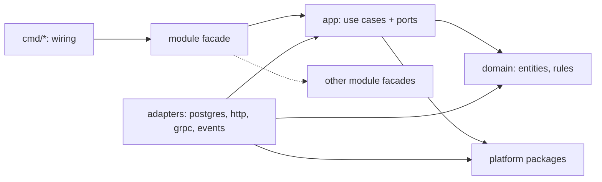

# 08 — Engineering Standards

These standards apply to every line of code in the platform. CI enforces them
wherever a tool can; code review enforces the rest.

## 1. Version policy: latest stable everywhere

### 1.1 Rules

1. **Latest stable release of everything**: language, libraries, frameworks,
   tools, base images, databases and platform components. "Stable" means a GA
   release; betas and release candidates never reach production.
2. **Pinned, then updated by automation.** Exact versions are pinned (`go.mod`
   and `go.sum`, `pnpm-lock.yaml`, image digests, Helm chart versions, OpenTofu
   lock file) so builds are reproducible. Staying on the latest version is
   automated by **Renovate**, never by floating tags such as `:latest`.
3. **Upgrade deadlines:**

   | Change | Deadline |
   |--------|----------|
   | Security fix | 48 hours |
   | Patch release | 7 days (auto-merged when CI is green) |
   | Minor release | Weekly batch |
   | Major release | 30 days, tracked as an upgrade issue |
   | New Go release (every February and August) | 30 days |

4. **Go:** the `go` directive in `go.mod` is the latest Go release; the
   `toolchain` directive pins the exact patch version. Development tools are
   pinned with `tool` directives in `go.mod` and run with `go tool <name>`.
5. **Node.js** is used only to build front ends (the shipped artifacts are
   static files). We use the newest **LTS** line, which is the newest line
   Node.js marks production-ready.
6. **Managed services:** use the newest version the target managed service
   offers. When a cloud provider lags behind a new major version (common for
   PostgreSQL and Kubernetes), local, CI and self-hosted environments use the
   newest version, and production upgrades as soon as the provider supports it.
   CI tests both.
7. **Compatibility check:** Phase 0 verifies that every tool in the table
   below works with the others. Where one lags (for example a linter that does
   not yet support a new TypeScript compiler), we use the newest compatible
   version and record the exception in an ADR with a review date.
8. **Self-hosted support window:** customers can run the last two Kubernetes
   minor versions and the last two PostgreSQL major versions.
9. **New dependencies** need a reason in the PR, a license on the allowlist
   (MIT, BSD, Apache-2.0, ISC, MPL-2.0), a healthy OpenSSF Scorecard, and a
   security review for anything that parses input or does cryptography. Prefer
   the Go standard library.

### 1.2 Baseline (verified 21 November 2026)

This table is the starting point; the lock files are the source of truth after
Phase 0.

| Area | Component | Version |
|------|-----------|---------|
| **Language** | Go | 1.27.4 |
| **Go quality** | golangci-lint · gofumpt · govulncheck | v2.15.0 · v0.12.0 · v1.10.0 |
| **Data access** | pgx · sqlc · goose (migrations) | v5.13.0 · v1.31.1 · v3.30.1 |
| **API** | ogen or oapi-codegen (decided in Phase 0) · kin-openapi (validation) | v1.25.0 or v2.8.2 · v0.153.0 |
| **RPC** | grpc-go · buf · ConnectRPC | v1.85.0 · v1.75.0 · v1.21.1 |
| **Identity primitives** | go-jose · go-webauthn · crewjam/saml (subject to hardening review) | v4.1.9 · v0.18.2 · v0.6.3 |
| **Engines** | cel-go · cedar-go · wazero | v0.30.0 · v1.9.3 · v1.12.0 |
| **Relationship engine (spike)** | OpenFGA · SpiceDB | v1.23.0 · v1.57.1 |
| **Messaging and cache clients** | nats.go · valkey-go · clickhouse-go | v1.56.0 · v1.0.80 · v2.51.0 |
| **Telemetry** | OpenTelemetry Go | v1.47.0 |
| **Go testing** | testcontainers-go · go-cmp · rapid · go.uber.org/mock · k6 | v0.45.0 · v0.7.0 · v1.3.0 · v0.6.0 · v1.8.3 |
| **Data stores** | PostgreSQL · Valkey · NATS Server · ClickHouse | 19.0 · 9.2.0 · 2.15.3 · 26.10 |
| **Front-end toolchain** | Node.js (LTS) · pnpm · TypeScript · Vite | 26 LTS · 12.21.0 · 7.0.2 · 8.3.8 |
| **Front-end libraries** | React · TanStack Router · TanStack Query · Tailwind CSS · Radix UI · React Hook Form · Zod · XYFlow · Monaco Editor · Lit · i18next · ECharts | 19.3.1 · 1.170.46 · 5.108.2 · 4.3.5 · 1.8.1 · 7.92.0 · 4.6.7 · 13.0.2 · 0.57.0 · 3.3.3 · 27.2.3 · 6.1.0 |
| **Front-end quality and tests** | ESLint · typescript-eslint · Prettier · Vitest · Testing Library · Playwright · Storybook · MSW · axe-core | 10.15.0 · 8.73.0 · 3.10.1 · 5.1.1 · 16.3.3 · 1.65.1 · 10.6.8 · 3.0.7 · 4.14.1 |
| **API tooling** | Redocly CLI · Spectral · oasdiff · Scalar · openapi-typescript · openapi-fetch · AsyncAPI CLI | 2.82.0 · 6.17.1 · v1.39.0 · 1.82.1 · 7.13.0 · 0.17.0 · 6.3.1 |
| **Containers and supply chain** | Distroless static (Debian 13, nonroot) · Docker Buildx · Syft · Trivy · Cosign | latest digest · v0.39.1 · v1.57.2 · v0.76.2 · v3.1.4 |
| **Kubernetes** | Kubernetes · Helm · Gateway API · Envoy Gateway · cert-manager · External Secrets · KEDA · Kyverno · Argo CD · Argo Rollouts · kind | 1.37 · 4.3.2 · v1.7.0 · v1.10.0 · v1.21.3 · v1.3.2 · v2.21.1 · v1.20.0 · v3.6.2 · v1.10.2 · v0.33.0 |
| **Infrastructure as code** | OpenTofu | v1.13.9 |
| **Automation** | Renovate | 44.x |
| **Local development** | Mailpit · Grafana OTel LGTM | v1.34.0 · 0.41.1 |

## 2. Repository and code structure

### 2.1 Monorepo layout

```
authnnz/
├── cmd/                        # Thin main packages: load config, wire modules, run. No business logic.
│   ├── authnnz/                #   all-in-one binary (local dev, small and air-gapped installs)
│   ├── router/ idp-runtime/ pdp/ directory-api/ mgmt-api/ worker/ ext-runtime/
│   ├── edge-pdp/ connector-agent/
│   └── authnnzctl/             #   CLI
├── internal/
│   ├── platform/               # Cross-cutting technical packages (no business rules):
│   │   ├── tenancy/ ids/ errs/ log/ telemetry/ config/ crypto/ db/ bus/ httpx/ grpcx/ egress/ version/
│   ├── modules/                # Business modules (bounded contexts), one directory each:
│   │   ├── tenancy/ identity/ org/ authn/ federation/ oauth/ session/ authz/
│   │   ├── configsvc/ flow/ risk/ extensions/ connectors/ keys/ audit/ metering/
│   └── testkit/                # Shared test infrastructure: containers, fixtures, golden files, clocks
├── api/
│   ├── openapi/                # OpenAPI source, split per domain; bundled in CI
│   ├── asyncapi/               # Events and webhooks
│   └── proto/                  # gRPC (PDP, internal)
├── web/
│   ├── console/ portal/ login/ # Admin console, account and org portals, hosted login
│   └── packages/               # ui (design system), api-client (generated), i18n, eslint-config, tsconfig
├── deploy/
│   ├── docker/ compose/ helm/ tofu/ kind/
├── test/
│   ├── e2e/ conformance/ load/ isolation/ chaos/
├── tools/                      # Custom linters and developer tools
├── docs/                       # plan/, adr/, runbooks/, module docs
├── .github/                    # Workflows, CODEOWNERS, PR and issue templates
├── .devcontainer/              # Reproducible development environment
├── go.mod go.sum Makefile .golangci.yml renovate.json .editorconfig
```

### 2.2 Inside a module (hexagonal / clean architecture)

Each business module has the same shape. Go's `internal` directory rule makes
the boundary **compiler-enforced**: other modules can import only the module's
root package, never its internals.

```
internal/modules/identity/
├── identity.go            # Public facade: Module type, New(...), exported service interface and DTOs
├── events.go              # Public event types this module emits
├── doc.go                 # Package documentation: purpose, owner, dependencies
├── identitytest/          # Fakes, builders and contract tests for other modules' tests
└── internal/
    ├── domain/            # Entities, value objects, invariants, domain errors. Pure Go: no I/O, no frameworks
    ├── app/               # Use cases (commands and queries); declares the ports (interfaces) it needs
    └── adapters/
        ├── postgres/      # Repositories: sqlc queries, row ↔ domain mapping, migrations/ (embedded)
        ├── http/          # Handlers implementing generated OpenAPI interfaces; DTO ↔ domain mapping
        ├── grpc/
        └── events/        # Outbox publishers and event consumers
```



**Dependency rules** (enforced by the compiler's `internal` rule plus
`depguard` in golangci-lint):

- `domain` imports only the standard library and `platform/ids` and `platform/errs`.
- `app` imports `domain` and `platform`; never `adapters`.
- `adapters` implement the ports declared in `app`.
- Modules talk to each other only through facades or events, never through
  each other's tables.
- `platform` never imports a module.
- Each module owns its own **PostgreSQL schema** (`identity.users`,
  `oauth.clients`, …). No joins across module schemas.

## 3. Go coding standards

**Base guides:** [Effective Go](https://go.dev/doc/effective_go),
[Go Code Review Comments](https://go.dev/wiki/CodeReviewComments) and the
[Google Go Style Guide](https://google.github.io/styleguide/go/). Where they
conflict, the rules below win.

### 3.1 Formatting and linting

- `gofumpt` + `goimports` formatting; CI fails on any diff.
- golangci-lint v2 with zero warnings. A `//nolint` needs the linter name and a
  reason (`//nolint:gosec // G404: non-security jitter`), checked by `nolintlint`.
- Configuration excerpt:

```yaml
version: "2"
linters:
  default: standard            # errcheck, govet, ineffassign, staticcheck, unused
  enable:
    - bodyclose
    - contextcheck
    - depguard                 # module boundaries and banned packages
    - errorlint
    - exhaustive
    - forbidigo                # no fmt.Print*, print or println (use slog)
    - gochecknoglobals
    - gochecknoinits
    - gocognit
    - gocritic
    - gosec
    - nilerr
    - nilnil
    - noctx
    - nolintlint
    - revive
    - rowserrcheck
    - sloglint
    - sqlclosecheck
    - tagliatelle              # snake_case JSON tags
    - thelper
    - tparallel
    - unparam
    - usestdlibvars
    - wrapcheck
  settings:
    gocognit:
      min-complexity: 20
    sloglint:
      attr-only: true          # slog.String("key", v) style, never loose key-value pairs
      key-naming-case: snake
    tagliatelle:
      case:
        rules:
          json: snake
    depguard:
      rules:
        banned:
          deny:
            - pkg: "math/rand$"
              desc: "use crypto/rand for anything security related, math/rand/v2 otherwise"
            - pkg: "log$"
              desc: "use log/slog"
            - pkg: "github.com/pkg/errors"
              desc: "use the standard errors package and fmt.Errorf with %w"
formatters:
  enable:
    - gofumpt
    - goimports
```

### 3.2 Naming

- Packages: short, lower-case, singular, no underscores. **Never** `util`,
  `common`, `helpers`, `models` or `base`.
- No stutter: `identity.User`, not `identity.IdentityUser`; `token.Issuer`, not
  `token.TokenIssuer`.
- Initialisms keep one case: `ID`, `URL`, `HTTP`, `OIDC`, `SAML`, `JWT`
  (`clientID`, `parseJWT`).
- Interfaces describe behavior: `Signer`, `UserStore`, `TokenIssuer`.
- Constructors are `New` or `NewX`; sentinel errors `ErrX`; error types `XError`.
- Typed IDs prevent mixing identifiers: `ids.UserID`, `ids.TenantID`, … (a
  `UserID` cannot be passed where a `TenantID` is expected).

### 3.3 Design

- Accept interfaces, return concrete types. Define interfaces where they are
  **used**, keep them small.
- Dependencies are passed explicitly through constructors. No global mutable
  state, no `init()` side effects, no dependency-injection framework; wiring
  lives in `cmd/*`.
- Configuration structs for constructors with many settings; functional options
  only for optional behavior of library-style packages.
- Make zero values useful or unexported. Validate configuration at startup and
  fail fast.
- Generics for type-safe infrastructure (typed IDs, collections, result
  pages), not for business abstractions.
- Prefer the standard library: `net/http` routing, `log/slog`, `errors`,
  `slices`, `maps`, `crypto/*`.

### 3.4 Errors

- Every error is handled or returned. Wrap with context:
  `fmt.Errorf("load client %s: %w", id, err)` — lower case, no trailing
  punctuation.
- Sentinel errors for expected outcomes (`ErrNotFound`, `ErrConflict`); error
  types when callers need details. Check with `errors.Is` and `errors.As`.
- Domain errors carry a stable machine-readable code. One table at the edge
  maps codes to HTTP status and [RFC 9457](10-api-standards.md#5-errors) problem
  types. Internal details and stack traces never reach clients.
- `panic` only for programmer errors during startup. Edge middleware recovers,
  logs and returns `500`.

### 3.5 Context, logging and telemetry

- `ctx context.Context` is the first parameter of anything that does I/O or
  may block. Never store a context in a struct.
- Tenant, principal, request ID and trace travel in the context through typed
  accessors in `platform/tenancy` (unexported keys).
- Every outbound call has a deadline and honors cancellation.
- `log/slog` JSON logs with `snake_case` keys; every entry carries `tenant_id`
  and `trace_id`.
- **Secrets never appear in logs.** Passwords, tokens, OTPs, keys and secrets
  use types such as `secret.String` whose `LogValue` returns `[REDACTED]`. Full
  PII is never logged.
- OpenTelemetry traces on every inbound and outbound call; RED metrics on
  every endpoint. No high-cardinality metric labels (no user IDs).

### 3.6 Concurrency

- Every goroutine has an owner and a way to stop: `errgroup` or
  `sync.WaitGroup.Go` plus context cancellation. No fire-and-forget.
- Mutexes protect state; channels transfer ownership. Worker pools are bounded.
- No `time.Sleep` for synchronization. Tests use `testing/synctest`.
- All tests run with `-race`.

### 3.7 Data access

- SQL first: queries written in SQL, compiled to typed Go by `sqlc`. No ORM.
- Every query is tenant-scoped. Repositories get a tenant-bound connection from
  the context; PostgreSQL row-level security (`SET LOCAL app.tenant_id`) enforces
  it a second time.
- Transactions through one helper (`db.InTx(ctx, func(tx) error)`); events
  written to the outbox in the same transaction.
- Explicit column lists (no `SELECT *`), keyset pagination, backward-compatible
  migrations (expand → migrate → contract).

### 3.8 Security rules

- **OWASP ASVS 5.0 Level 3** is the baseline for authentication, session,
  OAuth, authorization, key and tenancy modules; Level 2 elsewhere.
- Cryptography only through `platform/crypto`, which exposes an approved
  algorithm list. `crypto/rand` for every token, ID and secret
  (`rand.Text()` for random strings). Constant-time comparison for secrets.
- FIPS build mode supported (`GOFIPS140`). `CGO_ENABLED=0`; no `unsafe`.
- All outbound HTTP (webhooks, connectors, metadata fetches) goes through
  `platform/egress`, which blocks private and link-local addresses (SSRF) and
  enforces timeouts and size limits.
- XML is parsed only through the hardened SAML wrapper (no DTDs, no external
  entities, strict schema, signed-element-only access).
- Input validated against schemas at the edge and invariants in the domain;
  output encoded by context (`html/template` for any server-rendered HTML).
- Production secrets come from KMS or a secret manager, never from files in the
  image or the repository.

### 3.9 Documentation and size limits

- Every package has a `doc.go`. Every exported identifier has a doc comment
  that starts with its name. Comments explain **why**, not what.
- Runnable `Example` functions for public helper packages and SDKs.
- Each module has a README: purpose, owner, public API, events emitted and consumed.
- Guidelines (reviewed, not absolute): functions ≤ 60 lines, ≤ 5 parameters
  (otherwise a struct), nesting ≤ 3 levels, files ≤ 500 lines. Cognitive
  complexity above 20 fails CI.

## 4. Front-end standards (TypeScript and React)

- **TypeScript strict** plus `noUncheckedIndexedAccess`,
  `exactOptionalPropertyTypes` and `noImplicitOverride`. No `any` and no
  unexplained non-null assertions (lint errors).
- **Quality:** ESLint flat config with typescript-eslint `strict-type-checked`,
  React Hooks and jsx-a11y rules; Prettier formatting.
- **Structure:** feature folders (`src/features/users/{api,components,routes,schemas}`);
  shared design system in `web/packages/ui`; API calls only through the client
  **generated from OpenAPI** (`web/packages/api-client`).
- **State:** server state in TanStack Query; URL state in typed router search
  parameters; local state in components; no global store without an ADR.
- **Forms:** React Hook Form + Zod, with schemas generated from the API's JSON
  Schemas, so the UI and the API validate the same way.
- **Components:** small function components; every design-system component has
  a Storybook story; accessible primitives (Radix); Tailwind design tokens; no
  inline styles.
- **Text:** no hard-coded user-facing strings; ICU messages through i18next;
  right-to-left layouts supported.
- **Security:** no `dangerouslySetInnerHTML` (lint error) outside one audited
  sanitizer; works under a strict CSP (no inline scripts); tokens never stored
  in `localStorage` — the console uses a backend-for-frontend with `HttpOnly` cookies.
- **Performance budgets:** hosted login ≤ 50 KB of JavaScript (gzip); console
  routes code-split; Core Web Vitals: LCP < 2.5 s, INP < 200 ms, CLS < 0.1.

## 5. Git workflow, reviews and releases

- **Trunk-based development** with short-lived branches; squash merges;
  [Conventional Commits](https://www.conventionalcommits.org/) messages; signed
  commits; protected `main` (CI green, required reviews, linear history).
- **Pull requests:** about 400 changed lines or fewer; template covering what,
  why, how it was tested, security impact and screenshots.
- **Reviews:** one approval; two approvals and a CODEOWNER for security-critical
  paths (`authn`, `oauth`, `session`, `keys`, `authz`, `tenancy`,
  `platform/crypto`, `platform/db`).
- **Review checklist:** correctness · tests · tenant isolation · authorization
  on every endpoint · audit events · error mapping · no secrets in logs ·
  metrics and traces · API spec and docs updated · backward compatibility ·
  performance.
- **Releases:** semantic versioning; changelog generated from commits; images
  tagged with version and pinned by digest.

### Definition of done

A change is done when it has tests at the right levels ([09](09-testing-strategy.md)),
passes all CI gates, emits audit events and metrics, updates the threat model
when it changes a trust boundary, and — for any new configuration object — is
available in the Management API, the console, Terraform and YAML export.

## 6. Developer tooling

- **One entry point:** `make` targets — `tools`, `generate` (sqlc, OpenAPI,
  protobuf, mocks), `lint`, `test`, `test-integration`, `test-e2e`, `build`,
  `images`, `dev-up` (Docker Compose), `dev-k8s` (kind).
- **Generated code is committed** so `go build` works without generators; CI
  runs `make generate` and fails on any diff.
- **Dev container** (`.devcontainer/`) with every tool at its pinned version, so
  every developer and CI use identical toolchains.
- **Pre-commit hooks** (lefthook) format and lint changed files.
