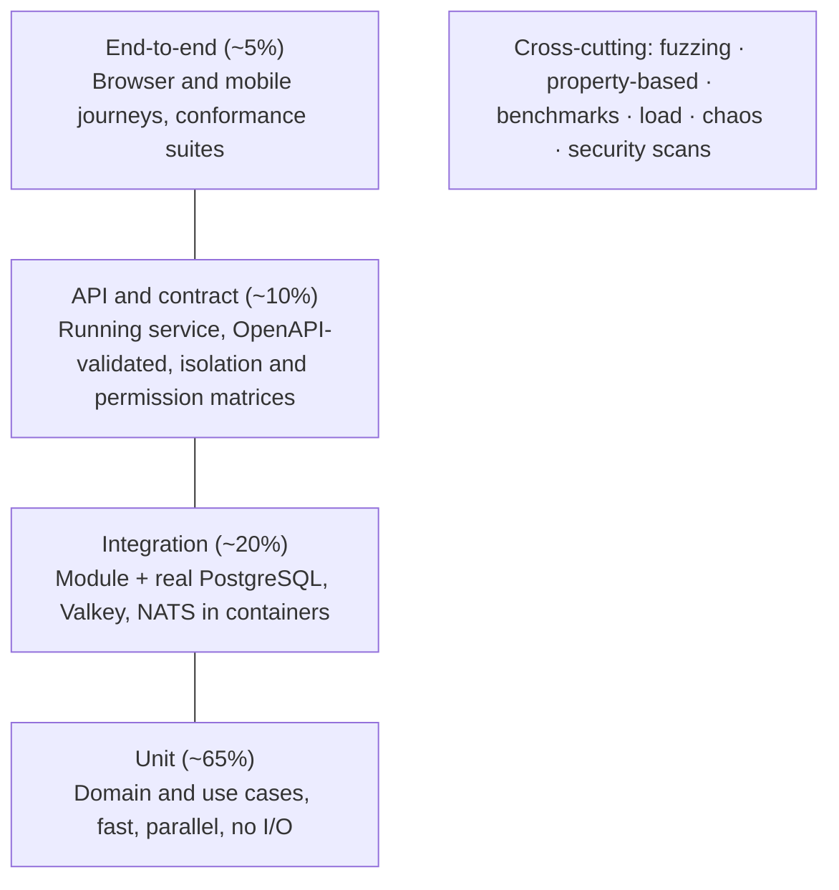

# 09 — Testing Strategy

An identity platform is judged by what it **refuses** to do. Tests must prove
the happy path works, and that tokens, tenants, permissions and inputs cannot be
abused. This document defines every test level, how to write each one, and the
gates that keep quality from drifting.

## 1. Test levels at a glance



| Level | Scope | Main tools | Runs | Time budget |
|-------|-------|-----------|------|-------------|
| Unit | One package: domain rules, use cases with fakes, parsers, engines | `testing`, go-cmp, rapid, `testing/synctest` | Every PR | < 2 min total |
| Integration | One module with real infrastructure | testcontainers-go, embedded NATS | Every PR (sharded) | < 6 min |
| Contract | Fakes vs real adapters; API vs OpenAPI; events vs AsyncAPI; breaking-change detection | Shared contract suites, kin-openapi, oasdiff | Every PR | < 3 min |
| API | All deployables running; Management, protocol and authorization APIs | Go test client, Schemathesis | PR (smoke), main (full), nightly (Schemathesis) | < 10 min |
| Security and audit matrices | Tenant isolation, admin permissions and audit coverage over every endpoint; audit reconciliation | Generated from OpenAPI | PR (smoke), main (full) | < 10 min |
| Conformance | OpenID (OIDC, logout, FAPI, CIBA), FIDO, SAML interop, SCIM, AuthZEN | Official suites in containers | Main, release | < 30 min |
| End-to-end | Hosted login, console, portals, mobile SDKs | Playwright, XCUITest, Espresso | Main, release | < 20 min |
| Front end | Components, hooks, accessibility, visual regression | Vitest, Testing Library, MSW, Storybook, axe | Every PR | < 4 min |
| Fuzzing | Every parser and decoder | Go native fuzzing | PR (seed corpus), nightly (10 min per target) | — |
| Performance | Hot-path benchmarks; load and soak | `testing.B`, benchstat, k6 | PR (benchmarks), nightly (load), weekly (24 h soak) | — |
| Resilience | Failures of pods, zones, database, bus, KMS; regional failover | Chaos Mesh, game days | Weekly in staging; DR drill quarterly | — |

## 2. Unit tests

### 2.1 Conventions

- Test tools (Playwright and its browsers, k6, testcontainers images, conformance
  suites) are pinned to exact versions and digests like everything else.
- Test files sit next to the code (`issuer_test.go`). Default to black-box
  tests (`package token_test`) that use only the public API; white-box tests
  (`package token`) only for tricky internals.
- **Table-driven** tests with named cases; `t.Run` subtests; `t.Parallel()`
  everywhere unless a test documents why it cannot.
- Use `t.Context()` for contexts, `t.Cleanup` for teardown, and `t.Helper()` in helpers.
- Assertions use the standard library and `go-cmp`
  (`if diff := cmp.Diff(want, got); diff != "" { t.Errorf("… (-want +got):\n%s", diff) }`).
  Failure messages state the input, what we got and what we wanted.
- **Test doubles, in order of preference:** real implementation → in-memory fake
  (shipped in `<module>test`) → stub → generated mock. Mocks only at external
  boundaries (SMS gateway, KMS, IdP), and only for interfaces we own.
- **Time:** production code uses the `time` package directly. Tests control
  time with `testing/synctest`, which runs code in a bubble with a fake clock.
- **Test data:** builders with safe defaults
  (`identitytest.NewUser(t, identitytest.WithEmail("alice@example.test"))`);
  each test creates its own tenant, so tests stay independent and parallel.
- **Golden files** for protocol output (discovery documents, SAML metadata,
  token claim sets, error bodies) under `testdata/`, refreshed with `-update`
  and reviewed like code.

### 2.2 Example: table-driven test

Imports are omitted in the examples.

```go
func TestPolicy_Validate(t *testing.T) {
	t.Parallel()
	policy := password.Policy{MinLength: 12, Breached: passwordtest.BreachedList("password123456")}

	tests := []struct {
		name    string
		input   string
		wantErr error
	}{
		{name: "too short", input: "short", wantErr: password.ErrTooShort},
		{name: "known breached password", input: "password123456", wantErr: password.ErrBreached},
		{name: "long passphrase", input: "correct horse battery staple"},
	}
	for _, tt := range tests {
		t.Run(tt.name, func(t *testing.T) {
			t.Parallel()
			err := policy.Validate(t.Context(), tt.input)
			if !errors.Is(err, tt.wantErr) {
				t.Errorf("Validate(%q) = %v, want %v", tt.input, err, tt.wantErr)
			}
		})
	}
}
```

### 2.3 Example: time-dependent behavior with `testing/synctest`

```go
func TestRefresh_RejectsTokenAfterAbsoluteLifetime(t *testing.T) {
	synctest.Test(t, func(t *testing.T) {
		svc := token.NewService(tokentest.NewStore(), token.Config{AbsoluteLifetime: 24 * time.Hour})
		rt, err := svc.Issue(t.Context(), "usr_alice")
		if err != nil {
			t.Fatalf("Issue: %v", err)
		}

		time.Sleep(24*time.Hour + time.Second) // fake clock: returns immediately

		if _, err := svc.Refresh(t.Context(), rt); !errors.Is(err, token.ErrExpired) {
			t.Fatalf("Refresh after lifetime = %v, want ErrExpired", err)
		}
	})
}
```

### 2.4 Example: property-based test

Properties state rules that must hold for **every** input. The generator
explores models and requests we would never write by hand, and shrinks failures
to the smallest example.

```go
func TestEvaluate_ForbidAlwaysWins(t *testing.T) {
	rapid.Check(t, func(t *rapid.T) {
		model := authztest.GenModel().Draw(t, "model")
		req := authztest.GenRequest(model).Draw(t, "request")
		forbidAll := authztest.MustPolicy(`forbid (principal, action, resource);`)

		got := authz.Evaluate(model.WithPolicies(forbidAll), req)
		if got.Allowed {
			t.Fatalf("allowed despite forbid-all policy: %+v", req)
		}
	})
}
```

Required properties include: a `forbid` always wins; adding a grant never
removes access; removing a grant never adds access; decisions never cross
tenants; refresh-token reuse always revokes the whole family; every issued token
verifies with the published JWKS; a locked setting never differs from its
parent and a "strictest" setting is never weaker than any ancestor's
([15 §8](15-hierarchy-and-shared-settings.md#8-how-it-is-tested)).

## 3. Integration tests

- Live in the same package, behind the `integration` build tag
  (`//go:build integration`), and run with `make test-integration`.
  golangci-lint is configured with the tag so these files are linted too.
- Use **real** PostgreSQL, Valkey and NATS — never a mocked database.
- **Fast isolation:** `testkit` starts one PostgreSQL container per test binary,
  migrates a template database once, then gives each test its own database
  cloned from the template (milliseconds). NATS runs embedded in the test process.
- **Migration tests:** apply every migration from empty; apply the new
  migrations to a snapshot of the previous release's schema; run the previous
  release's queries against the new schema (proves expand → contract safety).

### 3.1 Contract suites: fakes behave like the real thing

Each port has one contract suite. It runs against the in-memory fake in unit
tests and against the real adapter in integration tests, so fakes cannot drift
from reality.

```go
// In identitytest: behaviors every UserStore implementation must have.
func RunUserStoreContract(t *testing.T, newStore func(t *testing.T) identity.UserStore) {
	t.Run("user is invisible to other tenants", func(t *testing.T) {
		store := newStore(t)
		ctxA, ctxB := tenancytest.NewContext(t), tenancytest.NewContext(t)
		u := NewUser(t, WithEmail("alice@example.test"))

		if err := store.Create(ctxA, u); err != nil {
			t.Fatalf("Create: %v", err)
		}
		if _, err := store.Get(ctxB, u.ID); !errors.Is(err, identity.ErrNotFound) {
			t.Fatalf("Get from another tenant = %v, want ErrNotFound", err)
		}
	})
	// … email uniqueness per tenant, optimistic concurrency, pagination order, …
}
```

```go
//go:build integration

func TestPostgresUserStore(t *testing.T) {
	identitytest.RunUserStoreContract(t, func(t *testing.T) identity.UserStore {
		return postgres.NewUserStore(pgtest.NewDatabase(t)) // fresh, migrated database
	})
}
```

## 4. API, contract and security matrices

- **OpenAPI validation in every API test.** The test HTTP client validates each
  request and response against the spec (kin-openapi). A response that does not
  match the spec fails the test, so the spec cannot drift from the code.
- **Breaking-change gate.** `oasdiff` compares the PR's spec with `main`; a
  breaking change fails unless the PR introduces a new API version.
- **Events.** Emitted events and webhooks are validated against the AsyncAPI schemas.
- **Schemathesis** (nightly) generates thousands of valid and invalid requests
  from the spec and checks for server errors, schema violations and crashes.
- **Tenant-isolation matrix.** For every endpoint in the spec: create a
  resource in tenant A, then call the endpoint with tenant B's credentials. The
  only acceptable answer is `404`. New endpoints are covered automatically.
- **Admin-permission matrix.** Each Management API operation declares its
  required permission (`x-required-permission` in OpenAPI). The suite calls
  every operation with every built-in admin role and compares the result with
  the expected allow/deny table.
- **Audit coverage matrix.** Every mutating operation declares its audit event
  (`x-audit-event`). The suite calls each one and checks that exactly that event
  was recorded with the right actor, target, channel, field-level diff and
  reason, and that secrets appear only as fingerprints.
- **Audit reconciliation.** At the end of every integration and API suite, the
  write-ahead-log reconciler checks the test databases: any row change without
  a matching audit event fails the build. Hash chains and sequences are verified
  for gaps.
- **SDK tests** run against the all-in-one binary, the same one developers use
  as a local emulator.

## 5. Conformance and interoperability

| Area | How |
|------|-----|
| OpenID Connect, logout, FAPI 2.0, CIBA | OpenID Foundation conformance suite in a container, driven by CI per certification profile |
| WebAuthn / passkeys | FIDO conformance tools; Playwright virtual authenticators |
| SAML | Containerized IdPs and SPs plus recorded fixtures from Okta, Entra ID, AD FS, Ping and Google Workspace; XML signature-wrapping attack corpus |
| SCIM | Okta and Entra ID provisioning test suites |
| AuthZEN | AuthZEN interoperability test cases |
| LDAP / AD | Containerized directory servers |

## 6. End-to-end tests

- **Playwright** drives the hosted login, console and portals in Chromium,
  Firefox and WebKit.
- **Passkeys** are tested with the browser's virtual authenticator:

```ts
test('user signs in with a passkey', async ({ page, context }) => {
  const cdp = await context.newCDPSession(page);
  await cdp.send('WebAuthn.enable');
  await cdp.send('WebAuthn.addVirtualAuthenticator', {
    options: { protocol: 'ctap2', transport: 'internal', hasResidentKey: true,
               hasUserVerification: true, isUserVerified: true },
  });
  await registerPasskey(page, 'alice@example.test');

  await page.goto('/login');
  await page.getByRole('button', { name: 'Sign in with a passkey' }).click();
  await expect(page).toHaveURL(/\/callback/);
});
```

- **Email and SMS codes** are read from Mailpit and an SMS sink; external
  IdPs are containerized test IdPs.
- **Mobile SDKs:** XCUITest (iOS) and Espresso (Android) against the emulator binary.
- E2E tests cover journeys, not every rule; rules are covered lower in the pyramid.

## 7. Front-end tests

- **Vitest** for logic and hooks; **Testing Library** for components, querying
  by role and label the way users do; no snapshot-only tests.
- **MSW** handlers generated from the OpenAPI spec mock the API, so mocks match
  the real contract.

```tsx
it('offers only the roles the current admin may assign', async () => {
  server.use(handlers.listAssignableRoles([{ id: 'rol_viewer', name: 'Viewer' }]));
  render(<AssignRoleDialog userId="usr_1" />);

  expect(await screen.findByRole('option', { name: 'Viewer' })).toBeVisible();
  expect(screen.queryByRole('option', { name: 'Owner' })).not.toBeInTheDocument();
});
```

- **Storybook** stories double as interaction tests and visual-regression
  baselines (Playwright screenshots).
- **Accessibility:** axe runs in component and E2E tests; any WCAG 2.2 AA
  violation fails the build. A pseudo-locale run catches hard-coded strings and
  layouts that break with longer text or right-to-left scripts.

## 8. Fuzzing, performance and resilience

### 8.1 Fuzzing

Every parser and decoder has a fuzz target: JOSE/JWT, SAML and XML, SCIM filter
expressions, CEL inputs, the authorization model DSL, WebAuthn payloads,
OAuth request parameters, and webhook signature headers. The rule: rejecting
input is fine; panicking, hanging or accepting something invalid is not.

```go
func FuzzParseCompact(f *testing.F) {
	for _, seed := range jwstest.Corpus() { // valid, truncated and malicious tokens
		f.Add(seed)
	}
	f.Fuzz(func(t *testing.T, raw string) {
		tok, err := jws.ParseCompact(raw)
		if err != nil {
			return
		}
		if _, err := jws.ParseCompact(tok.Serialize()); err != nil {
			t.Fatalf("re-parse of serialized token failed: %v", err)
		}
	})
}
```

Crashing inputs found by fuzzing are committed to `testdata/fuzz/` as
regression tests.

### 8.2 Performance

```go
func BenchmarkCheck(b *testing.B) {
	pdp := authztest.NewPDP(b, authztest.DocumentSharingModel(), authztest.Tuples(100_000))
	req := authztest.Request("user:alice", "can_view", "document:42")
	b.ReportAllocs()
	for b.Loop() {
		if _, err := pdp.Check(b.Context(), req); err != nil {
			b.Fatal(err)
		}
	}
}
```

- Hot-path benchmarks (token issuance, signature verification, check, CEL
  evaluation, bundle loading) run on each PR and are compared with `main` using
  benchstat. A regression above 10% fails the PR.
- **k6** load tests run nightly against a production-shaped cell at 100% and
  150% of the targets in [04 §12](04-architecture.md#12-non-functional-requirements-and-slos);
  a 24-hour soak runs weekly. CPU and memory profiles are captured on every run.

### 8.3 Resilience

Weekly chaos experiments in staging: kill pods, fail a zone, fail over the
database, stop the event bus (logins must continue — static stability), kill
the audit relay and writer mid-stream (no audit events may be lost or
duplicated), slow down the KMS, cut network to connectors. A full regional disaster-recovery
drill runs every quarter.

## 9. Quality gates

| Gate | Rule |
|------|------|
| Test flags | Go tests always run with `-race -shuffle=on`; no cached results in CI |
| Coverage | ≥ 80% statements per module; ≥ 90% for `authn`, `oauth`, `session`, `keys`, `authz`, `tenancy`, `platform/crypto`; ≥ 85% on changed lines |
| Test strength | Nightly mutation testing on security-critical modules; surviving mutants are reviewed weekly |
| Security scans | govulncheck, gosec, Trivy (images), secret scanning on every PR; DAST (ZAP baseline) nightly on staging |
| Flaky tests | Treated as bugs and fixed within 5 working days; no automatic retries at unit, integration or API level |
| Pinning | Any version range, floating tag, image without a digest, unpinned CI action or `@latest` fails the build; lock files must be unchanged (`--frozen-lockfile`, `-mod=readonly`, `-lockfile=readonly`) |
| Audit | Zero unaudited changes (reconciliation); every mutating operation emits its declared event; no sequence gaps after chaos tests |
| Bugs | Every production bug gets a regression test at the lowest level that reproduces it |

## 10. When each suite runs

| Pipeline | Contents | Target duration |
|----------|----------|-----------------|
| Pull request | Lint (Go, TypeScript, OpenAPI), generated-code check, unit, integration (sharded), contract, front-end, isolation smoke, image build and scan, benchmarks | < 15 min |
| Merge to `main` | Everything above + full API, isolation and permission matrices, conformance, E2E, deploy to dev, smoke tests | < 40 min |
| Nightly | Extended fuzzing, Schemathesis, load tests, mutation testing, DAST | Overnight |
| Weekly | 24-hour soak, chaos experiments | — |
| Release | Full regression, upgrade test from the previous release under traffic, sign-off | — |
| Quarterly / twice a year | Disaster-recovery drill / external penetration test | — |
