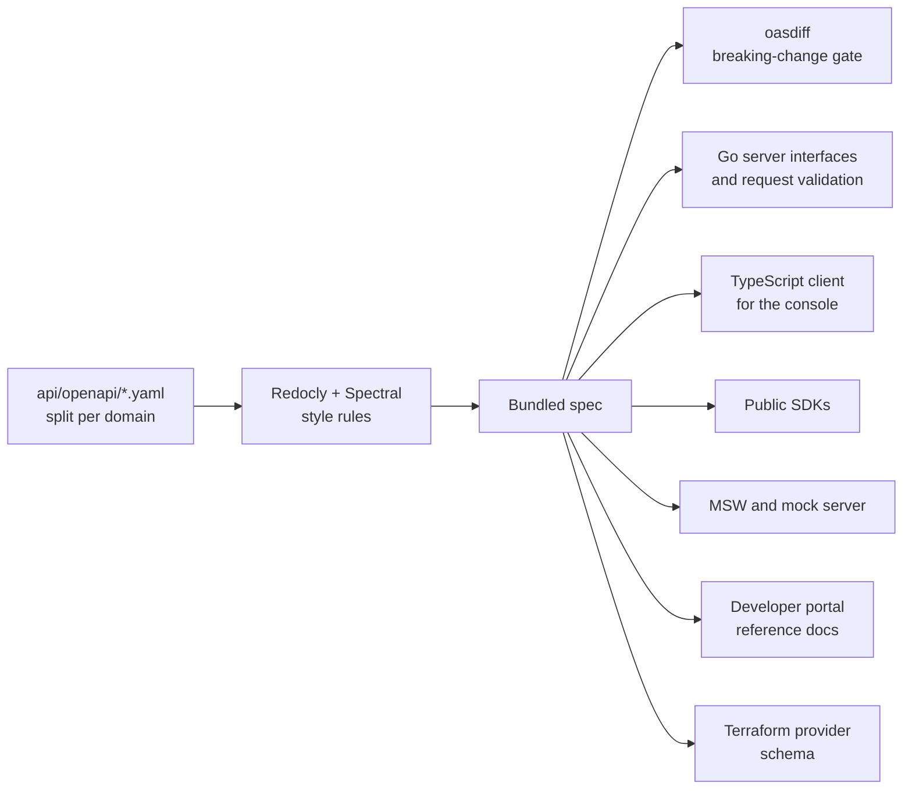

# 10 — API Standards

Every capability is available through a documented, versioned, public API
before it appears in the console. The console, CLI, Terraform provider and
SDKs are all clients of the **same public APIs**. Anything an admin can click,
a developer can automate.

## 1. Principles

1. **API-first, design-first.** The OpenAPI document is written and reviewed
   before the code. Server interfaces, clients, SDKs, docs and mocks are
   generated from it.
2. **Standards wherever they exist.** OAuth, OIDC, SAML, SCIM and AuthZEN
   endpoints follow their specifications exactly. Our own APIs follow the
   conventions below.
3. **One contract, many outputs.** The same JSON Schemas validate API
   requests, configuration objects, console forms (generated Zod schemas) and
   YAML/Terraform imports.
4. **Stable and predictable.** Consistent naming, errors, pagination and
   versioning across every endpoint; breaking changes are blocked in CI.

## 2. Specifications we publish

| Specification | Version | Describes |
|---------------|---------|-----------|
| **OpenAPI** | 3.2.0 | Management API, Authentication (headless) API, Authorization API, Account API |
| **JSON Schema** | 2020-12 | Every payload and configuration object (embedded in OpenAPI) |
| **AsyncAPI** | 3.1.0 | Webhooks and event streams |
| **Arazzo** | 1 (exact version confirmed during foundations) | Multi-step workflows (for example "create an app, add a connection, test a login") |
| **Protocol Buffers** | proto3 via buf | gRPC for the PDP and SDKs that need high throughput |
| OIDC Discovery, OAuth AS metadata, SAML metadata, SCIM `/ServiceProviderConfig` | Per standard | Protocol endpoints |

Each contract file declares its exact specification version, and the tools
that read them are pinned like every other dependency.

**OpenAPI 3.2 and tooling:** we write the spec in OpenAPI 3.2. The foundations stage checks
every tool in the chain (code generators, linters, docs). If a tool does not
support 3.2 yet, the parts it consumes avoid 3.2-only features, so the build can
emit a 3.1 copy for that tool. The published spec stays 3.2.

## 3. API families

| API | Base path | Consumers | Authentication |
|-----|-----------|-----------|----------------|
| Protocol endpoints | `/.well-known/*`, `/oauth2/*`, `/saml2/*`, `/scim/v2/*` | Apps, IdPs, directories | Per protocol |
| Authentication API (headless) | `/v1/auth/*` | Custom login UIs, mobile SDKs | Flow transaction tokens |
| Authorization API | `/access/v1/*` (AuthZEN), `/v1/authz/*` | Customer APIs, gateways, SDKs | OAuth client credentials, API keys |
| Account API | `/v1/me/*` | End users (account portal, apps) | User access token |
| Management API | `/v1/environments/{environment_id}/*` | Console, CLI, Terraform, customer automation | OAuth client credentials (`private_key_jwt` recommended), admin tokens, personal access tokens for the CLI |
| Platform API | `/platform/v1/*` | Our operators and resellers (multi-level tenancy) | Platform admin tokens |

The tenant comes from the credential and the host name, never from a request
parameter that a caller could change.

## 4. Design conventions

### 4.1 Resources and URLs

- Resource-oriented, plural nouns, lower-case with hyphens:
  `/v1/environments/{environment_id}/users/{user_id}/role-assignments`.
- Standard methods: `GET` (read/list), `POST` (create), `PATCH` (partial update
  with JSON Merge Patch, RFC 7396), `PUT` (full replace, only for documents such
  as flows and policies), `DELETE`.
- Actions that are not CRUD are sub-resources taking `POST`:
  `POST /users/{user_id}/block`, `POST /signing-keys/{key_id}/rotate`.
- No more than two levels of nesting below the environment.

### 4.2 Payloads

- JSON with **`snake_case`** field names, consistent with OAuth and OIDC.
- IDs are prefixed, sortable strings (`usr_01JD…`, `app_01JD…`).
- Timestamps in RFC 3339 UTC (`2026-11-21T10:15:00Z`); durations in seconds
  with an explicit unit in the name (`access_token_ttl_seconds`).
- Enums are lower-case strings; clients must tolerate unknown values.
- Every resource has `id`, `created_at`, `updated_at`; configuration objects add
  `version` and `status` (`draft`, `published`).
- Secrets are write-only: returned once at creation, never again.

### 4.3 Lists

- Cursor pagination: `page_size` (default 50, max 500), `page_token`;
  responses include `next_page_token`.
- Filtering with a single `filter` parameter using a small, documented grammar
  (`email ew "@acme.com" and status eq "active"`, SCIM-style operators).
- Sorting with `order_by=created_at desc`; partial responses with `fields=`;
  related objects with `expand=`.

### 4.4 Writes, concurrency and long operations

- **Idempotency:** `POST` accepts an `Idempotency-Key` header; repeating a
  request with the same key within 24 hours returns the original result.
- **Optimistic concurrency:** responses carry `ETag`; updates to configuration
  objects require `If-Match`; a stale version returns `412 Precondition Failed`.
- **Long-running operations** (imports, exports, bulk changes) return
  `202 Accepted` with an operation resource (`/v1/operations/{operation_id}`)
  that reports progress and the result.
- **Bulk endpoints** return a result per item; partial failure is explicit,
  and each item gets its own audit event.
- **Change reasons:** any write accepts `Change-Reason` and `Change-Ticket`
  headers, recorded in the audit event. Operations marked
  `x-audit-reason: required` (deleting users, impersonation, weakening a policy,
  key export, break-glass) reject requests without a reason.

## 5. Errors

All errors use **RFC 9457 Problem Details** (`application/problem+json`):

```json
{
  "type": "https://docs.authnnz.io/errors/validation-failed",
  "title": "Request validation failed",
  "status": 422,
  "code": "validation_failed",
  "detail": "2 fields are invalid.",
  "instance": "/v1/environments/env_01JD/users",
  "trace_id": "4bf92f3577b34da6a3ce929d0e0e4736",
  "errors": [
    { "pointer": "/email", "code": "invalid_format", "detail": "Must be an email address." },
    { "pointer": "/password", "code": "too_short", "detail": "Must be at least 12 characters." }
  ]
}
```

- `code` values are stable and documented; clients branch on `code`, never on
  text.
- Status codes are used consistently: `400` malformed, `401` unauthenticated,
  `403` authenticated but not allowed, `404` not found **or not visible to this
  tenant**, `409` conflict, `412` stale version, `422` validation, `429` rate
  limited, `5xx` server faults.
- Protocol endpoints use the error format their standard requires (for example
  OAuth `{"error": "invalid_grant"}`).

## 6. Versioning and deprecation

- Major version in the path (`/v1`). Adding fields, endpoints or enum values is
  not breaking; anything else needs a new major version.
- `oasdiff` in CI blocks breaking changes to a published version.
- Deprecation is announced with the `Deprecation` (RFC 9745) and `Sunset`
  (RFC 8594) headers, in the changelog and by email, at least **12 months**
  before removal.
- Each response includes `API-Version` with the exact minor revision.

## 7. Security and limits

- TLS 1.3 only for public endpoints (TLS 1.2 allowed per tenant for legacy
  clients); HSTS; strict CORS allowlists per application.
- Every Management API operation declares its required permission
  (`x-required-permission`), scopes and audit event (`x-audit-event`). The
  permission is enforced by our own authorization engine; every call, including
  reads of sensitive data, is audited ([13](13-audit-and-change-tracking.md)).
- Rate limits per tenant, credential and endpoint, advertised with the
  `RateLimit-Policy` and `RateLimit` headers; `429` includes `Retry-After`.
- Request size limits; no sensitive data in URLs; input validated against the
  schema before it reaches handlers.

## 8. Webhooks and events

- CloudEvents 1.0 envelope; signed per the **Standard Webhooks** specification
  (`webhook-id`, `webhook-timestamp`, `webhook-signature`); documented in AsyncAPI.
- At-least-once delivery with exponential backoff for 72 hours, a dead-letter
  view in the console, and manual replay.
- Event names are `resource.past_tense_verb` (`user.created`,
  `session.revoked`, `config.published`).

## 9. Toolchain



- **Lint rules** encode this document: naming, pagination parameters, problem
  details on every error response, `x-required-permission` and `x-audit-event`
  on every Management API operation, examples on every schema.
- **Go server code** generated as strict, typed interfaces (generator chosen in
  the foundations stage, D-16). Handlers only map between API types and use cases.
- **SDKs:** a generated core per language with a hand-written, idiomatic layer
  on top (token caching, retries, pagination helpers, framework middleware).
- The generated spec, clients and server code are checked in and verified by CI.

## 10. Developer experience: an API anyone can use

- **Developer portal** with reference docs generated from the spec, an
  interactive "try it" console against the developer's own sandbox tenant,
  guides and quick-starts per language and framework.
- **Self-service credentials:** create Management API clients and API keys in
  the console with exactly the scopes needed.
- **Free sandbox tenant** and test mode (captured emails and SMS, test users).
- **SDKs** for 25+ languages and frameworks ([23](23-sdks.md)),
  a CLI, a Terraform provider, and Postman and Bruno collections generated from
  the spec.
- **Local emulator:** one container image with every API for development and CI.
- **Changelog and status:** a public API changelog, deprecation notices, and a
  status page with per-API availability.
