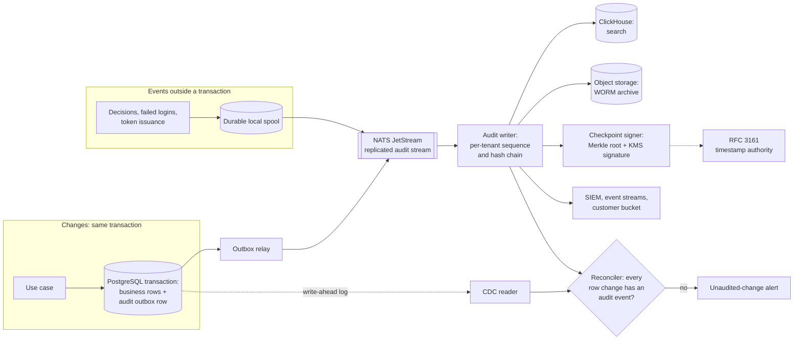

# 13 — Audit & Change Tracking

**Requirement:** 100% audit. Every change to any data or configuration, every
authentication and authorization event, every access to sensitive data, and
every action by our own staff and systems is recorded. It answers who, what,
when, where, how and why. It cannot be altered without detection, and it can be
proven complete.

Audit is built into the foundations, before any feature: completeness and
tamper evidence are very hard to retrofit.

## 1. What "100% audit" covers

| Scope | Recorded | Can a tenant turn it off? |
|-------|----------|---------------------------|
| **Every change** to data or configuration (create, update, delete, publish, rollback, promote, import, sync), from every channel: console, API, CLI, Terraform, GitOps, SCIM, directory sync, JIT provisioning, connector agents, Actions, scheduled jobs | Always, with field-level before/after values | No |
| **Every authentication event**: login success and failure, MFA, factor enrollment and removal, password change and reset, recovery, federation, session start and end, token issue, refresh, revoke and introspection, consent, step-up, lockout, risk decisions | Always | No |
| **Every authorization decision**: allow and deny, with the explanation reference | Always (see §6 for volume) | No |
| **Sensitive reads**: revealing masked PII, exports, data-subject requests, impersonation, viewing secrets metadata, bulk reads through the API | Always | No |
| **Audit access**: every search, view and export of audit logs ("audit the auditors") | Always | No |
| **Our staff and systems**: support access to tenant data, platform operations, deployments, infrastructure, database sessions, key operations | Always, in a separate platform trail; staff access to tenant data is also shown to the tenant | No |

**Not** in the audit trail: debugging logs, metrics and traces (operational
telemetry with short retention); secret values, raw passwords, OTPs, full tokens
and raw biometric data, which are never stored anywhere.

## 2. Seven completeness guarantees

These guarantees are how we can say 100% and prove it.

1. **Same-transaction capture (fail closed).** A change and its audit record
   are written in the same PostgreSQL transaction (a transactional outbox). If
   the audit record cannot be written, the change is rejected. No change can
   exist without its record.
2. **Compile-time enforcement.** Repository write methods accept only an
   `audit.Tx`, which can only be opened with an audit event. Code that tries to
   write without one does not compile. An architecture test fails the build on
   any database write outside that path.
3. **Spec-driven coverage.** Every mutating API operation declares its audit
   event in OpenAPI (`x-audit-event`). A CI test calls every operation and
   checks that the declared event was emitted, with correct before and after
   values, actor and target.
4. **Independent database capture and reconciliation.** A change-data-capture
   reader follows the PostgreSQL write-ahead log, which records every row
   change no matter who made it. A reconciler matches each row change to an
   audit event through the transaction ID. Any change without an audit event
   raises an **unaudited-change alert** in production and fails the
   integration test suite in CI.
5. **Gapless sequence, hash chain, signed checkpoints.** Each tenant's audit
   stream has a gapless sequence number and a SHA-256 hash chain. Signed
   checkpoints are written every minute. A missing, reordered or altered event
   is detectable by anyone holding the verification tool.
6. **Durable spooling for events outside a transaction.** Authorization
   decisions, failed logins and stateless token issuance are written to a
   durable local spool, sized for at least 24 hours of outage, before the
   response returns. In **strict mode** (the default), if the spool is full the
   request is refused rather than left unrecorded. Strict mode is always on;
   no tenant can turn it off (D-21).
7. **No bypass for humans.** No one has standing access to production
   databases or clusters. Break-glass access is just-in-time, approved,
   session-recorded and statement-logged (pgAudit). Infrastructure changes
   happen only through GitOps and OpenTofu, which are themselves audited.

## 3. The audit record

Every event answers six questions:

| Question | Fields |
|----------|--------|
| **Who** | Actor type (user, admin, service, API key, AI agent, SCIM, connector, system job, support, platform operator), actor ID, session, authentication strength (`acr`, `amr`), credential or client used, delegation chain (`on_behalf_of`), impersonator |
| **What** | Event type, target type and ID, organization, field-level diff (before → after), configuration versions |
| **When** | UTC timestamp (synchronized clocks), gapless per-tenant sequence number |
| **Where** | Tenant, environment, region, cell, service; client IP, user agent, device, geolocation |
| **How** | Channel (console, API, CLI, Terraform, GitOps, SCIM, system), API operation, request ID, trace ID, idempotency key, database transaction ID |
| **Why** | Reason text and change-ticket reference (required for sensitive actions), approvals for four-eyes changes |
| **Result** | Outcome (`success` / `failure`) and error code |
| **Integrity** | Previous hash, hash, checkpoint ID |

### 3.1 Example

```json
{
  "id": "aud_01JDX4M8Q3K2ZB7Y",
  "sequence": 482913,
  "time": "2026-11-21T10:15:02.418Z",
  "tenant_id": "ten_01HZ8Q",
  "environment_id": "env_01HZ9R",
  "category": "configuration",
  "type": "mfa_policy.updated",
  "outcome": "success",
  "actor": {
    "type": "admin",
    "id": "usr_01J0AB",
    "session_id": "ses_01JD7C",
    "auth": { "acr": "phishing_resistant", "amr": ["hwk"] },
    "on_behalf_of": null,
    "impersonated_by": null
  },
  "channel": {
    "type": "console",
    "client_id": "app_console",
    "ip": "203.0.113.24",
    "user_agent": "Mozilla/5.0 (Macintosh)",
    "geo": "DE"
  },
  "target": { "type": "mfa_policy", "id": "pol_01HX5T", "name": "Default MFA" },
  "change": {
    "before_version": 41,
    "after_version": 42,
    "diff": [
      { "op": "replace", "path": "/required_factors", "before": ["any"], "after": ["phishing_resistant"] },
      { "op": "replace", "path": "/grace_period_days", "before": 14, "after": 7 }
    ]
  },
  "reason": {
    "text": "Enforce phishing-resistant MFA after Q4 risk review",
    "ticket": "SEC-1432",
    "approved_by": ["usr_01J2CD"]
  },
  "request": {
    "request_id": "req_01JD9E",
    "trace_id": "4bf92f3577b34da6a3ce929d0e0e4736",
    "operation": "UpdateMfaPolicy",
    "db_xid": "887213345"
  },
  "integrity": {
    "prev_hash": "sha256:9f2c41d0",
    "hash": "sha256:51ab77e3",
    "checkpoint": "chk_01JDX4"
  }
}
```

### 3.2 Rules for record content

- **Diffs** use JSON Patch paths (RFC 6902) with both `before` and `after`
  values, so any object can be reconstructed at any point in time.
- **Secrets** (client secrets, API keys, signing keys, Action secrets) appear
  only as `"[REDACTED]"` plus a fingerprint, so you can tell *that* a secret
  changed and match it to a later leak, without storing the value.
- **Personal data** inside records is encrypted with a per-subject key. A GDPR
  erasure destroys that key: the record, its hash and all non-personal facts
  stay verifiable, but the personal data becomes unreadable. Hashes are computed
  over the encrypted form, so erasure never breaks the chain.
- **Schema:** our envelope maps one-to-one to OCSF classes for SIEM export.
  Every event type is registered in code and published in the AsyncAPI
  catalog. An unregistered event type cannot be emitted.

## 4. Architecture



- **Outbox rows** are removed only after the audit writer confirms the event
  is durably stored. The application's database role can insert into the
  outbox but cannot update or delete it.
- **The audit writer** consumes one ordered partition per tenant. It assigns
  the gapless sequence number and computes
  `hash = SHA-256(prev_hash ‖ JCS(event))`, using the JSON Canonicalization
  Scheme (RFC 8785) so the hash does not depend on field order.
- **Checkpoints:** every minute, a Merkle root over the new events is signed
  with a KMS key (a "signed tree head", as in Certificate Transparency). Checkpoints
  are also timestamped by an external RFC 3161 timestamp
  authority, so even we cannot rewrite history without detection.
- **Storage is append-only:** ClickHouse tables have no update or delete
  grants for any application role; the archive uses object storage in
  write-once mode (for example S3 Object Lock in compliance mode).
- **Change data capture** uses PostgreSQL logical replication read by a Go
  component in the `worker` (no extra infrastructure). Ephemeral tables
  (rate-limit counters, caches) are explicitly excluded in a reviewed list.

## 5. Change tracking features for users

| Feature | What it gives |
|---------|---------------|
| **History tab on every object** | Users, groups, roles, apps, connections, flows, policies, keys, branding, templates: every version with who, when, channel, reason and diff; restore with one click (the restore is itself a new audited change) |
| **Point-in-time ("as-of") view** | See any object, or a user's complete access, as it was at any past moment. Answers "who had access to resource X on 3 March?" and "what did this flow look like during the incident?" |
| **Activity timelines** | Per user, admin, organization, application and API client |
| **Audit explorer** | Search and filter by actor, target, type, channel, outcome, time and free text; diff viewer; follow a request across services by trace ID; saved queries |
| **Audit alerts** | Rules that notify (email, Slack, webhook, SIEM) on events such as "MFA policy weakened", "admin role granted", "signing key exported", "break-glass used" |
| **Reasons and approvals** | Sensitive actions require a reason; any change can carry a ticket reference (Jira, ServiceNow); four-eyes approvals are recorded with both people |
| **Integrity verification** | Console status, API and CLI (`portunctl audit verify --from … --to …`) to prove no events are missing or altered; usable by external auditors |
| **Customer-owned copy** | Continuous export to the customer's own write-once bucket and SIEM, so they hold an independent copy |
| **Access transparency** | Any access by our support staff to a tenant's data needs the tenant's approval, is time-boxed, and appears in the tenant's audit log |
| **Reports** | Change report per period, privileged-activity report, access-as-of report, failed-login report, compliance evidence packs |

Point-in-time views are built from configuration versions (already immutable)
plus history tables for identity data and relationship tuples, which record
when each fact became valid and when it stopped being valid.

## 6. Retention, volume and cost

| Plan | Searchable (hot) | Archive (write-once) |
|------|------------------|----------------------|
| Developer | 30 days | — |
| Pro | 90 days | 1 year |
| Business | 1 year | 3 years |
| Enterprise | 1 year | 7 years |
| Regulated | Configurable | Up to 10 years, legal hold |

- Capture is always 100%; plans differ only in how long records are kept.
- Shortening retention needs four-eyes approval, cannot go below regulatory
  floors (for example PCI DSS: 12 months, 3 immediately available), and is itself
  audited. Legal hold freezes deletion for selected records.
- Expired segments are deleted by a recorded, signed retention event, so
  verification continues from the next checkpoint.
- **Volume:** full authorization-decision logging is the largest cost. At the
  target of 200,000 checks per second, a busy cell produces about 17 billion
  decision events a day; with columnar compression that is roughly 0.5–1 TB a
  day (to be measured in load tests). Mitigations: short hot retention
  for allow-decisions with archive to compressed Parquet, and pricing of long
  hot retention as an add-on. Changes and authentication events are a small
  fraction of that volume.

## 7. Platform and infrastructure audit (our side)

Every change to the service itself is traced as well, in a separate
platform trail kept in a dedicated, write-once security account:

| Source | What is captured |
|--------|------------------|
| Git | Signed commits, protected branches, PR reviews and approvals, including every dependency upgrade with its reason and approvers |
| CI/CD | Build logs, SBOMs, provenance, image signatures, who approved each release |
| Argo CD / Argo Rollouts | Every sync, rollout, promotion and rollback per cell |
| OpenTofu | Every plan and apply, with the approving review |
| Kubernetes | API server audit logs (metadata for all requests; full request for RBAC, secrets access and exec) |
| Cloud provider | Control-plane audit logs (CloudTrail or equivalent), KMS key usage, secret-manager access |
| Databases | pgAudit for any human session; application changes covered by §2 |
| Access system | Just-in-time access requests, approvals, recorded sessions |
| Support tooling | Every support action on a tenant, mirrored into that tenant's audit log |

These feed the platform's security monitoring (SIEM) with detection rules (for example "production
access without an approved request").

## 8. How audit completeness is tested

| Test | What it proves |
|------|----------------|
| Audit coverage matrix (CI) | Every mutating API operation emits its declared event with correct actor, target, diff and reason |
| Reconciliation in integration tests | After each integration suite, the reconciler runs over the test database's write-ahead log; any unaudited row change fails the build |
| Architecture test | No package writes to the database outside `audit.Tx` |
| Chaos tests (weekly) | Kill the relay, writer or bus and fail over the database mid-stream; the sequence must have no gaps and no duplicates afterwards |
| Continuous verification (hourly in production) | Recompute hash chains and check checkpoint signatures for every tenant; alert on any mismatch |
| Performance budget | Audit adds ≤ 2 ms p99 to a write, and ≤ 0.1 ms p99 to an authorization check (asynchronous spool) |

## 9. Compliance mapping

| Framework | Requirement | Met by |
|-----------|-------------|--------|
| SOC 2 | CC7.2 monitoring, CC8.1 change management | §2, §5, §7 |
| ISO/IEC 27001:2022 | A.8.15 logging, A.8.16 monitoring, A.8.32 change management | §2–§7 |
| PCI DSS v4.0.x | Requirement 10: log all access, protect logs, retain 12 months (3 immediately available) | §1, §4, §6 |
| HIPAA Security Rule | §164.312(b) audit controls | §1, §4 |
| NIST SP 800-53 Rev. 5 | AU-2, AU-3 (content), AU-9 (protection), AU-10 (non-repudiation), AU-11 (retention), AU-12 (generation) | §3, §4, §6 |
| GDPR | Accountability and records of processing; right to erasure | §3.2 (per-subject encryption), §5 |
| SOX | Change control and access reviews over financial systems | §5, GOV-04 |
| DORA, NIS2 | ICT logging, incident evidence | §4, §7 |

## 10. Feature IDs

| ID | Capability |
|----|-----------|
| GOV-01 | Audit log with OCSF mapping, per-tenant hash chain, append-only storage, retention |
| GOV-10 | History tab with diff and restore on every object |
| GOV-11 | Complete change capture across all channels with field-level diffs |
| GOV-12 | Database change capture and reconciliation; unaudited-change alerts |
| GOV-16 | Auditing of audit-log access |
| GOV-18 | Integrity verification API and CLI, signed checkpoints, external RFC 3161 anchoring |
| GOV-19 | Platform and infrastructure audit trail |
| AUTHZ-14 | Every authorization decision logged by default, with durable spool and strict mode |
| GOV-13 | Point-in-time views of configuration, identity data, relationships and full access-as-of |
| GOV-14 | Audit alert rules |
| GOV-15 | Access transparency for our staff's access |
| GOV-17 | Customer-owned write-once audit copy |
| GOV-20 | Reasons, ticket references and approval records on changes |
| GOV-02 | Streaming to SIEMs |
| GOV-09 | Legal hold and retention policies per data class |
