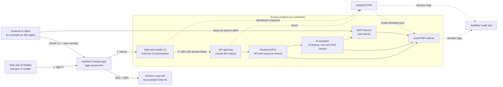

# 14 — How Customers Use It: Integration & Enforcement

This document follows one B2B customer from configuration to runtime and shows
**exactly where authentication and authorization happen**.

## 1. The short answer

- **Authentication happens in our service, never in the customer's code.** Users
  sign in on our hosted login (or through our SDK components and headless API).
  We federate to their company's identity provider when needed, run MFA and risk
  checks, and issue tokens. The customer's applications only **verify** those
  tokens: locally, in microseconds, using our published keys.
- **Authorization is decided by us and enforced in the customer's product.** The
  customer's UI, APIs, AI features and MCP servers each contain an
  **enforcement point** (our SDK, gateway plugin or sidecar). It asks "may this
  user do this action on this component or resource?" The **answer** comes from
  our policy decision point (central or a local sidecar) or from claims in the
  token.
- **Configuration happens in our console; usage happens in their product.**
  Roles and permissions are set up once in the console and can change at any
  time; the enforcement points pick up changes within seconds, without the
  customer redeploying anything.



## 2. Example: what the customer configured

**Acme** sells a CRM product to businesses. Acme is our **tenant**. Acme's
business customers (for example **Globex**) are **organizations** inside Acme's
tenant, and Globex's employees are **end users**.

### 2.1 Permission catalog: module → component → action

Acme organized its permissions by module. Each permission key is
`<module>:<component>:<action>`; dots express nesting inside a component.

| Module | Components (examples) | Actions | Example permission keys |
|--------|-----------------------|---------|-------------------------|
| **UI** | Pages, menus, buttons, widgets | `view`, `use` | `ui:billing:view`, `ui:reports.export-button:use` |
| **API** | Resources and operations of Acme's APIs | `read`, `create`, `update`, `delete`, custom (`approve`) | `api:invoices:read`, `api:invoices:approve` |
| **AI** | AI features, assistant tools, model tiers | `use`, `configure` | `ai:assistant:use`, `ai:assistant.refund-tool:use`, `ai:models.premium:use` |
| **MCP** | MCP servers and their tools | `invoke` | `mcp:crm-server.search_contacts:invoke`, `mcp:billing-server.issue_refund:invoke` |
| **Data** | Record types for row and field rules | `view`, `edit`, field-level `view` | `data:contacts:view`, `data:contacts.salary:view` |

- **Conditions** can be attached: `api:invoices:approve` only when
  `invoice.amount <= user.approval_limit`; `mcp:billing-server.issue_refund:invoke`
  only when `args.amount <= 500`.
- **Wildcards** grant a whole branch (`api:invoices:*`, `ui:billing.*:view`);
  the console shows exactly which components a wildcard covers today.
- **Components can be imported** instead of typed by hand: API components from
  Acme's OpenAPI document, MCP components from each MCP server's tool list, and
  UI components from a route and feature manifest produced by Acme's front-end
  build. Re-importing shows what was added or removed.

### 2.2 Roles, organizations and assignments

| Role | Grants (summary) | Scope |
|------|------------------|-------|
| Viewer | `ui:*:view` on dashboards and contacts, `api:contacts:read`, `ai:assistant:use` | Per organization |
| Sales agent | Viewer + `api:contacts:*`, `mcp:crm-server.*:invoke` | Per organization |
| Finance manager | `ui:billing:view`, `api:invoices:*` (approve with limit condition), `ai:assistant.refund-tool:use`, `mcp:billing-server.issue_refund:invoke` (≤ 500) | Per organization |
| Org admin | Manage members and roles of their own organization | Per organization |

- Globex's IT admin, in the **organization admin portal**, connects Globex's
  Entra ID (SSO + SCIM) and maps Entra groups to Acme's roles
  (`Globex-Finance` → Finance manager).
- **Entitlements** limit what an organization can receive at all: Globex is on
  Acme's "Business" plan, so the `ai:models.premium` component is unavailable to
  every Globex user, whatever their role.

All of this is versioned configuration: it can be simulated, published and
rolled back ([04 §2](04-architecture.md#2-how-100-dynamic-works)).

## 3. Where authentication happens

1. A Globex employee opens `app.acme.com`. Acme's front end (our SDK) redirects
   to `login.acme.com`, Acme's custom domain on our hosted login (OIDC
   authorization code + PKCE).
2. Our flow engine sees the `@globex.com` email domain, sends the user to
   Globex's Entra ID (SAML or OIDC), applies Globex's MFA policy and the risk
   check, and creates an SSO session.
3. We issue tokens for Acme's app:
   - **ID token:** who the user is (`sub`, `email`, `org_id`).
   - **Access token** for Acme's APIs (`aud: https://api.acme.com`): `sub`,
     `org_id`, roles, coarse permissions, `acr`/`amr`, short lifetime.
   - **Refresh token**, rotated on every use.
4. **Other callers authenticate the same way:**
   - Acme's back-end services: client credentials.
   - Acme's AI assistant acting for the user: token exchange, producing a token
     with the user as subject and the assistant in the `act` claim.
   - External AI clients connecting to Acme's MCP servers: OAuth 2.1 with the
     user's consent per tool.
5. Acme's services **verify** tokens locally (signature against our JWKS,
   issuer, audience, expiry) using our SDK. No network call is needed for that.

## 4. Where authorization happens

| Enforcement point | Lives in | Checks | Gets the answer from | Is it a security boundary? |
|-------------------|----------|--------|----------------------|----------------------------|
| **UI** | Acme's web and mobile front end | Which menus, pages, buttons and widgets to show | Permission snapshot for the user and organization, loaded at sign-in and refreshed on change | **No.** It is user experience only; the API must still check |
| **API gateway** (optional) | Envoy, Kong, NGINX, AWS API Gateway, Azure APIM, Apigee | Valid token, audience, scopes, route → permission | Token claims; PDP for mapped routes | Yes, coarse |
| **Backend API** | Acme's services, through SDK middleware | Route permission, then resource-level checks ("approve **this** invoice") | Token claims for coarse checks; local sidecar or central PDP for fine-grained checks | **Yes, the main one** |
| **Data access** | Acme's queries | Which rows and fields a list or search may return | PDP data filter turned into a SQL / search filter | Yes |
| **AI features** | Acme's AI assistant | Feature access, model tier, each tool call the model makes, which documents retrieval may use | Sidecar or PDP, on behalf of the user | Yes |
| **MCP servers** | Acme's MCP servers, through our MCP guard | Which tools appear in `tools/list`, whether a `tools/call` is allowed with these arguments, whether user approval is needed | Sidecar or PDP | Yes |
| **Background jobs** | Acme's workers | Service-account permissions; user permissions when acting for a user | Delegated token + PDP | Yes |

### 4.1 UI module

```tsx
const { can } = usePermissions(); // loaded once per session, refreshed on change events

return (
  <nav>
    {can('ui:billing:view') && <Link to="/billing">Billing</Link>}
    <Can permission="ui:reports.export-button:use">
      <ExportButton />
    </Can>
  </nav>
);
```

The snapshot contains only UI permissions for this app and organization, so it
stays small. Hiding a button is a courtesy; the API call behind it is checked
again.

### 4.2 API module

```go
authz := authnnz.NewMiddleware(authnnz.Config{
	Issuer:   "https://login.acme.com",
	Audience: "https://api.acme.com",
	PDP:      authnnz.Sidecar("unix:///var/run/authnnz/pdp.sock"),
})

mux := http.NewServeMux()
mux.Handle("GET /invoices", authz.Require("api:invoices:read")(listInvoices))
mux.Handle("POST /invoices/{id}/approve",
	authz.RequireOn("api:invoices:approve", authnnz.Resource("invoice", authnnz.PathValue("id")))(approveInvoice))
```

Route-to-permission mappings can also live in Acme's OpenAPI document
(`x-permission`) so the gateway, the middleware and the imported catalog all use
the same source.

### 4.3 AI module

Three separate checks, all made **on behalf of the signed-in user**:

1. **Feature access:** may this user use the assistant, and this model tier?
   (`ai:assistant:use`, `ai:models.premium:use`, plus organization entitlements
   and usage quotas.)
2. **Every tool call the model makes** is checked before it runs, with the
   tool's arguments as context. The AI can never do more than the user could
   do in the UI or API.
3. **Retrieval (RAG):** documents are filtered by the user's permissions
   *inside* the vector or search query, so the model never sees content the user
   is not allowed to read.

```python
@authz.tool(permission="ai:assistant.refund-tool:use", resource=lambda a: ("order", a["order_id"]))
def issue_refund(order_id: str, amount: float, *, user): ...

docs = vector_store.search(question, k=20,
                           filter=authz.filter(user, "can_view", "document"))  # only permitted documents
```

Wrappers are provided for popular agent frameworks (for example LangChain and
LangGraph, LlamaIndex, Vercel AI SDK, OpenAI Agents SDK, Claude Agent SDK) and
vector stores (pgvector, OpenSearch, Elasticsearch, Pinecone, Weaviate, Qdrant).

### 4.4 MCP module

Acme's MCP servers are OAuth-protected resources. They publish protected
resource metadata that points MCP clients to our authorization server. The
client obtains a token with the user's consent and calls the server, where our
MCP guard does three things:

- `tools/list` returns **only the tools this user and client may invoke**;
- every `tools/call` is checked against the tool's permission and conditions on
  its arguments;
- sensitive tools can require **human approval** (a push or CIBA prompt on the
  user's phone) or step-up authentication before running.

```ts
const server = new McpServer({ name: 'acme-billing', version: '1.4.0' });
const guard = authnnz.mcpGuard({ issuer: 'https://login.acme.com', resource: 'https://mcp.acme.com' });

guard.tool(server, 'issue_refund', {
  permission: 'mcp:billing-server.issue_refund:invoke',
  input: { orderId: z.string(), amount: z.number() },
  requireApproval: (args) => args.amount > 100, // user approves on their phone
}, async (args, ctx) => issueRefund(ctx.user, args));
```

An **MCP gateway** mode puts one guard in front of many MCP servers, for
customers who cannot change each server.

The SDK calls in §4.1–4.4 are illustrative: they show the intended developer
experience, and the exact API is designed during the build.

## 5. Agents: the intersection rule

When an AI agent or MCP client acts for a user, its effective permission is the
**intersection** of:

1. what the **user** may do (roles, relationships, conditions);
2. what the user **consented** to for this client (scopes and tools approved on
   the consent screen);
3. what the **agent or client itself** is allowed (its own registration and
   policies set by Acme);
4. what the user's **organization is entitled** to (plan, entitlements).

Guardrail policies (for example "refunds over 1,000 always need a human") apply
on top. An agent can never do more than the user, and never more than the user
agreed to.

## 6. Where the answer comes from

| Pattern | Latency | How fresh | Use it for |
|---------|---------|-----------|------------|
| **Claims in the access token** | None (local) | Until the token expires (default 5–15 min) | Coarse checks: module access, roles, scopes |
| **Permission snapshot** | One call per session, then cached | Seconds (pushed on change) | Rendering the UI |
| **Local PDP sidecar** | < 1 ms | Seconds (sync stream) | High-volume API, AI and MCP checks |
| **Central PDP** | A few ms | Immediate (consistency tokens available) | Fine-grained, rarely repeated or high-risk decisions |
| **Data filter** | One call per query | Immediate | Lists, search, RAG retrieval |

**Rules of thumb:** keep tokens small (module-level permissions and roles, not
thousands of resource grants); check anything resource-specific or high-risk
with the PDP; never treat the UI as the security boundary.

**Change propagation targets** (for example when Globex removes a user's
Finance manager role):

| Where | Effective within |
|-------|------------------|
| Central PDP | Immediately |
| Local PDP sidecars | 5 seconds |
| UI snapshots and SDK caches | 30 seconds (push events) |
| Existing access tokens | Next refresh (≤ token lifetime); immediately for services that consume CAEP revocation events |

## 7. Audit at the enforcement points

- Every decision made by the PDP, the sidecar or our SDK middleware and guards
  (including checks the SDK answers from token claims) is recorded with app,
  module, component, action, resource, user, organization, agent and result
  ([13](13-audit-and-change-tracking.md)).
- UI checks are not logged one by one (they are user experience, not security);
  delivery of each permission snapshot is.
- **Limit:** checks that Acme writes by hand against raw token claims, without
  our SDK, are invisible to us. The go-live checklist below therefore requires
  all enforcement to go through the SDK, gateway plugin, guard or sidecar.

## 8. Customer go-live checklist

1. **Catalog:** create modules and import components (OpenAPI, MCP tool lists,
   UI manifest); add conditions where needed.
2. **Roles:** define roles and organization-level role templates; set plan
   entitlements per organization.
3. **Applications:** register the web app, API audiences, MCP servers, AI
   agents and back-end services.
4. **Organizations:** invite customer admins; they connect SSO/SCIM and map
   groups to roles in the organization admin portal.
5. **Integrate:** front-end SDK (login + permissions), back-end middleware,
   gateway plugin (optional), AI wrappers, MCP guard; deploy the sidecar where
   latency matters.
6. **Events:** subscribe to role, membership and session events, or rely on the
   SDK's built-in cache invalidation.
7. **Test:** use the console playground ("can a Globex finance manager approve
   invoice 42?") and simulation before publishing changes.
8. **Audit:** stream decision and change logs to the customer's SIEM.

## 9. What this review added to the plan

| ID | Capability |
|----|-----------|
| AUTHZ-29 | Permission catalog: modules (UI, API, AI, MCP, data, custom) → nested components → actions; naming convention, wildcards with impact view, conditions; roles pick permissions by module |
| AUTHZ-30 | Component import and drift detection: from OpenAPI, MCP tool lists and UI manifests; SDKs report permission keys used in code that are not in the catalog |
| AUTHZ-31 | AI authorization: feature and model-tier gating, per-tool checks for model tool calls, usage quotas per role and organization, permission-filtered RAG retrieval |
| AUTHZ-32 | Decision reporting from SDKs and sidecars, so SDK-enforced checks reach the audit trail |
| AUTHZ-33 | Change propagation: push invalidation of SDK caches and UI snapshots, sidecar sync, with the targets in §6, measured and alerted per tenant |
| M2M-10 | MCP guard for MCP servers: token verification, filtered `tools/list`, per-tool and argument checks, human approval and step-up for sensitive tools, intersection rule; MCP gateway mode |
