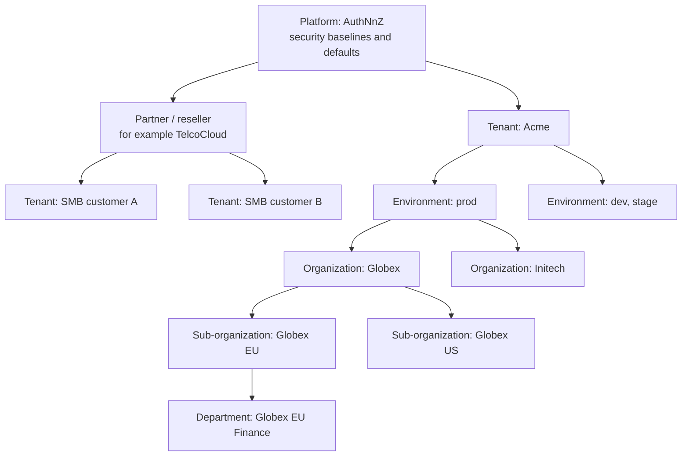
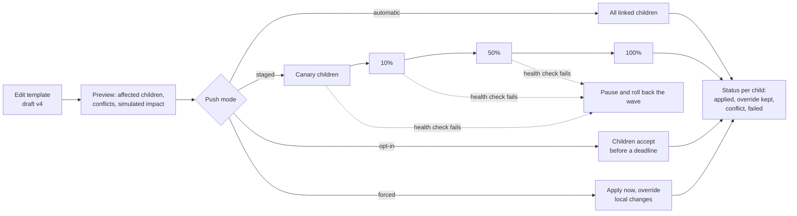

# 15 — Multi-Level Tenancy, Shared Settings & Change Propagation

B2B customers rarely have one flat list of settings. A reseller serves many
customers; a SaaS company serves thousands of business customers; those
customers have subsidiaries and departments. Each level needs to **share** some
settings, **customize** others, **enforce** a few, and **push** improvements
down without breaking anyone. This document defines how.

## 1. The hierarchy

| Level | Who administers it | Typical use |
|-------|--------------------|-------------|
| **Platform** | Us | Security baselines every tenant gets (for example minimum password rules) |
| **Partner / reseller** (nestable up to 3 levels) | The partner | White-labeled identity for the partner's own customers |
| **Tenant** | Our customer (for example Acme) | Their product's identity setup |
| **Environment** | Tenant admins | dev / stage / prod, promoted between each other ([04 §2.1](04-architecture.md#21-configuration-model)) |
| **Organization** (nestable up to 10 levels) | Tenant admins and the organization's own admins | The tenant's business customers, their subsidiaries and departments |
| **Application** | Tenant admins | Per-app settings, optionally per organization |

Every level has the same configuration capabilities. A level can only see and
change itself and its descendants, never its siblings or ancestors.

## 2. Four ways a child gets a setting

| Mode | What happens | Parent changes reach the child? | Example |
|------|--------------|---------------------------------|---------|
| **Inherited** (live) | The child has no value of its own and uses the nearest ancestor's | **Immediately**, unless the child overrides it | Acme changes the default session timeout; every organization without its own value gets it at once |
| **Shared reference** | The child points to one object owned by an ancestor (flow, theme, SSO connection, email provider, role set) | **Immediately**: there is only one object | Globex EU and Globex US both use Globex's single Entra ID connection |
| **Linked template** | The child was created from a versioned template and stays linked to it | **When the parent pushes a new version**, using the push mode chosen (§4) | Acme's "Standard customer organization" template v4 adds an Auditor role |
| **Copy** | The child gets an independent copy at creation | **Never**; the child may see an "update available" notice | A partner clones a reference tenant setup for a new customer |

The mode is chosen per object or setting. A child can combine them: inherit its
password policy, reference a shared theme, stay linked to a role template, and
own its SSO connection.

## 3. Override policies and merge rules

### 3.1 Override policy (set by the parent, per setting)

| Policy | Child may… |
|--------|------------|
| `inherit` | Not set a value; always uses the parent's |
| `overridable` | Replace the value freely |
| `bounded` | Change the value only within limits the parent sets (minimum, maximum, allowed subset) |
| `additive` | Add items (roles, allowed origins, custom fields) but not remove or change the parent's items |
| `locked` | Nothing; the parent's value always applies, and the console shows who locked it |

Policies chain: if the platform locks a setting for every tenant, no tenant can
unlock it for its organizations. A parent can only loosen what it was itself
allowed to change.

### 3.2 Merge rule (built into each setting type)

Not every setting should simply take "the most specific value". Each setting's
schema declares how values from different levels combine:

| Merge rule | Meaning | Used for |
|------------|---------|----------|
| **Most specific wins** | The value from the lowest level that set one | Branding, text, templates, flow choice, SSO connection |
| **Strictest wins** | The safest of all values along the path | MFA strength, password rules, session lifetimes (shortest), lockout thresholds, audit retention (longest) |
| **Intersection** | Only what every level allows | IP allowlists, allowed login methods, allowed countries |
| **Union** | Everything any level adds | Custom roles, additional allowed origins, extra claims |
| **Ceiling** | The child's value can never exceed the parent's | Entitlements, quotas, permission catalog, rate limits |

### 3.3 Defaults per setting category

| Setting | Default merge rule | Default override policy |
|---------|--------------------|-------------------------|
| Branding, themes, text, email and SMS templates | Most specific | Overridable |
| Login methods available | Intersection | Bounded (subset of parent) |
| MFA, password and lockout policies | Strictest | Bounded (can only strengthen) |
| Session and token lifetimes | Strictest | Bounded |
| IP and geo restrictions | Intersection | Bounded |
| Roles and permissions | Union | Additive (base roles can't be changed) |
| Permission catalog | Ceiling | Locked |
| SSO connections, SCIM | Most specific (or shared reference) | Overridable |
| Messaging and other connectors | Shared reference | Overridable |
| Flows | Most specific (choose a shared flow or own) | Overridable |
| Audit retention | Strictest (longest) | Bounded |
| Data residency | Fixed at creation | Locked |
| Entitlements and quotas | Ceiling (allocated by the parent) | Bounded |

Tenants can change these defaults for their own descendants within what the
platform allows.

### 3.4 Worked example

Effective MFA policy for a user in **Globex EU Finance**, signing in to Acme's
billing app:

| Level | Setting | Result so far |
|-------|---------|---------------|
| Platform | MFA required for admins | Admins need MFA |
| Acme (tenant) | MFA required for everyone, any factor | Everyone needs MFA |
| Globex (organization) | Phishing-resistant factors only | Strictest so far: phishing-resistant |
| Globex EU (sub-org) | "Any factor" (tries to loosen) | **Rejected at save time**: policy is `bounded`, so a child can only strengthen |
| Billing app | Step-up for refunds | Phishing-resistant MFA, plus step-up for refunds |

The console and API show this table for any setting, user, organization and
application (§6).

## 4. Pushing changes down

### 4.1 Push modes for linked templates

| Mode | When to use | Notes |
|------|-------------|-------|
| **Automatic** | Low-risk changes (new text, a new optional role) | Applied to all linked children at once |
| **Staged** (default) | Most changes | Canary children first, then waves; automatic pause and rollback if login success or error rates degrade |
| **Opt-in** | Changes children should review | Children's admins accept or defer; applied automatically at the deadline unless the parent says otherwise |
| **Manual** | Optional improvements | Children apply when they choose; the parent sees who is behind |
| **Forced** | Security fixes | Applied immediately, overriding local changes; needs four-eyes approval and a reason |

### 4.2 Conflicts with local changes

Each push compares three versions per setting: the old template, the new
template, and the child's current value.

| Situation | Result |
|-----------|--------|
| Child never changed the setting | New template value applied |
| Child changed it; template did not change it | Child's value kept |
| Both changed it | **Conflict**, resolved by the template's rule: keep the child's value (default), take the template's, or hold for review |
| Setting is locked | Template value always applied |

### 4.3 What the parent sees and controls

- **Before:** which children are affected, which fields change, which conflicts
  exist, and a simulation (for example "1,240 users in 37 organizations will
  need to enroll a passkey").
- **During:** progress per wave and per child; pause, resume, roll back.
- **After:** a drift report showing children behind the latest template version
  or diverged from it, with alerts.
- **Child admins** are notified of pending and applied changes, with the
  template's changelog.

### 4.4 Platform baselines

We use the same mechanism to push platform security baselines to every
tenant, with advance notice, staged rollout, and a forced mode for urgent
security fixes.

## 5. Isolation and access across levels

- **Configuration flows down; data never crosses tenants.** Users, credentials,
  sessions and audit records belong to exactly one tenant.
- **References are one-way.** A child can use an ancestor's shared object but
  cannot read its secrets (connector credentials are used, never shown), and
  cannot see its siblings.
- **Administering descendants** (a partner managing its tenants, Acme managing
  Globex, Globex managing its subsidiaries) uses delegated admin roles scoped to
  the subtree. Every action is audited and visible to the child
  ([13](13-audit-and-change-tracking.md)).
- **Users across organizations:** within a tenant, one user can belong to
  several organizations (ORG-07). Each organization chooses whether membership
  and role assignments inherit down to its sub-organizations.
- **Users across tenants** never share an identity. A partner's staff can sign
  in to a child tenant through an explicit, audited trust (federation), for
  example for MSP support.
- **Quotas and entitlements** are allocated top-down. A partner allocates users
  and features to its tenants; Acme allocates AI usage or premium features to
  organizations. No child can exceed what its parent was given; usage rolls up.

## 6. Seeing where a value comes from

- **Effective-configuration view** for any level: every setting shows its value
  and its **source**: *inherited from Acme*, *overridden here*, *locked by
  platform*, *from template v4*, or *shared reference*. One click reverts an
  override to the inherited value.
- **Diff** between a child and its parent, or between a child and its template.
- **Where-used** for every shared object, with impact analysis before a change
  or deletion. Objects in use cannot be deleted.
- **Hierarchy explorer:** a searchable tree of partners, tenants, environments,
  organizations and sub-organizations, with drift and override markers.
- **API:** the same information, for example
  `GET /v1/environments/{environment_id}/organizations/{organization_id}/effective-settings?include=sources`.

## 7. How it works inside

- **Sparse overlays.** The runtime bundle for a tenant environment
  ([04 §2.3](04-architecture.md#23-runtime-bundles-dynamic-without-being-slow))
  contains the full tenant configuration plus a compact overlay per
  organization holding only the values it overrides. Resolution walks the path
  (platform → … → sub-organization → application), applying each setting's merge
  rule, and caches the result per organization and application.
- **A parent change is one recompile, not thousands.** Changing an inherited
  value at Acme rebuilds one bundle; all 5,000 organizations see it within the
  normal propagation time, because they hold no copy.
- **Template pushes** update each child's linked template version in waves.
  Pushes are resumable and idempotent: a failure mid-way can be retried or
  rolled back safely.
- **Version vectors.** Each resolved configuration carries the versions of
  every level it came from. Decisions, logins and audit records store that
  vector, so we can always answer "which settings produced this result?" and
  rebuild any past state for as-of views.
- **Audit.** A change at a parent is recorded once, with the number of affected
  descendants. Each template application to a child is recorded per child,
  together with who pushed it, the mode and the conflict outcome.

### Targets

| Measure | Target |
|---------|--------|
| Inherited change visible in every descendant | < 5 s p99 (same as any configuration publish) |
| Resolution cost per request (cached) | < 50 µs |
| Template push throughput | ≥ 10,000 children per minute per tenant, in waves |
| Organization nesting depth | 10 levels |
| Partner nesting depth | 3 levels |

## 8. How it is tested

- **Property-based tests:**
  - a locked setting never differs from its parent;
  - a "strictest" setting is never weaker than any ancestor's;
  - an intersection never allows something an ancestor forbids;
  - a child never exceeds a ceiling;
  - removing an override always restores the inherited value.
- **Push tests:** interrupted pushes resume without duplicates; rollback
  restores every child exactly; conflicts follow the template's rule.
- **Scale tests:** 50,000 organizations, nested 10 levels, with pushes under load.
- **Isolation tests:** no level can read a sibling's or an ancestor's
  configuration or secrets through any API.

## 9. Feature IDs

| ID | Capability |
|----|-----------|
| TEN-01 | Hierarchy in the data model: platform, tenant, environment, organization, sub-organization |
| TEN-06 | Configuration inheritance along the hierarchy |
| TEN-11 | Override policies (`inherit`, `overridable`, `bounded`, `additive`, `locked`) set per setting by parent admins, and merge rules (most specific, strictest, intersection, union, ceiling) |
| TEN-12 | Effective-configuration view with sources, revert to inherited, diff against parent |
| TEN-13 | Shared library objects referenced by descendants, with where-used, impact analysis and delete protection |
| TEN-14 | Linked templates with versioned push (automatic, staged, opt-in, manual, forced), conflict handling and drift reports, for organizations, partner → tenant templates and platform baselines |
| TEN-15 | Copy (clone) mode with "update available" notices |
| ORG-06 | Nested organizations to 10 levels with inherited settings and membership options; MSP and partner access across organizations |
| TEN-02 | Partners and resellers with child tenants, white-labeling, usage roll-up |
| TEN-16 | Quota and entitlement allocation down the hierarchy, with usage roll-up |
