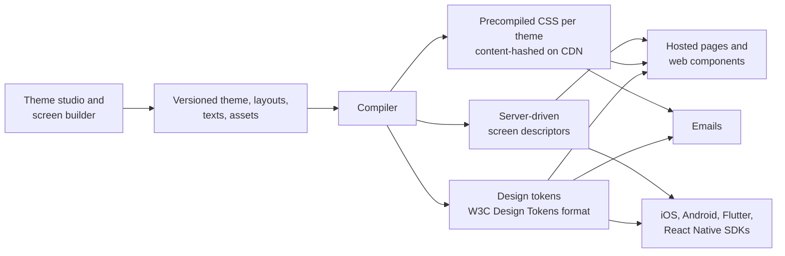

# 16 — Look & Feel: No-Code Customization and Design Quality

Two commitments:

1. **Customers can make every screen their users see look exactly like their
   brand, without writing code.** Point-and-click tools, live previews and
   ready-made templates do the work; code is optional, never required.
2. **Our own product is rich, fast and beautiful.** The console, portals and
   default screens are designed and built to the standard of the best developer
   and SaaS products, and measured against that standard.

## 1. What customers can customize

| Surface | Who sees it | Customizable without code |
|---------|-------------|---------------------------|
| Hosted login, sign-up, MFA, recovery, consent, device and approval screens | End users | Theme, layout, every block on every screen, text, languages, images |
| Account portal | End users | Theme, layout, which sections appear, custom links |
| Organization admin portal | The customer's business customers' IT admins | Theme, product name, logo, help and support links |
| Emails, SMS and push messages | End users and admins | Full visual email designer, text per language |
| Embeddable web components and SDK screens | End users inside the customer's app | Inherit the theme automatically |
| Native mobile screens (iOS, Android, Flutter, React Native) | End users | Inherit the theme and screen layouts automatically, without an app release |
| Error, maintenance and logged-out pages | End users | Theme, text, images |
| Admin console (white-label) | Partners' and resellers' customers | Product name, logo, colors, domain, help and support links |

## 2. No-code tools

### 2.1 Theme studio

A visual editor with a live preview beside it:

- **Brand kit:** logos (light and dark), favicon, color palette, fonts, corner
  radius, spacing density, shadows, button and input styles. Edited with color
  pickers, sliders and presets.
- **Layouts:** centered card, split screen with image, full page, side panel,
  or a template from the gallery.
- **Backgrounds:** color, gradient, mesh gradient, image, video loop or subtle
  pattern.
- **Effects:** glass, shadows, glow, texture and motion, each adjustable with
  sliders (§2.2).
- **Light, dark and high-contrast variants**, generated automatically and
  editable.
- **Live preview** of every screen, on desktop, tablet and mobile, in light and
  dark, in every enabled language, including right-to-left scripts.
- **Built-in quality checks** as you edit: color contrast (WCAG 2.2 AA) with
  one-click fixes, minimum text sizes, visible focus states, image weight.

```
┌─ Branding › Theme studio › "Acme Blue" ─────────────────────────────── [prod ▾] ─┐
│ Draft · 4 changes          [Preview link] [Schedule] [Visual diff] [Publish ▸]   │
├───────────────────────────┬──────────────────────────────────────────────────────┤
│ BRAND                     │ [Desktop] Tablet  Mobile     Light | Dark    [EN ▾]  │
│ Logo     [acme.svg] [Up]  │ Screen: [Sign in ▾]                                  │
│ Primary  [#4F46E5]  ...   │ ┌────────────────────────┬─────────────────────────┐ │
│ Accent   [#F59E0B]  ...   │ │  ACME                  │                         │ │
│ Font     [Inter       ▾]  │ │                        │                         │ │
│ Radius   ---o------ 10px  │ │  Welcome back          │      (brand image)      │ │
│ Density  (•) Std ( ) Tight│ │  [ email           ]   │                         │ │
│                           │ │  [    Continue     ]   │                         │ │
│ LAYOUT                    │ │  ───────  or  ───────  │                         │ │
│ ( ) Centered (•) Split    │ │  [Google] [Microsoft]  │                         │ │
│ ( ) Full page             │ │  [  Sign in with a  ]  │                         │ │
│                           │ │  [     passkey      ]  │                         │ │
│ BACKGROUND (•) Image      │ │  Terms · Privacy · Help│                         │ │
│ EFFECTS [Frosted glass ▾] │ └────────────────────────┴─────────────────────────┘ │
│ Blur  -----o---- 24px     │                                                      │
│ Glass on: card, dialogs   │ BLOCKS (drag to reorder)               [+ Add block] │
│ ✓ Contrast AA passed      │ Logo · Heading · Email · Continue · Divider ·        │
│ [Import from website]     │ Social · Passkey · Footer links                      │
│ [Ask design assistant]    │ Rule: show "Enterprise SSO" when org has SSO         │
└───────────────────────────┴──────────────────────────────────────────────────────┘
```

### 2.2 Visual effects, including glass

Effects are theme settings like colors and fonts: chosen from presets, tuned
with sliders, previewed live, and stored as design tokens. Nothing needs code.

**Glass (frosted, translucent surfaces):**

| Control | What it changes |
|---------|-----------------|
| Surfaces | Where glass is used: login card, side panel, navigation, dialogs, buttons, banners; each switched on or off |
| Blur | How much the background is blurred behind the surface |
| Transparency | How much of the background shows through |
| Tint | The color and strength of the glass tint, separately for light and dark |
| Saturation | How vivid the colors behind the glass appear |
| Edge and highlight | Border thickness and brightness; optional light highlights for a "liquid glass" look |
| Texture | Optional fine grain for a frosted feel |
| Depth | Shadow under the glass surface |

**Other effects:**

| Effect | Options |
|--------|---------|
| Backgrounds | Solid, linear and radial gradients, mesh gradients, images, video loops, subtle animated gradients |
| Shadows and elevation | Flat, soft, layered or deep shadows per surface |
| Glow and highlights | Accent glow on focus and primary buttons |
| Shapes | Corner radius per element type, from sharp to fully rounded |
| Motion | None, subtle or expressive transitions and hover effects |

Glass is stored as data, so it can be exported, versioned, inherited and
overridden like any other setting:

```json
{
  "effect": {
    "glass": {
      "surfaces": ["card", "navigation", "dialog"],
      "blur_px": 24,
      "transparency": 0.45,
      "tint": { "light": "#FFFFFF", "dark": "#0B1020", "strength": 0.6 },
      "saturation": 1.4,
      "edge": { "width_px": 1, "brightness": 0.35, "highlight": "liquid" },
      "grain": 0.04,
      "shadow": "soft"
    }
  }
}
```

**Glass that stays readable and fast:**

- **Readability:** the contrast check samples the real background behind each
  glass surface at several points. If text would fall below WCAG 2.2 AA, the
  studio raises the tint automatically or suggests a fix.
- **User preferences:** people who ask their device for reduced transparency,
  reduced motion or high contrast get solid surfaces and still visuals
  automatically.
- **Devices and browsers:** browsers without background blur, low-power
  devices and battery-saver mode get a matching solid tinted surface, so the
  design keeps its look without slowing the page.
- **Native apps:** the mobile SDKs map glass settings to each platform's own
  materials (for example the system blur materials on iOS and blur effects on
  Android 12 and later), with the same solid fallback elsewhere.
- **Emails:** email clients cannot blur, so the message designer automatically
  uses the solid fallback color derived from the glass tint.
- **Preview switches:** the preview can simulate reduced transparency, reduced
  motion, high contrast and a low-end phone before publishing.

### 2.3 Brand import and design assistant

- **Import from a website or logo:** paste the company's website address or
  upload a logo; the studio proposes a palette, fonts and a complete accessible
  theme.
- **Design assistant (optional, can be turned off):** describe the look you want
  in words ("calm, trustworthy, banking") and get theme and wording suggestions.
  Suggestions are always shown in the preview first and are never applied
  without the admin's approval. It works only with the customer's own brand
  assets.

### 2.4 Template gallery: themes and effect presets

Professionally designed starting points. A theme and an effect preset can be
combined freely, for example the Corporate theme with the Frosted glass preset.

| Built-in themes | Built-in effect presets |
|-----------------|-------------------------|
| Minimal Light, Minimal Dark | Flat (no effects) |
| Corporate, Enterprise Navy | Soft shadows, Elevated |
| Split Hero, Full-Bleed Image | Frosted glass, Clear glass, Tinted glass |
| Bold Color, Monochrome, Editorial | Liquid glass (highlights and depth) |
| Frosted Glass, Midnight Glass, Aurora (mesh gradient with glass) | Glass over mesh gradient, Glass over image |
| Gradient Wave, Sunset, Ocean | Animated gradient (subtle) |
| High Contrast (accessibility first) | Glow accents |
| Playful (gaming and consumer) | Grain texture |
| Industry themes: Banking Trust, Healthcare Calm, Government Clear, Retail Vibrant, Education Friendly, Telecom Modern, Insurance Assured | Motion: none, subtle, expressive |

**Everything can be overwritten:**

- Start from any theme or preset and change **any value**: one color, the blur
  strength, the glass surfaces, the corner radius, or everything.
- **Stay linked or go your own way.** Values you have not changed keep
  following the template and receive its improvements (Template mode); values
  you changed are yours (Own mode). You can switch any value back to the
  template, to the parent or to the default at any time
  ([15 §2](15-hierarchy-and-shared-settings.md#2-setting-modes-defaults-and-resets)).
- **Save as your own template:** any theme or effect combination can be saved as
  a custom template, versioned, and shared down the hierarchy. For example, a
  partner publishes a white-label glass theme for all its tenants, or Acme
  publishes one for all its customer organizations.
- **Duplicate and compare:** copy a template to experiment, and compare two
  templates side by side on every screen.
- New built-in themes and presets arrive with new product versions and are
  adopted deliberately, like product defaults
  ([15 §2.5](15-hierarchy-and-shared-settings.md#25-versioned-product-defaults)).

### 2.5 Screen builder

Every hosted screen is built from **blocks** that can be added, removed and
reordered by drag and drop:

- **Blocks:** logo, heading, text, image, banner or announcement, identifier
  field, password field, passkey button, social login buttons, enterprise SSO
  button, custom fields from the user schema, terms and consent checkboxes,
  links, divider, language switcher, marketing panel, footer.
- **Show or hide blocks by condition** with a simple rule builder (application,
  organization, language, device, country, new or returning user). Advanced
  users can switch to a CEL expression.
- **Reusable blocks** such as a shared header and footer, defined once and used
  on every screen.
- **Guardrails:** the builder keeps every screen working and safe. A password
  screen always has its password field; a consent screen always shows the
  application and the permissions requested.
- **One layout for every platform.** Screens are stored as server-driven UI
  descriptors ([04 §4.3](04-architecture.md#43-server-driven-ui-contract)), so the
  same design appears in the browser, in embeddable components and in native
  mobile apps, and changes reach mobile users without an app release.

### 2.6 Content and translations

- **Click any text in the preview to edit it**, per language.
- Variables (`{user.first_name}`, `{app.name}`) and plural forms (ICU) are
  inserted from a menu, without writing syntax.
- **Translation workflow:** 40+ built-in languages; import and export (XLIFF,
  JSON) for translation agencies; machine-translation suggestions marked for
  review; missing-translation warnings before publishing.

### 2.7 Message designer

A drag-and-drop designer for emails (responsive, dark-mode aware) that inherits
the theme automatically, plus simple editors for SMS and push text. Preview
across common email clients and send test messages before publishing.

### 2.8 Asset library

Logos, images, illustrations, icons and fonts in one place. Fonts can be chosen
from a curated library or uploaded, and are always served from our CDN (no
calls to third-party font services, for privacy and Content Security Policy).
Images are optimized automatically: modern formats and responsive sizes. The
library shows where each asset is used, and assets can be shared down the
hierarchy.

### 2.9 White-labeling

Partners and tenants can present the platform as their own product: product
name, logo, colors, custom domain, email sender, help and support links,
across the console, organization admin portal, account portal and emails.
Nothing in a white-labeled experience mentions Portun unless the customer
chooses to. Domains, URLs, certificates, email senders and passkeys on the
customer's domain are covered in [17 — White-label domains](17-white-label-domains.md).

## 3. Guardrails: beautiful, accessible and safe by default

| Guardrail | How it works |
|-----------|--------------|
| Accessibility | Contrast, text size, focus visibility and reading order are checked live; publishing is blocked for WCAG 2.2 AA failures unless an admin explicitly accepts them, which is audited |
| Required elements | Screens cannot lose the elements they need to work or to stay honest (credential fields, consent details, required legal links) |
| Performance | Image and font sizes are optimized automatically; the preview warns when a screen would exceed the performance budget |
| Security | No scripts in no-code customization; everything is sanitized and served under a strict Content Security Policy; external resources only from an allowlist |
| Anti-phishing | Hosted screens always run on the customer's verified domain; elements that help users recognize the real login page cannot be hidden |
| Privacy | Fonts and images are self-hosted; no third-party trackers |
| Effects | Glass and other effects never reduce text below WCAG 2.2 AA; solid fallbacks for reduced transparency, reduced motion, high contrast, unsupported browsers and low-power devices (§2.2) |

## 4. Publishing, previews and experiments

Themes, screen layouts, texts and message templates are versioned
configuration, like everything else ([04 §2](04-architecture.md#2-how-100-dynamic-works)):

- **Draft → preview → approve → publish → roll back.**
- **Shareable preview links** let marketing or legal review a draft on their own
  phone; links expire and are audited.
- **Visual diff:** side-by-side screenshots of every screen that changes before
  publishing.
- **Scheduled publishing:** for example a seasonal theme that goes live on a date
  and reverts automatically afterwards.
- **A/B experiments:** compare two designs on real traffic and see sign-up
  completion and drop-off per variant ([GOV-03](02-feature-catalog.md#l-governance-audit--privacy-gov)).
- Every change is audited with before and after values
  ([13](13-audit-and-change-tracking.md)).

## 5. Across the hierarchy

Look and feel follows the same rules as every other setting
([15](15-hierarchy-and-shared-settings.md)):

- Acme publishes its theme once; all customer organizations follow it
  (**Parent** mode).
- Globex replaces only its logo and primary color (**Own** for those two
  settings) and keeps following Acme for everything else.
- A partner gives all its tenants a white-labeled base theme (**Template**) and
  pushes improvements down.
- Any level can return a setting, a section ("all branding") or everything to
  **Default** or **Parent** at any time, with preview and undo.

## 6. Same look everywhere



- Design tokens and screen descriptors are delivered at runtime, so web pages,
  embeddable components and native apps all match, and a design change needs
  no rebuild or app release.
- Themes are resolved per organization through the hierarchy and cached, so a
  customized login page is as fast as the default one.

## 7. Optional pro mode

For customers who want code, a pro mode allows scoped, sanitized custom CSS and
custom HTML templates for screens and emails. It runs under the same Content
Security Policy, never allows scripts, is versioned and audited like everything
else, and is never needed for anything the no-code tools can do.

## 8. Design quality of our own product

### 8.1 Principles

1. **Clear:** one obvious next step on every screen; plain language.
2. **Fast:** instant feedback; nothing waits without a visible reason.
3. **Guided:** setup checklists, sensible defaults, inline help and examples.
4. **Trustworthy:** every change shows its impact before it happens and can be undone.
5. **Delightful:** polished visuals, motion with purpose, attention to detail.

### 8.2 Design system

- **Foundations:** design tokens for color, type, spacing (8-point grid),
  radius, elevation and motion; light, dark and high-contrast themes; a
  consistent icon set; illustrations for empty states and onboarding.
- **Components:** accessible primitives (Radix UI) styled with the tokens,
  documented and tested in Storybook ([11 §8](11-admin-ui.md#8-front-end-technology)).
- **Data visualization:** consistent, accessible charts for analytics and
  dashboards.
- **Motion:** short, purposeful transitions; `prefers-reduced-motion` respected.

### 8.3 Rich, easy interactions in the console

| Interaction | Example |
|-------------|---------|
| Command palette and keyboard shortcuts | `Ctrl/⌘ K` to jump to any user, app, setting or doc |
| Visual editors | Flow designer, screen builder, theme studio, role matrix, relationship graph |
| Inline editing with instant validation | Edit a value where it is shown; errors explain how to fix them |
| Side panels instead of page jumps | Open a user or app without losing your place |
| Undo everywhere | Toast with "Undo" after every change; full history per object |
| Optimistic updates and skeleton loading | The UI responds immediately; loading states keep their layout |
| Saved views and bulk actions | Filtered user lists, multi-select actions |
| Presence and conflict warnings | See who else is editing an object; no silent overwrites |
| Helpful empty states | Every empty list explains what to do next, with a one-click start |
| Guided setup and tours | Checklists and wizards for first app, SSO, branding and go-live; interactive "Take a tour" on every screen, with practice mode ([20](20-guided-tours.md)) |
| Personalization | Light, dark or system theme; optional glass (translucent) surfaces; compact or comfortable density; pinned and recent items |
| Notifications center | Pending approvals, push progress, alerts |

### 8.4 Targets

| Measure | Target |
|---------|--------|
| Time from sign-up to a branded login page | ≤ 5 minutes |
| System Usability Scale (SUS) with design partners | ≥ 80 |
| Task success for key tasks (create app, set up SSO, change theme, assign roles) | ≥ 90% without help |
| Console route change | < 200 ms |
| Hosted login: largest contentful paint on a typical 4G phone | < 1.5 s |
| Interaction to next paint (all UIs) | < 200 ms |
| Accessibility | WCAG 2.2 AA on every UI, verified by an external audit before GA |

### 8.5 How design quality is ensured

- **Design work by Claude:** screens, the design system, prototypes and
  content are designed and built by Claude in the Experience workstream
  ([05 §4](05-roadmap-and-delivery.md#4-workstreams)), following this document.
- **Design QA is part of the definition of done** for every UI change:
  automated visual-regression, accessibility and performance checks plus a
  design review pass against the principles in §8.1.
- **Optional external design review:** a brand or UX specialist can review the
  default themes and key flows before GA.
- **Usability tests with design partners** at every integration checkpoint;
  findings are tracked like bugs.
- **Product analytics, with consent:** anonymous usage measurement in the
  console (switched off by default in the self-hosted edition) shows where
  admins struggle, and feeds the targets in §8.4.
- **Content design:** consistent terminology, and error messages that say what
  happened and what to do.

## 9. How it is tested

- **Visual regression:** every component and every default theme and template is
  screenshot-tested in light, dark and high-contrast, on desktop and mobile,
  in a left-to-right and a right-to-left language.
- **Customization fuzzing:** random themes and layouts are generated and checked
  for contrast, overflow, broken layouts and missing required elements.
- **Renderer parity:** the same screen descriptor is rendered on web, iOS and
  Android and compared.
- **Accessibility:** automated axe checks on every screen and template, plus
  manual screen-reader testing and an external audit.
- **Effects:** every glass and effect preset is screenshot-tested over light,
  dark and busy image backgrounds; contrast is measured behind glass surfaces;
  fallbacks are verified with reduced transparency, reduced motion, high
  contrast, browsers without blur and low-end phones.
- **Performance:** each template and effect preset is measured against the
  targets in §8.4, including on low-end phones.

## 10. Feature IDs

| ID | Capability |
|----|-----------|
| UX-09 | Theme studio: brand kit, layouts, backgrounds, effects, light/dark/high-contrast, live multi-device and multi-language preview, live quality checks |
| UX-10 | Brand import from website or logo, and optional design assistant |
| UX-11 | Template gallery: built-in themes (including industry themes) and effect presets, combinable; override any value while staying linked; save, version and share your own templates |
| UX-12 | No-code screen builder: drag-and-drop blocks, conditional visibility, reusable blocks, guardrails, one layout for web and native |
| UX-13 | Content and translation editor: click-to-edit text, variables and plurals from menus, translation workflow |
| UX-14 | Message designer for emails, SMS and push |
| UX-15 | Asset library with self-hosted fonts, automatic image optimization and where-used |
| UX-16 | White-labeling of console, portals and emails for partners and tenants |
| UX-17 | Design publishing: preview links, approvals, visual diff, scheduled publishing, A/B experiments |
| UX-18 | Optional pro mode: sanitized custom CSS and HTML under strict CSP |
| UX-19 | Runtime design tokens shared by hosted pages, web components and native SDKs |
| UX-20 | Rich console interactions: command palette, shortcuts, side panels, undo, saved views, bulk actions, presence, guided setup, personalization |
| UX-21 | Visual effects: glass (surfaces, blur, transparency, tint, saturation, edge and highlights, texture, depth), gradients and mesh gradients, animated backgrounds, shadows, glow, shapes and motion; readable and fast by design with automatic fallbacks |
