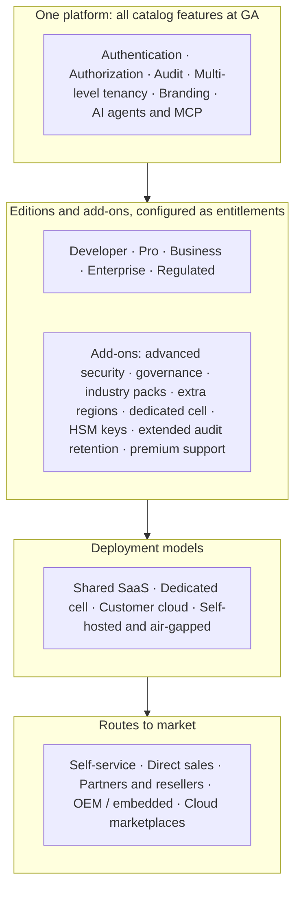

# 22 — Commercialization: From Platform to Product

How the platform becomes something customers can find, try, buy, deploy,
renew and expand, and partners can resell.

## 1. The sellable stack

**All features are built and shipped at GA** ([05](05-roadmap-and-delivery.md)).
Editions decide which features a customer is *entitled* to use. Entitlements are
configuration (TEN-08, OPS-14), so product and sales teams can change
packaging, run trials and create custom deals without any engineering work.

## 2. Editions

| Area | Developer (free) | Pro | Business | Enterprise | Regulated |
|------|------------------|-----|----------|------------|-----------|
| **Target** | Prototypes, small apps | Startups, consumer apps | B2B SaaS | Large companies | Banks, health, government, telecom |
| **Sign-in** | Passwords, passkeys, email codes, TOTP, social | + SMS/voice/WhatsApp (pass-through cost), push | + enterprise SSO (SAML, OIDC, LDAP), device flow | + certificates, Kerberos, RADIUS, device trust | + CIBA, transaction signing, identity proofing |
| **Organizations (B2B)** | — | Basic | Organizations, admin portal, SCIM | + nested organizations, MSP access | Same as Enterprise |
| **Authorization** | RBAC | RBAC, permission catalog | + fine-grained (relationships, attributes, Cedar), UI/API/AI/MCP enforcement | + sidecar PDP, gateway plugins, data filtering | Same as Enterprise |
| **Audit** | 100% capture, 30-day search | 90 days | 1 year + SIEM streaming | + customer write-once copy, access transparency | Configurable retention up to 10 years, legal hold |
| **Branding** | Theme studio, templates | + custom domain, screen builder | + white-label, email sender domain | + full white-label of portals | Same as Enterprise |
| **Hierarchy** | — | — | Templates and push to organizations | + partner levels | Same as Enterprise |
| **AI and agents** | MCP authorization | + agent identities | + MCP guard | + human-in-the-loop approvals, agent oversight | Same as Enterprise |
| **Governance** | — | — | Access requests | + access reviews, SoD, posture center, governance automation | Same as Enterprise |
| **Security** | Brute-force and bot protection | + breached passwords | + risk rules | + risk engine, adaptive MFA, Shared Signals | + FAPI 2.0, FIPS mode, HSM |
| **Deployment** | Shared SaaS | Shared SaaS | Shared SaaS, region choice | + dedicated cell, customer cloud, self-hosted | + air-gapped, sovereign options |
| **Support** ([18 §2](18-operating-the-service.md#2-support)) | Community | Business hours | 24/7 for severity 1 | 15-minute severity 1 response, named contacts | Same as Enterprise + compliance reviews |
| **SLA** | — | 99.9% | 99.95% | 99.99% | 99.99% (99.995% dedicated) |

**Add-ons** for any paid edition: advanced security, governance, each industry
pack, extra data-residency regions, a dedicated cell, HSM or bring-your-own-key,
extended audit retention, premium support.

**Self-hosted** is licensed with the Enterprise or Regulated feature set.

**Product lines:** parts of the platform are also sold on their own, for
example authorization as a service, an enterprise-ready kit for B2B SaaS, agent
and MCP security, or an audit log service, each with a focused console and an
upgrade path to the full platform ([24 §4](24-product-forms.md#4-product-lines-sold-separately-new)).

This table is the starting proposal; final packaging is set with pricing
research and design partners (D-25).

## 3. Pricing model

| Principle | Detail |
|-----------|--------|
| **Transparent for self-service** | Public prices and a calculator for Developer, Pro and Business; monthly or annual billing |
| **Quoted for Enterprise and Regulated** | Annual contracts with committed volumes and discounts |
| **Fair for B2B** | Business pricing counts active organizations and enterprise connections, not only monthly active users, so a B2B company is not penalized for large customers |
| **Usage dimensions** | Monthly active users, active organizations, enterprise SSO/SCIM connections, machine tokens, authorization decisions, active AI agents; SMS and voice passed through at cost plus a small margin |
| **No surprise bills** | Soft limits with alerts and forecasts; overages charged at the published rate; spend caps available |
| **Self-hosted** | Annual subscription by identities under management, including updates and support |
| **Partners and OEM** | Wholesale pricing with volume tiers; partners set their own prices for their customers |

Price points are decided later (D-25, deferred until before the release
candidate), from market research and design-partner validation. Usage metering
exists from the first build, so any model can be applied.

## 4. Routes to market

| Route | Who | How it works |
|-------|-----|--------------|
| **Self-service (product-led)** | Developers, startups, small B2B SaaS | Free sign-up → guided tour and quick-starts → upgrade in the product when they reach a limit or need a paid feature. The classic trigger is a B2B company's first enterprise customer asking for SSO |
| **Direct sales** | Enterprise and regulated buyers | Account executives and solutions engineers; proof-of-concept kit; security review pack; procurement documents |
| **Partners and resellers** | MSPs, hosting providers, regional resellers | White-labeled platform on their domain, multi-level tenancy, partner billing (OPS-16) |
| **System integrators** | Implementation partners for large projects | Certification program, reference architectures, deal registration |
| **OEM / embedded** | Software vendors embedding identity in their own product | Wholesale licensing, full white-label, multi-level tenancy for their customers |
| **Cloud marketplaces** | Customers buying through AWS, Azure or Google Cloud | Listings and private offers; purchases count toward the customer's cloud spending commitment (OPS-06) |

## 5. Selling and buying, step by step

1. **Discover:** developer content, docs, free SDKs, comparison pages,
   cloud marketplaces, partners, analyst coverage.
2. **Try:** free tenant in minutes; interactive tours and practice mode
   ([20](20-guided-tours.md)); 30-day trial of paid features.
3. **Evaluate:** proof-of-concept kit for larger deals: a preconfigured tenant,
   success criteria templates per industry, a migration dry-run from the
   incumbent (Auth0, Okta, Cognito, Keycloak, Entra External ID and others).
4. **Pass security review:** trust center, SOC 2 and ISO reports, penetration
   test summaries, answered questionnaires ([18 §6](18-operating-the-service.md#6-trust-center)).
5. **Buy:** order form with the master agreement, DPA, SLA and, where needed, a
   BAA; or a card purchase or a marketplace private offer.
6. **Onboard:** tenant and entitlements provisioned automatically from the
   signed order (OPS-17); onboarding by customer success or a partner; migration
   with importers and lazy migration.
7. **Expand and renew:** usage dashboards, health reviews, add-ons, more
   organizations and regions.

**Sales enablement** ready by GA:
- scripted demos per industry;
- the POC kit;
- comparison sheets against each major competitor;
- an ROI and total-cost calculator (build versus buy, and versus the incumbent);
- reference architectures;
- case studies from design partners.

## 6. Product features that make it sellable

| ID | Capability |
|----|-----------|
| TEN-08 | Entitlements and quotas per plan (existing) |
| TEN-10 | Self-service sign-up, plan choice and in-product upgrade (existing) |
| OPS-01 | Metering, billing, invoices, multiple currencies, local taxes; customer usage dashboard with forecasts (extended) |
| OPS-06 | Cloud marketplace listings, private offers and marketplace metering (extended) |
| OPS-14 | **Commercial catalog:** plans, add-ons, trials, promotions and custom contract entitlements configured without code; upgrade and downgrade with proration; in-product prompts at limits |
| OPS-15 | **Self-hosted licensing:** signed license files, offline activation for air-gapped sites, usage reporting (uploaded manually where offline), grace periods and warnings. A license problem never blocks end users from signing in |
| OPS-16 | **Partner program platform:** partner portal (deal registration, certifications, resources), wholesale billing to partners, partners price and invoice their own customers, usage roll-up |
| OPS-17 | **Quote-to-provisioning:** signed orders in the CRM (for example Salesforce or HubSpot) provision tenants, editions, add-ons and committed volumes automatically, and contract changes update entitlements |
| OPS-18 | **Modular product lines** sold separately, with focused consoles ([24](24-product-forms.md)) |

## 7. Legal and commercial readiness

To prepare with legal counsel during the build:

- **Company and brand:** legal entities in target regions, trademark and domain
  registration (D-01).
- **Contracts:** terms of service, master subscription agreement, DPA with
  standard contractual clauses, SLA, BAA, acceptable use policy, reseller, OEM
  and partner agreements, self-hosted license agreement.
- **Export controls:** classification of the software under encryption export
  rules (for example the US Export Administration Regulations) before
  self-hosted downloads and sales to restricted countries; sanctions screening
  (OPS-10).
- **Open-source compliance:** license notices from the SBOM for every release.
- **Insurance:** cyber liability and professional indemnity cover sized for
  enterprise contracts.
- **Tax:** registrations for selling software and services in each market.

## 8. Go-to-market team and timeline

**Decision deferred (D-26), to be made before hardening.** The options:

| Option | What it means |
|--------|---------------|
| **Start lean** | The owner leads sales, with 2–3 hires before GA (solutions engineer, developer relations, partner manager); grow with revenue |
| **Full team** | About 20 people joining from about nine months before GA: product marketing, developer marketing, sales leadership, account executives, solutions engineers, partner managers, marketing and sales operations, customer education |
| **Partners and marketplaces only** | Resellers, system integrators and cloud marketplaces sell; no own sales team at first |

Whichever option is chosen, Claude prepares the sales and marketing material:
website and docs content, demos, the POC kit, comparison sheets, the ROI
calculator, and trust-center content.

**Before GA:**
- design partners convert to paid early-access contracts and public references;
- analysts (for example Gartner, Forrester, KuppingerCole) are briefed about six months before launch;
- the community, docs and developer content are live from the first public preview.

## 9. Commercial readiness at GA

- Pricing page, calculator and self-service billing live (cards, invoices, taxes).
- Contracts, order forms and partner agreements approved.
- Marketplace listings approved on AWS, Azure and Google Cloud.
- Partner program launched with first resellers and system integrators.
- Demo environments, POC kit, comparison sheets and ROI calculator ready.
- At least three public reference customers from the design partners.
- Trust center and status page live.

## 10. Revenue streams and business measures

**Revenue streams:**
- SaaS subscriptions and usage;
- platform fees for dedicated cells and customer-cloud deployments;
- self-hosted subscriptions;
- add-ons and industry packs;
- partner and OEM wholesale;
- professional services for migrations and complex implementations, delivered
  mostly through partners.

| Measure | Target |
|---------|--------|
| Gross margin (SaaS) | ≥ 75%, tracked with cost management (OPS-11) |
| Net revenue retention | ≥ 120% |
| Free → paid conversion | Set from the design-partner and early-access baseline |
| Time to first value | Branded login working in under 10 minutes |
| Sales cycle (enterprise) | Tracked by segment; shortened by the POC kit and trust center |

## 11. Decisions

| ID | Decision | Status |
|----|----------|--------|
| D-25 | Pricing and packaging | Deferred until before the release candidate; the edition table in §2 is the starting proposal |
| D-26 | Go-to-market team | Deferred until before hardening; options in §8 |
| D-27 | Partner and services model | **Accepted:** partner-led implementation, with a small in-house team for migrations and key accounts |
