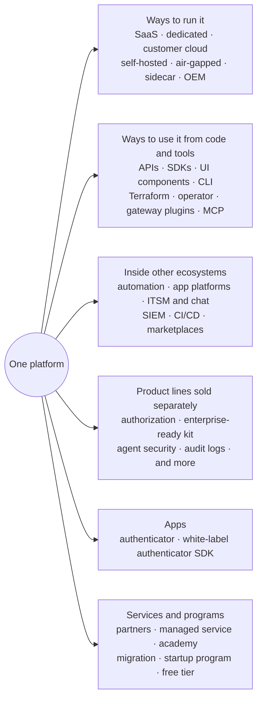

# 24 — Every Form the Platform Takes

One platform, one codebase, offered in many forms: as a service, as software, as
code libraries, as building blocks inside other ecosystems, as separately sold
products, as apps, and as services and programs.

## 1. Ways to run it

| Form | What it is | Where planned |
|------|-----------|---------------|
| **Shared SaaS** | Multi-tenant cloud service with hosted login and APIs | [04](04-architecture.md), [12](12-containers-and-deployment.md) |
| **Dedicated cell** | A single-tenant copy of the data plane run by us | TEN-03 |
| **Customer cloud (BYOC)** | Runs in the customer's own cloud account | TEN-03, [04 §11](04-architecture.md#11-deployment-topologies) |
| **Self-hosted and air-gapped** | Helm chart, Kubernetes operator, offline bundles | OPS-05, [12 §7](12-containers-and-deployment.md#7-self-hosted-packaging) |
| **All-in-one binary** | Everything in one process for development, small installs and the local emulator | DX-04 |
| **Sidecar and embedded engine** | Authorization decisions next to or inside the customer's service | AUTHZ-12 |
| **Connector agent** | On-premises bridge to Active Directory, LDAP, RADIUS and Kerberos | FED-06 |
| **OEM embedding kit** | The engine shipped inside another vendor's product | DX-14 |
| **Partner-operated and sovereign** | Run by a white-label partner or a local operator for sovereignty requirements | TEN-02, [17](17-white-label-domains.md) |

## 2. Ways to use it from code and tools

| Form | Where planned |
|------|---------------|
| REST and gRPC APIs (Management, Authentication, Authorization, Account) | [10](10-api-standards.md) |
| Standard protocol endpoints (OIDC, OAuth, SAML, SCIM, AuthZEN, Shared Signals) | [03](03-standards-and-compliance.md) |
| SDKs and UI components for 25+ languages and frameworks | [23](23-sdks.md) |
| CLI, local emulator, test kit, typed permission code generation | DX-03, DX-04, DX-10, DX-11 |
| Configuration as code: Terraform, Pulumi, Crossplane, Kubernetes operator, YAML and GitOps, CI/CD actions | DYN-11 |
| API gateway and service-mesh plugins (Envoy, Istio, Kong, NGINX, AWS, Azure, Apigee) | AUTHZ-13 |
| MCP authorization server, MCP guard and gateway, MCP server for administration | M2M-06, M2M-10, DX-08 |
| Webhooks and event streams | DYN-07, DYN-08 |

## 3. Inside other ecosystems (new)

| Ecosystem | What customers get |
|-----------|--------------------|
| **Automation platforms** (Zapier, Make, n8n, Microsoft Power Automate) | Triggers from platform events (user created, role changed, risky login) and actions (create user, assign role, revoke session) without code |
| **Website and commerce platforms** (WordPress, Shopify, Webflow, low-code app builders) | Plugins that add passkeys, social login and branded sign-in to sites and stores |
| **Business platforms** (Salesforce, ServiceNow, Microsoft Dynamics) | Apps that use the platform for sign-in and permissions, and show identity data inside those tools |
| **Collaboration and IT service management** (Slack, Microsoft Teams, ServiceNow, Jira) | Access requests, approvals, four-eyes changes and security alerts handled where people already work |
| **Security operations** (Splunk, Microsoft Sentinel, Datadog, Elastic) | Ready-made dashboards and detection rules on top of the log streams |
| **CI/CD** (GitHub Actions, GitLab CI) | Deploy configuration from Git; get short-lived workload tokens instead of stored secrets (M2M-03) |
| **Cloud marketplaces** (AWS, Azure, Google Cloud) | Buy through existing cloud agreements (OPS-06) |

## 4. Product lines sold separately (new)

Every product line is a set of entitlements on the same platform (OPS-14), with
its own pricing page, onboarding and a **focused console** that shows only the
modules bought. Customers can start with one line and expand to the full
platform without migrating anything.

| Product line | Who buys it | What it includes |
|--------------|-------------|------------------|
| **Complete identity platform** | Companies that want everything | All catalog features per edition ([22](22-commercialization.md)) |
| **Authorization as a service** | Teams that already have an identity provider | Permission catalog, RBAC/ReBAC/ABAC/Cedar, AuthZEN API, sidecar, SDKs, decision audit |
| **Enterprise-ready kit for B2B SaaS** | SaaS companies whose customers demand SSO | Organizations, per-customer SSO and SCIM, organization admin portal, audit logs for their customers, domain verification |
| **Agent and MCP security** | Companies building AI agents and MCP servers | MCP authorization server, MCP guard and gateway, agent identities and delegation, human approvals, permission-aware retrieval |
| **Identity orchestration** | Enterprises with several existing identity providers (mergers, legacy) | Brokering across existing providers, flows, risk and MFA on top, gradual migration without forcing users to move |
| **Passkeys and passwordless** | Consumer apps that want to drop passwords | Passkeys, email and SMS codes, device binding, recovery, hosted or embedded screens |
| **Audit log service** | Any software company | Tamper-evident audit log API for the customer's **own** application events, with an embeddable log viewer for their customers |
| **Risk and fraud signals** | Fraud, security and growth teams | Risk scoring, sign-up fraud, bot and ATO signals through an API |
| **Consent and privacy** | Consumer brands and regulated companies | Consent records, preference center, data-subject requests |
| **Entitlements for SaaS** | SaaS companies with plans and feature gating | Plan-based features and quotas for their own product (AUTHZ-24) |
| **Digital credentials** | Governments, universities, employers, membership organizations | Issue and verify verifiable credentials to digital wallets |

## 5. Apps

- **Authenticator app** for push approval with number matching, TOTP, device
  binding, and admin approvals (AUTH-07).
- **White-label authenticator SDK**: banks and other companies put the same
  capabilities inside their own branded app (AUTH-25).

## 6. Services and programs

| Form | What it is |
|------|-----------|
| Professional services | Migrations and complex implementations, mostly through certified partners (D-27) |
| Managed identity operations | MSP partners run customers' identity configuration as a managed service |
| Academy and certification | Training and certification for customers, partners and developers |
| Migration program | Importers, dual running and services to move from other providers |
| Startup program | Credits and support for early-stage companies |
| Free tier and community | Free Developer edition, free SDKs, free self-hosted developer edition (all under our proprietary license, D-08), community forum |

## 7. Feature IDs

| ID | Capability |
|----|-----------|
| DX-15 | Ecosystem connectors: automation platforms (Zapier, Make, n8n, Power Automate), website and commerce plugins (WordPress, Shopify, Webflow), business-platform apps (Salesforce, ServiceNow, Dynamics) |
| GOV-22 | Approvals and alerts in Slack, Microsoft Teams, ServiceNow and Jira, for access requests, four-eyes changes and security alerts |
| GOV-23 | Audit log service for customers' own application events: tamper-evident API, search, streaming, and an embeddable audit-log viewer for their customers |
| AUTH-31 | Verifiable credential issuance (OpenID4VCI) of SD-JWT VC and mDoc credentials to digital wallets, alongside verification (AUTH-16) |
| OPS-18 | Modular product lines: separately sold sets of entitlements with their own pricing, onboarding and a focused console, upgradable to the full platform |
